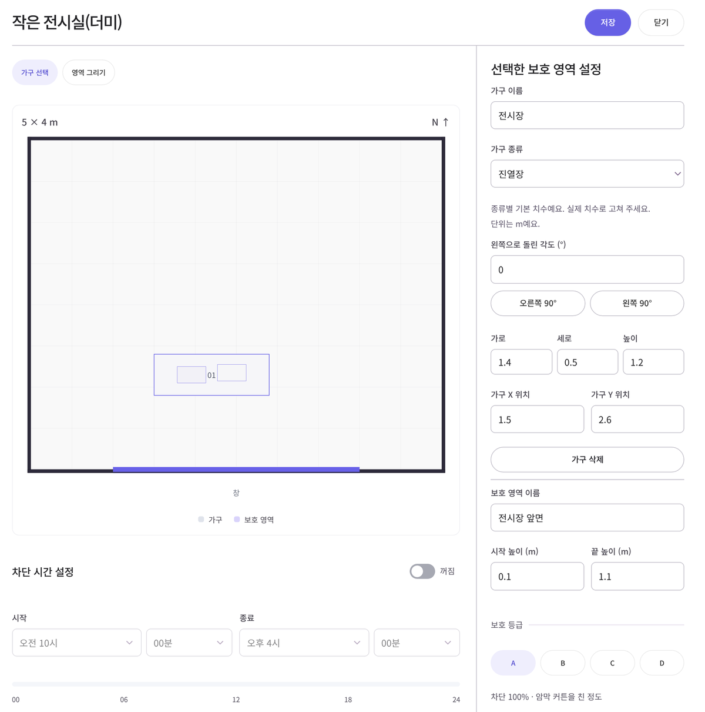

# SunSync

Predicts future sunlight and switches only the needed cells of a smart film to protect designated targets while keeping daylight.


*A sample room at 15:00. Blue film cells are opaque; the rest of the window stays clear.*

## The problem
Direct sunlight can damage things like old books or artwork. A curtain or blind protects them, but it blocks the whole window, including the daylight people want.

## The idea
Cover the window with a smart film divided into small cells that can be controlled one by one, and make only the cells that matter opaque.

1. **Measure the room.** A phone photo of one printed marker gives the size and position of the window and furniture (FR-03, FR-06).
2. **Predict the sun.** From the room's location and the weather forecast, SunSync predicts where direct sunlight falls, hour by hour (FR-01).
3. **Choose the cells.** It makes opaque only the cells that block sun from the protected object, and keeps the plan from changing needlessly (FR-02, FR-04).

The film is simulated in software (a virtual film, FR-05). Connecting a real film is future work.

## How a user uses it
1. Log in, register a room and enter the window size.
2. A marker appears on the film attached to the window. Take a photo with a phone so that the marker is in view. The size and position of the furniture are measured automatically.

   

3. Choose what to protect from the recognized furniture, such as a bookshelf or a desk top.

   

4. SunSync predicts where sunlight will fall, hour by hour, and decides which film cells are opaque at each time. Pick a time in the 3D view to see it.

Places where daylight is welcome but direct sunlight should be avoided, such as libraries, offices and museums, could use it instead of curtains.

## Documents
- Reports: [requirements](docs/reports/SunSync_Requirements.pdf), [specification](docs/reports/SunSync_Specification.pdf) (LaTeX sources in `docs/reports/requirements` and `docs/reports/specification`)
- [Functional requirements](docs/features.md): FR-01 to FR-07, owners and sub-requirements
- [Decisions](docs/decisions.md): one line per team decision
- [Architecture](docs/architecture.md): modules and data flow
- [UI flow](docs/ui-flow.md): screens, login and the APIs they call
- [Project proposal](docs/ai_applications/README.md) (ITE 351)

<details>
<summary>All documents</summary>

- [Functional requirements](docs/features.md): FR-01 to FR-07, owners and sub-requirements
- [Decisions](docs/decisions.md): one line per team decision
- [Architecture](docs/architecture.md): modules and data flow
- [FR-06 space data](docs/fr06_design.md) and [JSON schema](docs/fr06_scene_schema.json)
- FR-01 sunlight prediction: [FR-01.1 pvlib path design](docs/fr01_1_pvlib_design.md), [FR-01.4 KMA AI implementation guide](docs/fr01_4_README.md), [FR-01.4 Open-Meteo DNI design](docs/fr01_4_open_meteo_dni_design.md), [prediction errors (FR-01-7)](docs/fr01_7_prediction_error_implementation.md), [large spaces (FR-01-8)](docs/fr01_8_large_space_implementation.md), [API](docs/fr01_api.md), [FR-01 → FR-02 tile contract](docs/fr01_fr02_tile_contract.md), [mock test plan](docs/fr01_mock_test_plan.md)
- FR-02 & FR-04 shading plan & adaptive control: [format](docs/fr02_schedule.md), [design](docs/fr02_design.md), [API](docs/fr02_api.md), [FR-04 uncertainty-aware adaptive control & LG SGF](docs/fr04_adaptive_control_lg_sgf.md)
- FR-03 measurement: [single 60 cm marker](docs/fr03_single_marker.md), [measurement workflow](docs/fr03_measurement_workflow.md), [robust estimation](docs/fr03_robust_measurement.md), [selected film](docs/fr03_selected_film.md)
- FR-03 & FR-06 Vision AI 3D furniture estimation: [ArUco-calibrated depth & 3D bounding box pipeline](docs/fr03_vision_ai_3d_estimation.md)
- FR-05 film control: [protocol](docs/fr05_protocol.md)
- [Database](docs/db.md): tables, migrations and persistence
- [UI flow](docs/ui-flow.md): screens, login and the APIs they call
- [Deployment on one server](docs/deploy.md): https address, services, backup
- [Google login](docs/auth.md): how it works, the settings, the Google console and how to switch it on
- [AI & Applications Proposal](docs/ai_applications/README.md): Project proposal blog for ITE 351 (Task 1 & Task 3)
- Requirement document: `docs/reports/SunSync_Requirements.pdf` (LaTeX source in `docs/reports/requirements`); specification report: `docs/reports/SunSync_Specification.pdf` (source in `docs/reports/specification`)
- Records of past work (not kept up to date): [UI and FR-06 integration](docs/ui-fr06-integration.md) and [UI data integration](docs/ui-data-integration.md) (2026-11-01), [Award example integration](docs/award-integration.md) and [design specification](docs/design-spec-2026-10-23.md) (October), [hero image record](docs/hero-asset.md)
- Meeting notes: shared Google document (not in the repository)

</details>

## Architecture
```text
phone / PC (PWA) --https--> Caddy ---- /api/*      --> FastAPI backend --> SQLite
                                  |                          ^   ^
                                  |- /measure/*  --> measurement server (OpenCV ArUco)
                                  '- other paths --> built web app          |
                                                     timers: forecast and nowcast workers

                          FR-05 virtual film <- FR-02 plan <- FR-01 prediction <- FR-06 Scene
                                       FR-04 smooths the FR-02 plan (see the note below)
```

## Team
| Name | Part |
|---|---|
| Misong Ha | FR-01 Future sunlight path prediction |
| Jiyeon Kim | FR-02 Selective shading decision, FR-07 Deployment and accounts |
| Daeun Lee | FR-03 QR-based spatial measurement |
| Heegyeong Chung | FR-06 Space information management |
| Dain Lee | UI (web and app screens) |

---

# For developers

## Structure
```
backend/    FastAPI + SQLModel + SQLite
frontend/   React + Vite (TypeScript)
engine/     sunlight prediction (FR-01), shading plan (FR-02), stable control (FR-04), Vision AI
measure/    ArUco measurement server (/measure) and its registration core
mobile/     native camera adapters (Android, iOS)
deploy/     server files: Caddy, systemd units, update, backup
tools/      experiments, mock validation and dummy data scripts
data/       FR-01 experiment data (fr01/)
artifacts/  output of local validation runs (not tracked by Git)
tests/      backend tests
docs/       requirements, architecture, decisions, data contracts, reports
```

Guided furniture registration: [measurement core and API](measure/registration-core/README.md),
[mobile integration contract](measure/registration-core/integration/CONTRACT.md).
Native camera adapters and automatic camera setup: [mobile/README.md](mobile/README.md).
Browser photo capture is an opt-in development test and is disabled in production builds.

## Setup
Requirements: Python 3.11+, Node.js 22 or newer (CI uses 24, the server 22)

> **Python 3.11+ is required.** On macOS, the built-in `python3` is 3.9 and will fail (`int | None` syntax). Install 3.12 (`brew install python@3.12`) and create the venv with `python3.12 -m venv .venv`.

### Backend
```bash
python -m venv .venv
source .venv/bin/activate        # Windows: .venv\Scripts\activate
pip install -r requirements.txt
cd backend
uvicorn app.main:app --reload
```
API docs: http://localhost:8000/docs. Login is off unless `SUNSYNC_AUTH=google` is set ([auth](docs/auth.md)).

### Frontend
```bash
cd frontend
npm install
npm run dev
```
App: http://localhost:5173

### Checks
From the repository root, after activating the venv:
```bash
pip install -r requirements-dev.txt
PYTHONPATH=backend python -m app.scene_cli validate docs/examples/fr06_scene_example.json
pytest -q
ruff check backend tests
ruff format --check backend tests
mypy backend/app
PYTHONPATH=backend python -m app.scene_cli schema --check
```
Frontend: `cd frontend && npm ci && npm test && npm run lint && npm run build`.
GitHub Actions runs the backend checks on Python 3.11/3.12 and the frontend checks.

Space data ([FR-06 guide](docs/fr06_design.md), [example](docs/examples/fr06_scene_example.json)),
sunlight prediction ([FR-01 API](docs/fr01_api.md)) and its mock validation
([test plan](docs/fr01_mock_test_plan.md)) are described in `docs/`.

## Git rules
- Branch: `feature/<short-name>` from `main`, merge by PR (1 reviewer)
- Commit: `feat:`, `fix:`, `docs:`, `refactor:`, `chore:`
