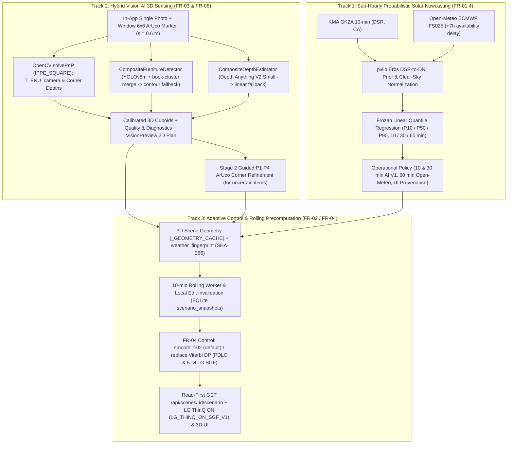
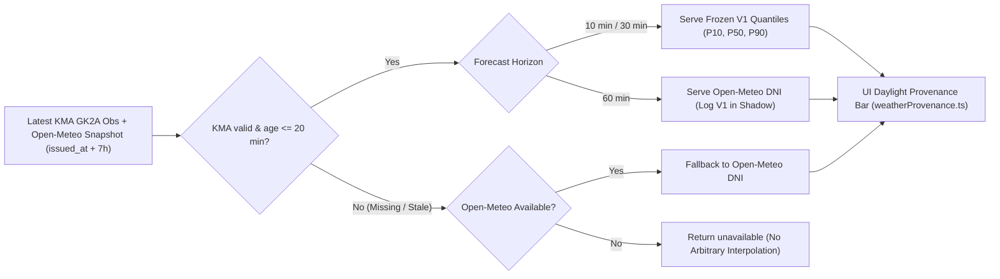
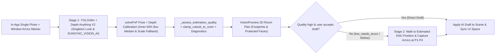
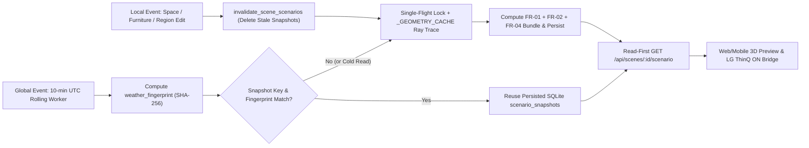
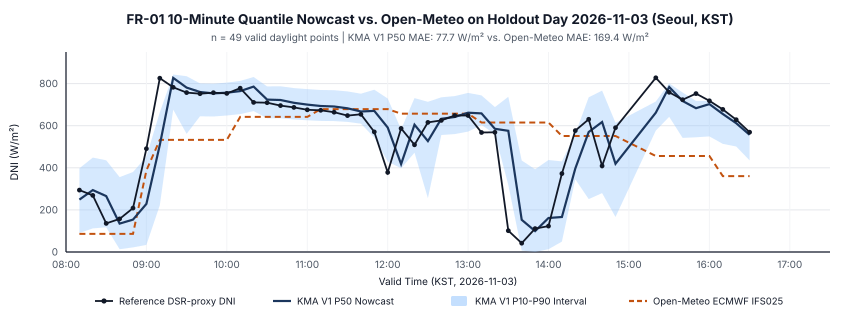
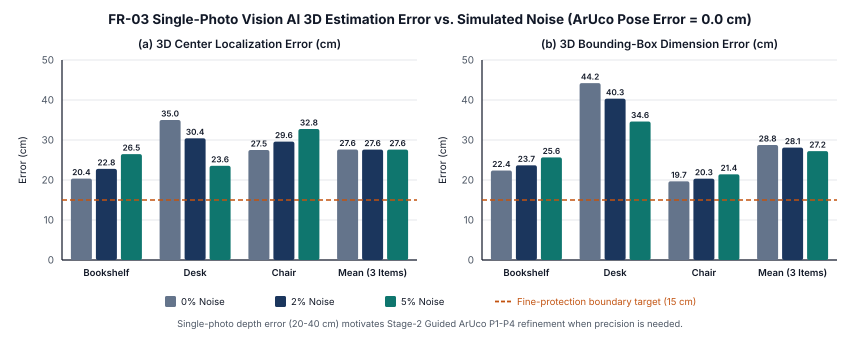

# SunSync-AI: Machine Learning-Driven Solar Nowcasting and Computer Vision for Proactive Smart Film Shading Control

**Track:** Prototype Service with AIML Integration and Smart Appliance Ecosystem  
**Repository:** [https://github.com/hing9-9-9/SunSync](https://github.com/hing9-9-9/SunSync)  
**Codebase Reference:** `main` (`882521e`, November 24, 2026)

## Members

- **Jiyeon Kim**, Department of Information Systems, Hanyang University, kjy8402@hanyang.ac.kr
- **Daeun Lee**, Department of Information Systems, Hanyang University, daeun4862@hanyang.ac.kr
- **Dain Lee**, Department of Information Systems, Hanyang University, ldi0308@hanyang.ac.kr
- **Heegyeong Chung**, Department of Information Systems, Hanyang University, hgchung04@gmail.com
- **Misong Ha**, Department of Information Systems, Hanyang University, msha9865@hanyang.ac.kr

## Table of Contents

- [I. Introduction](#i-introduction)
  - [A. Motivation](#a-motivation)
  - [B. System Capabilities](#b-system-capabilities)
- [II. Datasets](#ii-datasets)
  - [A. Solar Irradiance Nowcasting Dataset (FR-01.4)](#a-solar-irradiance-nowcasting-dataset-fr-014)
  - [B. Real-Weather and 1-Minute Measured Irradiance Replay Datasets (FR-04)](#b-real-weather-and-1-minute-measured-irradiance-replay-datasets-fr-04)
  - [C. Vision AI 3D Sensing Benchmark and Field Diagnostics Inputs (FR-03 & FR-06)](#c-vision-ai-3d-sensing-benchmark-and-field-diagnostics-inputs-fr-03--fr-06)
- [III. Methodology](#iii-methodology)
  - [A. End-to-End System Architecture](#a-end-to-end-system-architecture)
  - [B. Track 1: Sub-Hourly Probabilistic Solar Nowcasting (FR-01.4)](#b-track-1-sub-hourly-probabilistic-solar-nowcasting-fr-014)
  - [C. Track 2: Hybrid Vision AI 3D Sensing and Guided ArUco Fallback (FR-03 & FR-06)](#c-track-2-hybrid-vision-ai-3d-sensing-and-guided-aruco-fallback-fr-03--fr-06)
  - [D. Track 3: Uncertainty-Aware Adaptive Shading Control and Scenario Precomputation (FR-04)](#d-track-3-uncertainty-aware-adaptive-shading-control-and-scenario-precomputation-fr-04)
  - [E. Core Implementation Files](#e-core-implementation-files)
- [IV. Evaluation & Analysis](#iv-evaluation--analysis)
  - [A. FR-01 Solar Nowcasting: Validation, Frozen Final Test, and Regime Breakdown](#a-fr-01-solar-nowcasting-validation-frozen-final-test-and-regime-breakdown)
  - [B. FR-03 Vision AI 3D Estimation: Noise Sensitivity and Hybrid Justification](#b-fr-03-vision-ai-3d-estimation-noise-sensitivity-and-hybrid-justification)
  - [C. FR-04 Adaptive Shading Control: Synthetic Benchmark and Real-Weather Replay](#c-fr-04-adaptive-shading-control-synthetic-benchmark-and-real-weather-replay)
  - [D. Automated Verification](#d-automated-verification)
- [V. Related Work & Tools](#v-related-work--tools)
- [VI. Conclusion & Discussion](#vi-conclusion--discussion)

---

## I. Introduction

### A. Motivation

Libraries, archives, museums, and sunlit reading rooms face a direct conflict between material preservation and natural daylight. Ultraviolet and high-intensity direct solar radiation cause irreversible photodegradation on books, paper archives, textiles, and artwork. Conventional motorized blinds and uniform electrochromic glass fail along two axes: they react only after glare or direct exposure has already begun, and they darken the entire window pane even when sunlight hits only one bookshelf or reading desk.

Inspired by LG Chem's Switchable Glazing Film (SGF) and LG Electronics' ThinQ ON smart-home ecosystem, our team built **SunSync-AI**. Instead of darkening an entire window, SunSync models each window as a discrete grid of individually addressable film cells (up to $10 \times 10$ per module) and traces 3D solar rays from the window to protected interior surfaces. Only the cells whose ray paths intersect a protected region above its irradiance cap are darkened.

*Live SunSync 3D prototype view: only the specific south-window film cells blocking direct sunlight toward the Grade A display case are darkened while surrounding cells remain transparent.*

Deterministic ray tracing alone leaves three practical failure modes unsolved:

1. **Coarse weather forecasts miss sub-hourly cloud transients.** Hourly Numerical Weather Prediction (NWP) feeds such as Open-Meteo lag rapid cumulus passages, producing either unshaded UV spikes or unnecessary darkening.
2. **Manual 3D room and furniture entry creates high setup friction.** Entering 3D East-North-Up (ENU) coordinates by hand is slow, while single-photo monocular depth models suffer from scale ambiguity and 20 to 40 cm localization error.
3. **Rule-based cell switching flickers under intermittent clouds.** Switching binary film cells every time forecasted Direct Normal Irradiance (DNI) crosses a threshold creates visual flicker and accelerates hardware wear.

### B. System Capabilities

SunSync-AI integrates three AIML tracks directly into our live FastAPI, SQLite, and React/Three.js web and mobile application. Table 1 summarizes the implemented capabilities on `main` (`882521e`).

| AIML / System Track | Implemented Capabilities on `main` | Key Code & Evaluation Artifacts |
| --- | --- | --- |
| **Track 1: Solar Nowcasting (`FR-01.4`)** | Frozen `fr01_kma_quantile_v1` trained on 28 days of KMA GK2A + Open-Meteo data; one-time 4-day holdout evaluated; operational shadow worker and UI daylight provenance bar | `server/backend/app/nowcast/`, `model_artifacts/fr01_kma_quantile_v1/`, `frontend/src/weatherProvenance.ts` |
| **Track 2: Vision AI 3D Sensing (`FR-03` / `FR-06`)** | In-app single-photo camera scan, YOLOv8m + Depth Anything V2 with `SUNSYNC_VISION_AI` singleton lock, 2D `VisionPreview` floorplan, Guided ArUco `P1~P4` fallback, strict `mode=experiment` diagnostics & tape-measure comparison CLI | `server/engine/vision_ai/`, `server/backend/app/api/vision_ai.py`, `frontend/src/VisionPreview.tsx`, `server/tools/ai_experiments/compare_fr03_field_measurements.py` |
| **Track 3: Adaptive Control (`FR-04`) & Precomputation** | Default `smooth_fr02` API stabilization, Viterbi DP `replace` mode (binary PDLC & 5-level LG SGF), ThinQ ON bridge contract, real KMA & 1-min NOAA SURFRAD replays, 10-min rolling scenario precomputation | `server/engine/fr04/`, `docs/experiments/fr04_*`, `server/backend/app/services/scenario_store.py`, `GET /api/scenes/{id}/scenario` |

---

## II. Datasets

We constructed and audited three dataset suites corresponding to our three AIML tracks. Every meteorological and replay input is tracked with explicit SHA-256 checksums, UTC timestamps, and strict temporal leakage boundaries.

### A. Solar Irradiance Nowcasting Dataset (`FR-01.4`)

To forecast sub-hourly direct solar irradiance in Seoul (`37.5714° N, 126.9658° E`), we paired 10-minute geostationary satellite observations from the Korea Meteorological Administration (KMA) GK2A API Hub with archived historical NWP runs from Open-Meteo (`ecmwf_ifs025`).

| Dataset Component | Source & Resolution | Period (UTC) | Rows / Runs | SHA-256 (Prefix) | Role in Experiment |
| --- | --- | --- | ---: | --- | --- |
| Development KMA | KMA GK2A point `DSR`, `CA` (10-min) | `2026-10-05` to `2026-11-01` (28 days) | 4,032 rows | `00e8259d5dbb` | Train, Validation, Diagnostic |
| Development Open-Meteo | `ecmwf_ifs025` single runs (6-h cadence, hourly valid time) | `2026-10-05` to `2026-11-01` | 3,192 rows (114 runs) | `484e7b97d0ba` | Forecast prior & NWP baseline |
| Final Test KMA | KMA GK2A point `DSR`, `CA` (10-min) | `2026-11-02` to `2026-11-05` (4 days) | 576 rows | `838bf1c4e0c2` | One-time frozen evaluation only |
| Final Test Open-Meteo | `ecmwf_ifs025` archived runs (6-h cadence) | `2026-11-01 12Z` to `2026-11-05 18Z` | 504 rows (18 runs) | `1f2a3f841237` | Frozen test baseline (`issued + 7h`) |

**Anti-Leakage Split and Availability Contract.** Open-Meteo forecast rows represent `preceding_hour_mean` values tied to a specific issuance run (`issued_at_utc`). To prevent look-ahead leakage, our dataset builder (`server/backend/app/nowcast/kma_model_dataset.py`) enforces `snapshot_available_at_utc = issued_at_utc + 7 hours` and requires `valid_time < next_split_start` across every partition:

- **Train (`2026-10-05` to `2026-10-28 UTC`):** 1,266 / 1,216 / 1,141 valid daylight rows for 10 / 30 / 60-minute horizons.
- **Validation (`2026-10-29` to `2026-10-30 UTC`):** 97 / 91 / 82 rows (used exclusively for model specification and bound selection).
- **Diagnostic (`2026-10-31` to `2026-11-01 UTC`):** 97 / 91 / 82 rows (report-only; excluded from model selection).
- **Frozen Final Test (`2026-11-02` to `2026-11-05 UTC`):** 180 / 168 / 151 valid daylight rows evaluated once after model freeze (`status: completed_no_retuning_allowed`).

**Data Quality Audit.** Our exploratory audit (`docs/fr01/kma_ai_analysis.md`) verified zero duplicate timestamps and zero 10-minute cadence violations. Provider missing sentinels (`nan`, `6553.5`, negative codes) and 4 out-of-range cloud-amount values (`1.1`) were normalized to null rather than imputed with zero. Nighttime rows (solar elevation below 5°) accounted for most DSR nulls (`2,512` input rows excluded across 28 days), alongside daytime satellite outages (`173` daytime nulls in the initial 14-day audit). Valid daytime DSR and cloud fraction (`CA`) exhibited a strong negative Pearson correlation of `-0.657`. Because KMA provides downward shortwave radiation (`DSR`) rather than DNI, we convert `DSR` to a solar-geometry-corrected DNI reference (`reference_type: dsr_proxy`) using `pvlib.irradiance.erbs()`.

### B. Real-Weather and 1-Minute Measured Irradiance Replay Datasets (`FR-04`)

To evaluate shading flicker suppression beyond idealized curves, we assembled three evaluation datasets for FR-04:

1. **Synthetic 4-Scenario Stress Suite (`server/tools/ai_experiments/run_fr04_adaptive_control_experiment.py`):** 5-minute steps from 08:00 to 18:00 across `Sunny`, `Partly Cloudy Rapid-Flicker`, `High Uncertainty Squall`, and `Overcast Low Irradiance` skies over a $4 \times 4$ south-facing window (1 Grade A cell, 3 Grade B cells capped at 30 W/m², 12 Grade D cells).
2. **Real KMA GK2A 10-Minute Replay (`docs/experiments/fr04_real_weather_replay.md`):** Four real autumn days from the Seoul development set (`2026-10-10` clear, mean DSR 529.2 W/m²; `2026-10-16` intermittent, 15 cloud flips; `2026-10-05` intermittent restless, 13 DSR jumps $\ge 150$ W/m²; `2026-10-18` overcast, mean DSR 112.7 W/m²; 206 weather records replayed at 5, 10, and 30-minute intervals).
3. **Real 1-Minute Measured DNI Replay (`docs/experiments/fr04_minute_replay.md`):** Because 10-minute satellite sampling smooths out sub-10-minute cloud flickers, we replayed four quality-flagged (`flag = 0`) 1-minute measured DNI days from **NOAA SURFRAD (`Penn_State_PA`)** mapped by solar time onto our Seoul scene (`2023-10-11` clear, mean DNI 829 W/m²; `2023-10-02` intermittent sunny, 32 crossings of 100 W/m² and 16 dips under 10 min; `2023-10-22` intermittent restless, 83 crossings of 100 W/m², 90 jumps $\ge 300$ W/m², and 39 dips under 10 min; `2023-10-06` overcast).

### C. Vision AI 3D Sensing Benchmark and Field Diagnostics Inputs (`FR-03` & `FR-06`)

Our Vision AI pipeline uses pretrained COCO-80 object detection weights (`yolov8m.pt`) mapped to SunSync indoor semantic classes (`bookshelf`, `desk`, `chair`, `other`, covering `chair`, `couch`, `sofa`, `bench`, `bed`, `dining table`, `desk`, `book`, `bookshelf`, `refrigerator`, `tv`, `microwave`, and `oven`) together with `depth-anything/Depth-Anything-V2-Small-hf` for dense relative depth. Metric scale is anchored by a single window-mounted $6 \times 6$ `DICT_4X4_50` ArUco marker (`side_length_m = 0.6 m`, with measured physical marker size override supported in capture) paired via `POST /api/scenes/{scene_id}/marker-pairing`.

To benchmark 3D back-projection accuracy reproducibly across pixel/depth noise, `server/tools/ai_experiments/run_fr03_vision_3d_experiment.py` synthesizes a $6.0 \times 5.0 \times 2.8\text{ m}$ reading room containing a north window marker at $(3.0, 5.0, 1.6)\text{ m}$, a camera at $(3.0, 0.8, 1.4)\text{ m}$, and three ground-truth floor-standing objects: `Library Bookshelf` ($1.20 \times 0.40 \times 1.80\text{ m}$), `Oak Study Desk` ($1.40 \times 0.70 \times 0.75\text{ m}$), and `Ergonomic Chair` ($0.60 \times 0.60 \times 0.85\text{ m}$). For physical field tests, `docs/examples/fr03_field_measurements_template.csv` and `server/tools/ai_experiments/compare_fr03_field_measurements.py` link photo identifiers, dry-run API responses (`mode=experiment&apply_to_scene=false`), and tape-measured room/furniture coordinates.

---

## III. Methodology

### A. End-to-End System Architecture

SunSync-AI connects three AIML modules into one live FastAPI + SQLite + React/Three.js application:

### B. Track 1: Sub-Hourly Probabilistic Solar Nowcasting (`FR-01.4`)

**Algorithm Choice.** Auditing our collected 28-day dataset (1,141 to 1,266 daylight rows per horizon) showed that high-capacity nonlinear models risk overfitting a single season. We selected **physically bounded Linear Quantile Regression (`P10`, `P50`, `P90`)** trained in clear-sky-normalized space via `scipy.optimize` (`L-BFGS-B`) for frozen production model `fr01_kma_quantile_v1`. This formulation guarantees zero quantile crossings after monotone clipping, requires zero GPU resources, and serializes into 5 KB deterministic JSON artifacts (`maximum_dni_absolute_error_W_m2 = 0.0` in round-trip verification).

**Feature Engineering and Target Formulation.** Rather than regressing raw irradiance directly (which confounds solar geometry with cloud transmittance), we predict the dimensionless clear-sky ratio $k_q = \text{DNI}_q / \text{DNI}_{\text{clear}}$ from a fixed 5-feature vector:

1. `intercept`: constant `1.0`.
2. `direct_prior_factor`: lead-time weighted blend of the Erbs-converted KMA observation and the available Open-Meteo forecast:
   $$w_{\text{obs}}(h) = \exp\!\left(-\frac{h / 60}{1.5}\right), \quad x_{\text{prior}} = w_{\text{obs}} \cdot \frac{\text{KMA\_DNI}_{\text{prior}}}{\text{DNI}_{\text{clear}}} + (1 - w_{\text{obs}}) \cdot \frac{\text{OM\_DNI}}{\text{DNI}_{\text{clear}}}$$
3. `open_meteo_factor`: $\text{OM\_DNI} / \text{DNI}_{\text{clear}}$.
4. `cloud_transmittance`: $1 - \text{cloud\_cover\_pct} / 100$.
5. `advection_impact`: fixed to `0.0` in V1 (reserved in the frozen schema for future GK2A 2D cloud-motion patch advection).

For each quantile $\tau \in \{0.1, 0.5, 0.9\}$, `L-BFGS-B` minimizes pinball loss subject to physically motivated box constraints (`intercept` $\in [-0.5, 0.5]$, `direct_prior_factor` and `open_meteo_factor` $\in [0.0, 1.5]$, `cloud_transmittance` $\in [-0.5, 0.5]$). Postprocessing enforces physical bounds and monotonicity:

$$\hat{k}_{10} = \text{clip}(f_{10}(x), 0, 1.05), \quad \hat{k}_{50} = \max(\hat{k}_{10}, \text{clip}(f_{50}(x), 0, 1.05)), \quad \hat{k}_{90} = \max(\hat{k}_{50}, \text{clip}(f_{90}(x), 0, 1.05))$$

Table 2 reports the exact frozen weights stored in `server/backend/app/nowcast/model_artifacts/fr01_kma_quantile_v1/horizon_*/model.json`.

| Horizon | Quantile | `intercept` | `direct_prior_factor` | `open_meteo_factor` | `cloud_transmittance` | `advection_impact` |
| :---: | :---: | ---: | ---: | ---: | ---: | ---: |
| **10 min** | P10 | -0.1318 | 0.5830 | 0.0000 | 0.3843 | 0.0000 |
| **10 min** | P50 | -0.0054 | 1.0085 | 0.0000 | 0.0158 | 0.0000 |
| **10 min** | P90 | 0.3639 | 0.7567 | 0.0000 | -0.0792 | 0.0000 |
| **30 min** | P10 | -0.1297 | 0.2774 | 0.1219 | 0.4631 | 0.0000 |
| **30 min** | P50 | -0.0022 | 0.8972 | 0.0172 | 0.1204 | 0.0000 |
| **30 min** | P90 | 0.4692 | 0.7096 | 0.0000 | -0.0898 | 0.0000 |
| **60 min** | P10 | -0.1768 | 0.0000 | 0.5084 | 0.3467 | 0.0000 |
| **60 min** | P50 | -0.0164 | 0.8245 | 0.0000 | 0.2141 | 0.0000 |
| **60 min** | P90 | 0.5000 | 0.6975 | 0.0000 | -0.0515 | 0.0000 |

At 10 minutes, `P50` places nearly unit weight (`1.0085`) on `direct_prior_factor` (recent KMA persistence), whereas at 60 minutes, `P10` shifts away from persistence (`0.0000`) onto `open_meteo_factor` (`0.5084`) and `cloud_transmittance` (`0.3467`). For 60-minute `P90`, we kept the `[-0.5, 0.5]` intercept bound after it beat `[-0.75, 0.75]` on validation P90 pinball loss (`42.14` vs. `42.51 W/m²`) and mean interval width (`452.96` vs. `493.81 W/m²`).

**Operational Serving Policy.** Informed by the final-test crossover at 60 minutes (Section IV.A), `server/backend/app/nowcast/kma_operational.py` serves frozen V1 quantiles for 10 and 30-minute horizons, defaults 60 minutes to Open-Meteo while recording V1 in shadow mode, falls back to Open-Meteo when KMA observations are missing or older than 20 minutes, and surfaces explicit daylight forecast provenance spans in the UI via `frontend/src/weatherProvenance.ts`.

### C. Track 2: Hybrid Vision AI 3D Sensing and Guided ArUco Fallback (`FR-03` & `FR-06`)

Single-photo monocular depth networks output affine-invariant relative depth without metric scale. SunSync anchors every photo to the paired $6 \times 6$ window ArUco marker (`s = 0.6 m`, `DICT_4X4_50`):

1. **Metric Camera Pose (`solvePnP`).** Given observed marker corners $p_i = (u_i, v_i)$ and camera intrinsics $K$, OpenCV `cv2.solvePnP(..., SOLVEPNP_IPPE_SQUARE)` solves $(R_{c,m}, t_{c,m})$ and maps the camera into room ENU coordinates:
   $$R_{\text{ENU}, c} = R_{\text{ENU}, m} R_{c, m}^T, \quad t_{\text{ENU}, c} = t_{\text{ENU}, m} - R_{\text{ENU}, c} t_{c, m}$$
2. **Stabilized Metric Depth Calibration.** Corner depths $Z_{\text{true}, i} = [R_{c,m} P_{m,i} + t_{c,m}]_z$ calibrate relative depth $Z_{\text{metric}} = \text{clip}(\alpha \cdot d_{\text{rel}} + \beta, 0.3, 25.0)$. When all four corners lie on a single nearly fronto-parallel marker (`ptp(rel) <= 0.15` or `ptp(met) <= 0.25`), `calibrate_monocular_depth` switches from ordinary least squares to proportional scaling ($\beta = 0$, $\alpha = \bar{Z}_{\text{true}} / \max(10^{-4}, \bar{d}_{\text{rel}})$) to eliminate noisy regression slopes. Per-object representative depth uses the median over the inner 60% of each detection box (trimming 20% from each edge to limit background bleed).
3. **Composite Detection, Runtime Guards, and Field Experiment Diagnostics.** `CompositeFurnitureDetector` runs `YoloV8DetectorAdapter` (`conf_thresh = 0.25`) and merges nearby `"book"` detections into unified `"bookshelf"` boxes via `_merge_book_clusters`. `CompositeDepthEstimator` runs `MonocularDepthAdapter` (`Depth-Anything-V2-Small-hf`). Process-level singletons (`shared_yolo_adapter`, `shared_depth_adapter`) load weights once and serialize CPU inference behind a `threading.Lock`. `SUNSYNC_VISION_AI` controls runtime policy (`auto`, `on`, `off`), while request-level `mode=experiment` enforces strict real-model execution (returning HTTP 503 with explicit diagnostics instead of synthetic fallback) and attaches a structured `diagnostics` object recording model/library versions, inference latency, ArUco reprojection error, depth calibration residuals, valid depth pixel counts, and pre/post-clamp dimensions (`measured`, `prior`, `clamped`).
4. **2-Stage Coarse-to-Fine Hybrid UX.** Because single-photo depth carries 20 to 40 cm localization error (Section IV.B), `_assess_estimation_quality` grades each item (`high`, `medium`, or `low_needs_aruco`) based on detection source, confidence (`< 0.65`), distance (`> 4.0 m`), and room boundary clamping (`clamp_cuboid_to_room`), emitting four ENU corners (`estimated_corners_enu_m`) and Korean movement guidance (`aruco_capture_guidance_ko`). On mobile and web, users shoot directly from the in-app camera, inspect detected footprints and protected faces on the interactive 2D `VisionPreview.tsx` room plan before saving, and either accept the AI draft or transition directly into Stage-2 guided `P1~P4` ArUco corner measurement in `SpatialCapture.tsx`.

### D. Track 3: Uncertainty-Aware Adaptive Shading Control and Scenario Precomputation (`FR-04`)

**Two Explicit Control Modes.** We separate production stabilization from experimental continuous-dimming optimization (`docs/fr04/adaptive_control_lg_sgf.md`):

- **Default Production Mode (`mode: "smooth_fr02"`):** Applies deterministic stabilization directly to the FR-02 binary plan without ever making any cell brighter than FR-02:
  - `FR-04.1` Gap Filling: closes transparent gaps strictly shorter than `min_gap_seconds` (default `600 s`).
  - `FR-04.2` Minimum Holding Time: holds darkened states for `brightening_hold_seconds` (`600 s`) before brightening, while permitting immediate darkening.
  - `FR-04.3` Dynamic Hysteresis: widens the brightening margin in proportion to forecast spread $(I_{q90} - I_{q10}) / (I_{q50} + 1)$.
- **Experimental Optimization Mode (`mode: "replace"`):** Uses Viterbi Dynamic Programming per window cell to choose opacity trajectories $u_{1..T}$ (binary `{0, 1}` for PDLC or 5-level continuous dimming `{0, 0.25, 0.5, 0.75, 1.0}` for LG SGF) minimizing:
  $$\mathcal{L}(u_{1..T}) = \sum_{t=1}^T \left( w_{\text{damage}} \cdot \text{Risk}_t(u_t) + w_{\text{daylight}} \cdot u_t^2 + w_{\text{flicker}} \cdot |u_t - u_{t-1}| \right)$$
  Grade A artifacts enforce a hard constraint ($u_t \ge 0.99$ whenever illuminated), while Grades B and C evaluate transmitted irradiance against risk-averse effective DNI $I_{\text{eff}, t} = I_{q50, t} + \kappa_{\text{grade}} \max(0, I_{q90, t} - I_{q50, t})$ with $\kappa_B = 1.2 > \kappa_C = 0.8$. Cell opacity matrices serialize to our internal LG ThinQ ON bridge schema (`LG_THINQ_ON_SGF_V1`) via `POST /api/scenes/{scene_id}/thinq-hub-sync`.

**Rolling Time-Bucket & Event-Driven Scenario Precomputation.** Opening a room detail screen previously triggered three redundant 3D ray-tracing requests (`sunpath-predictions`, `shading-plans`, `adaptive-shading-plan`), causing 15-second frontend timeouts on a single-worker Uvicorn server. We refactored the serving architecture (`docs/overview/scenario-precomputation.md`) to decouple slow-changing 3D geometry (`_GEOMETRY_CACHE`) from weather updates (`weather_fingerprint`, a 16-character SHA-256 hash of scene weather, Open-Meteo snapshot IDs, and active AI nowcast runs). A 10-minute rolling UTC worker (`operational_nowcast_worker.py`) precomputes and persists combined bundles in SQLite (`scenario_snapshots`), space edits immediately invalidate stale snapshots, single-flight locks coalesce concurrent cold-cache reads, and clients fetch all three outputs in one read-first call (`GET /api/scenes/{scene_id}/scenario`).

### E. Core Implementation Files

| Module | Repository Paths | Responsibility |
| --- | --- | --- |
| Solar ML Nowcasting | `server/backend/app/nowcast/kma_linear_model.py`, `kma_model_dataset.py`, `kma_operational.py`, `model_artifacts/fr01_kma_quantile_v1/` | Leak-free dataset construction, L-BFGS-B quantile training, frozen JSON serving, shadow worker |
| Vision AI 3D Engine | `server/engine/vision_ai/protocols.py`, `server/engine/vision_ai/pipeline.py`, `server/backend/app/api/vision_ai.py`, `server/backend/app/config.py` | YOLOv8 + Depth Anything V2 singletons, `SUNSYNC_VISION_AI`, `mode=experiment` diagnostics, IPPE_SQUARE pose, quality & guidance |
| Vision Capture UI | `frontend/src/SpatialCapture.tsx`, `frontend/src/VisionPreview.tsx`, `frontend/src/visionGeometry.ts`, `frontend/src/measureApi.ts` | In-app single-photo scan, 2D room-plan preview with protected faces, guided `P1~P4` ArUco handoff |
| Adaptive Control & Precomputation | `server/engine/fr04/controller.py`, `server/engine/fr04/stabilizer.py`, `server/backend/app/api/adaptive_control.py`, `server/backend/app/services/scenario_store.py` | `smooth_fr02`, Viterbi DP (`PDLC` / `LG SGF`), `LG_THINQ_ON_SGF_V1`, 10-min rolling snapshots |
| Experiment & Replay CLI | `server/tools/ai_experiments/evaluate_fr01_kma_final_test.py`, `run_fr03_vision_3d_experiment.py`, `compare_fr03_field_measurements.py`, `run_fr04_real_weather_replay.py`, `run_fr04_minute_replay.py` | Frozen final-test evaluation, 3D noise sweep, field tape-measure comparison, real KMA & SURFRAD API replays |

---

## IV. Evaluation & Analysis

All figures below are generated programmatically from repository experiment artifacts (`docs/ai_applications/generate_figures.py`).

### A. FR-01 Solar Nowcasting: Validation, Frozen Final Test, and Regime Breakdown

*Figure 1: Frozen V1 (`fr01_kma_quantile_v1`) one-time Final Test (`2026-11-02` to `2026-11-05 UTC`) point forecast MAE/RMSE versus Open-Meteo ECMWF IFS025 (a) and P10-P90 Prediction Interval Coverage Probability (PICP) with mean interval width (b).*

Table 3 compares our frozen V1 quantile model against the archived Open-Meteo baseline on identical valid timestamps across both the Validation split (`Oct 29-30`) and the one-time Frozen Final Test (`Nov 2-5`).

| Evaluation Split | Horizon | Valid Rows | KMA V1 P50 MAE (W/m²) | Open-Meteo MAE (W/m²) | MAE Change | KMA V1 P50 RMSE (W/m²) | Open-Meteo RMSE (W/m²) | P50 Pinball (W/m²) | PICP (P10-P90) | Mean Width (W/m²) |
| --- | :---: | ---: | ---: | ---: | ---: | ---: | ---: | ---: | ---: | ---: |
| **Validation** (`Oct 29-30`) | 10 min | 97 | **62.29** | 163.94 | -62.0% | **122.23** | 208.71 | 31.14 | 82.5% | 272.72 |
| **Validation** (`Oct 29-30`) | 30 min | 91 | **83.62** | 159.20 | -47.5% | **133.15** | 205.58 | 41.81 | 81.3% | 381.67 |
| **Validation** (`Oct 29-30`) | 60 min | 82 | **117.43** | 157.34 | -25.4% | **181.84** | 205.94 | 58.71 | 81.7% | 452.96 |
| **Final Test** (`Nov 2-5`) | 10 min | 180 | **73.16** | 167.19 | **-56.2%** | **131.98** | 214.63 | 36.58 | **81.1%** | 244.41 |
| **Final Test** (`Nov 2-5`) | 30 min | 168 | **122.30** | 167.16 | **-26.8%** | **183.05** | 216.10 | 61.15 | 73.8% | 361.07 |
| **Final Test** (`Nov 2-5`) | 60 min | 151 | 177.54 | **173.25** | +2.5% | 231.59 | **224.98** | 88.77 | 71.5% | 453.31 |

**Key Findings from FR-01 Evaluation:**

1. **Strong sub-hourly advantage at 10 and 30 minutes, NWP parity by 60 minutes.** On the untouched Final Test, KMA V1 cuts MAE by **56.2%** at 10 minutes (`73.16` vs. `167.19 W/m²`, bias `-2.57` vs. `-90.16 W/m²`) and by **26.8%** at 30 minutes (`122.30` vs. `167.16 W/m²`), with 10-minute PICP hitting `81.1%` against the nominal `80%` target. By 60 minutes, point-observation persistence decays without 2D cloud-advection vectors and Open-Meteo slightly outperforms V1 (`173.25` vs. `177.54 W/m²`). This crossover directly determined our operational serving split (V1 at 10 and 30 minutes, Open-Meteo at 60 minutes).
2. **Effect of extending the training window.** Expanding the training set from 10 days (`503` rows, Oct 19 start) to 24 days (`1,266` rows, Oct 5 start) kept 10-minute validation PICP identical at `82.5%` while tightening mean interval width by **13.5%** (`315.23` down to `272.72 W/m²`) and lowering P10 pinball loss by **15.4%** (`14.84` down to `12.55 W/m²`).
3. **Regime breakdown.** At the 10-minute horizon, clear skies (`0-20%` cloud cover, `n = 37`) yield `20.37 W/m²` MAE vs. `186.06 W/m²` for Open-Meteo, and overcast skies (`70-100%`, `n = 53`) yield `80.68` vs. `150.53 W/m²` (`90.6%` PICP). Accuracy degrades most in broken/partly cloudy transitions (`20-70%`, `n = 7`: MAE `144.58 W/m²`, PICP `57.1%`) and low solar elevation (`5-20°`, `n = 21`: PICP `52.4%`), confirming that spatial cloud-motion patches are the main lever for V2.

*Figure 2: 10-minute probabilistic nowcast versus Open-Meteo ECMWF IFS025 on holdout Final Test day `2026-11-03` (`n = 49` valid daylight observations, KST). KMA V1 tracks the sharp midday cloud drop (13:20-14:10 KST) that the hourly NWP run misses completely (`77.7` vs. `169.4 W/m²` daily MAE).*

### B. FR-03 Vision AI 3D Estimation: Noise Sensitivity and Hybrid Justification

*Figure 3: Per-item 3D center localization error (a) and bounding-box dimension error (b) from `run_fr03_vision_3d_experiment.py` across 0%, 2%, and 5% simulated detection/depth noise.*

Table 4 summarizes our 3D estimation sweep across noise levels.

| Simulated Noise | ArUco Camera Pose Error | Depth Calibration | Bookshelf Center / Dim Err | Desk Center / Dim Err | Chair Center / Dim Err | Mean 3D Center Err | Mean 3D Dim Err | Yaw Err |
| :---: | ---: | --- | ---: | ---: | ---: | ---: | ---: | ---: |
| **0.0%** | 0.0 cm | $Z = 1.0 d + 0.0$ | 20.4 / 22.4 cm | 35.0 / 44.2 cm | 27.5 / 19.7 cm | **27.6 cm** | **28.8 cm** | 0.0° |
| **2.0%** | 0.0 cm | $Z = 1.0 d + 0.0$ | 22.8 / 23.7 cm | 30.4 / 40.3 cm | 29.6 / 20.3 cm | **27.6 cm** | **28.1 cm** | 0.0° |
| **5.0%** | 0.0 cm | $Z = 1.0 d + 0.0$ | 26.5 / 25.6 cm | 23.6 / 34.6 cm | 32.8 / 21.4 cm | **27.6 cm** | **27.2 cm** | 0.0° |

**Analysis.** Even at 0% pixel noise, single-view 2D bounding-box unprojection exhibits a structural error floor of **27.6 cm** in 3D center position and **28.8 cm** in dimensions (especially on wide horizontal furniture like the Oak Study Desk, `44.2 cm` dimension error), because a single frontal perspective box conflates front and rear depth extents and relies on class thickness priors (`0.40 m` bookshelf, `0.70 m` desk, `0.55 m` chair). Conversely, the window ArUco marker recovers camera pose with `0.0 cm` error. This gap directly justifies our **2-Stage Coarse-to-Fine Hybrid architecture**: single-photo Vision AI rapidly populates candidate furniture and protected faces on `VisionPreview.tsx`, while `_assess_estimation_quality` and `diagnostics` flag uncertain items and guide the user to refine exact `P1~P4` corners with the ArUco marker when centimeter-level shading boundaries are required.

### C. FR-04 Adaptive Shading Control: Synthetic Benchmark and Real-Weather Replay

*Figure 4: (a) Total opacity-change (flicker) reduction and LG SGF sun-weighted Grade B daylight gain on the synthetic stress scenarios; (b) Live API cell switch counts on real measured 1-minute NOAA SURFRAD irradiance days (`FR-02` vs. default `FR-04 smooth_fr02`).*

Table 5 presents the synthetic 4-scenario benchmark (`docs/experiments/fr04_adaptive_control_experiment_benchmark.md`) comparing all three FR-04 control configurations against the rule baseline (positive percentages indicate improvement over baseline).

| Control Mode | Flicker Reduction (Total Opacity Change) | Switch Count Change | Grade B Daylight Gain (Mean Opacity) | Grade B Sun-Weighted Transmittance Gain | Cap Exceedances at `q90` (Baseline / Mode) |
| --- | ---: | ---: | ---: | ---: | :---: |
| `FR-04 smooth_fr02` (API default, binary) | +0.0% to **+42.9%** | +0.0% to +42.9% | -2.7% to +0.0% | -3.9% to +0.0% | 9 / **0** |
| `FR-04 replace`, PDLC (binary DP) | +62.5% to **+78.6%** | +62.5% to +78.6% | -3.5% to +0.0% | -3.9% to +0.8% | 9 / **0** |
| `FR-04 replace`, LG SGF (5-level DP) | +62.5% to **+78.6%** | -12.5% to +35.7% | -2.0% to +2.1% | **+1.3% to +20.6%** | 9 / **0** |

All three FR-04 modes eliminated every `q90` Grade B cap exceedance observed under the rule baseline (6 in `Partly Cloudy Rapid-Flicker` and 3 in `High Uncertainty Squall`). Five-level LG SGF dimming achieved the same `+78.6%` total opacity-change reduction as binary PDLC while returning **+1.3% to +20.6%** more sun-weighted daylight on Grade B cells by stepping to intermediate opacity levels (`0.25`, `0.50`, `0.75`) instead of snapping fully opaque.

Table 6 summarizes our real KMA 10-minute replay and measured 1-minute NOAA SURFRAD replay through the full application API (`docs/experiments/fr04_real_weather_replay.md`, `docs/experiments/fr04_minute_replay.md`).

| Real Replay Dataset & Day | Step | Switches (`FR-02` / `FR-04`) | Switch Reduction | Daylight Gain (Same Step) | Daylight vs. 30-min `FR-02` | Never Brighter than `FR-02` |
| --- | :---: | :---: | ---: | ---: | ---: | :---: |
| KMA Seoul `2026-10-05` (restless) | 5 min | 159 / 115 | **+27.7%** | -7.2% | n/a | yes |
| KMA Seoul `2026-10-05` (restless) | 10 min | 108 / 108 | +0.0% | +0.0% | n/a | yes |
| SURFRAD `2023-10-11` (clear) | 1 min | 164 / 164 | +0.0% | -0.3% | **+31.5%** | yes |
| SURFRAD `2023-10-02` (intermittent sunny) | 1 min | 155 / 125 | **+19.4%** | -0.7% | **+31.5%** | yes |
| SURFRAD `2023-10-22` (intermittent restless) | 1 min | 604 / 206 | **+65.9%** | -15.3% | **+33.9%** | yes |
| SURFRAD `2023-10-22` (intermittent restless) | 5 / 30 min | 206/206, 140/140 | +0.0% | +0.0% | baseline | yes |

**Key Insight from Real-Weather Replays.** Default `FR-04 smooth_fr02` produces large stability gains when control runs at sub-10-minute cadence: on the restless 1-minute SURFRAD day (`2023-10-22`), switches drop **65.9%** (`604` to `206`) with zero cap violations. Comparing fine-grained `FR-04` (1-min step) against coarse `FR-02` (30-min step, the naive way to reduce switching) reveals why adaptive stabilization matters: 1-minute `FR-04` admits **+31.5% to +33.9% more daylight** than 30-minute `FR-02` (`0.0805` vs. `0.1217` mean opacity on Oct 22) because coarse 30-minute blocks hold cells dark long after brief clouds or moving sunbeams pass. Conversely, when evaluated at 10-minute or 30-minute steps, single steps already equal or exceed the `600 s` gap-fill and holding-time thresholds, leaving zero sub-step flicker for `smooth_fr02` to suppress.

### D. Automated Verification

On `main` (`882521e`), our automated test suite verifies every AIML contract, leakage check, runtime lock, diagnostic schema, replay pipeline, and frontend integration flow:

- **Backend & Engine (`pytest server/tests`):** `856 passed, 0 failed` tests covering solar geometry (`pvlib`), KMA/Open-Meteo anti-leakage dataset builders, frozen V1 artifact round-trip fidelity, Vision AI runtime `SUNSYNC_VISION_AI` switching, `mode=experiment` diagnostics & field comparison CLI, FR-04 smoothing/DP/real-weather replays, and rolling scenario precomputation.
- **Frontend (`npm --prefix frontend test`):** `207 passed, 0 failed` unit tests covering in-app Vision camera flow, `VisionPreview` geometry, `estimateVisionFurniture`, `weatherProvenance` segment merging, ArUco burst capture verification, and offline-first sync.

---

## V. Related Work & Tools

### Academic and Domain Foundations

1. **Solar Decomposition and Clear-Sky Modeling:** Erbs, Klein, and Duffie (1982), *"Estimation of the diffuse radiation fraction for hourly, daily and monthly-average global radiation,"* Solar Energy 28(4), underpins our `pvlib.irradiance.erbs()` conversion of KMA GK2A DSR to solar-geometry-corrected DNI priors.
2. **Probabilistic Solar Nowcasting:** Quantile regression evaluated via pinball loss and Prediction Interval Coverage Probability (PICP) follows standard probabilistic solar forecasting practice (van der Meer et al., 2018; Lauret et al., 2019), allowing downstream controllers to hedge against upper-tail irradiance (`P90`).
3. **Planar Marker Pose and Monocular Depth Estimation:** Infinitesimal Plane-Based Pose Estimation for square markers (Collins & Bartoli, 2014, implemented in OpenCV `SOLVEPNP_IPPE_SQUARE`) provides exact metric camera pose from the paired window ArUco tag. Dense relative depth uses **Depth Anything V2** (Yang et al., 2024, `depth-anything/Depth-Anything-V2-Small-hf`), while 2D indoor object detection uses **Ultralytics YOLOv8** (Jocher et al., 2023).
4. **Smart Glazing Control and Hysteresis Stabilization:** Balancing photodegradation limits, visual daylight autonomy, and switching frequency builds on receding-horizon electrochromic glazing control literature, adapted here to cell-level PDLC and 5-level LG Switchable Glazing Film dimming.

### Software Libraries, APIs, and Hardware Ecosystem

| Category | Tools, Libraries, and Data Sources Used in SunSync-AI |
| --- | --- |
| **Solar & Numerical ML** | `pvlib` (solar position, clear-sky Ineichen, Erbs decomposition), `NumPy`, `SciPy` (`scipy.optimize.minimize` L-BFGS-B), `Shapely` (2D/3D polygon clamping & ray-window clipping) |
| **Computer Vision** | `OpenCV` (`opencv-contrib-python`, `cv2.aruco` `DICT_4X4_50`, `SOLVEPNP_IPPE_SQUARE`), `Ultralytics` (`yolov8m.pt`), `PyTorch`, `HuggingFace Transformers` (`Depth-Anything-V2-Small-hf`), `Pillow` |
| **Backend & Precomputation** | `FastAPI`, `Pydantic v2`, `SQLModel`, `SQLite` (WAL mode), `Uvicorn`, `systemd` timers (`sunsync-ai-nowcast-worker.timer`, `sunsync-kma-worker.timer`) |
| **Frontend & 3D Visualization** | `React`, `TypeScript`, `Vite`, `Three.js` (interactive 3D room & sunlight projection), `VisionPreview` SVG floorplan |
| **Meteorological & Hardware Sources** | KMA API Hub (GK2A `DSR` & `CA`), Open-Meteo Historical Forecast API (`ecmwf_ifs025`), NOAA GML SURFRAD (`Penn_State_PA`), LG Chem Switchable Glazing Film (SGF) & LG ThinQ ON / Matter integration design |

---

## VI. Conclusion & Discussion

### Key Findings

SunSync-AI integrates three empirical AIML pipelines into a single smart-film control prototype on `main` (`882521e`). First, our frozen linear quantile solar nowcaster (`fr01_kma_quantile_v1`) achieved a **56.2% MAE reduction at 10 minutes** and **26.8% at 30 minutes** on an untouched 4-day holdout test while handing 60-minute horizons back to Open-Meteo based on observed crossover behavior. Second, our hybrid Vision AI stack combines cached YOLOv8m and Depth Anything V2 inference, strict `mode=experiment` diagnostics, an in-app camera with interactive 2D `VisionPreview`, and a Stage-2 guided `P1~P4` ArUco corner fallback that explicitly mitigates single-photo depth error. Third, our FR-04 adaptive controller suppressed up to **65.9%** of switches on real restless 1-minute skies while admitting **+31.5% to +33.9%** more daylight than 30-minute schedules, backed by 10-minute rolling scenario precomputation that eliminated live UI calculation timeouts.

### Current Limitations and Future Directions

1. **Single-Station, Single-Season Solar Data and DSR Proxy:** Our FR-01 dataset covers one Seoul coordinate in October-November 2026 and uses Erbs-converted KMA DSR (`dsr_proxy`) rather than collocated pyrheliometer DNI measurements. Multi-season and multi-site validation remains future work.
2. **2D Cloud-Motion Advection:** `advection_impact` remains `0.0` in V1, which limits 60-minute nowcast skill and lowers PICP (`57.1%`) during partly cloudy transitions. Incorporating GK2A cloud-motion patches is the primary lever for V2.
3. **Physical Field Tape-Measure Evaluation:** While the `mode=experiment` diagnostics schema and `compare_fr03_field_measurements.py` evaluation pipeline are implemented and unit-tested, quantitative real-room accuracy numbers against tape-measured ground truth are still being collected.
4. **Borrowed 1-Minute Sky, Assumed Film Optics, and UI Step Cadence:** The 1-minute FR-04 replay maps NOAA SURFRAD data from Pennsylvania onto Seoul solar time, and LG SGF optical transmittance values (`0.03` opaque to `0.72` clear, `0.85` glazing) are engineering assumptions rather than a vendor datasheet. Aligning the dashboard adaptive badge from 30-minute preview steps to finer control intervals will expose `smooth_fr02` gains directly in the UI.
