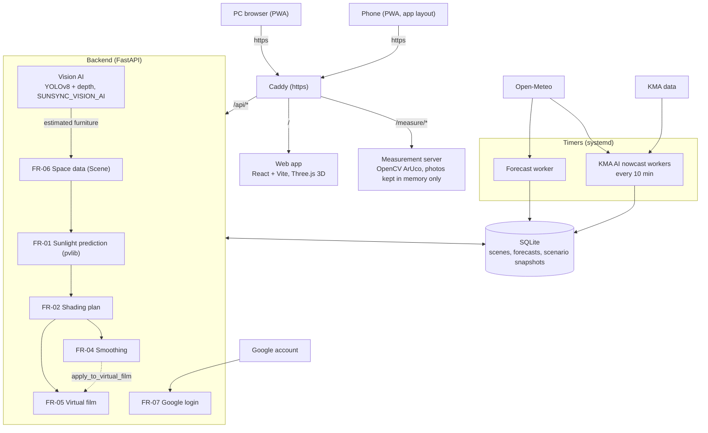

# Architecture

- **Space data (FR-06).** A shared Pydantic `Scene` contract at `backend/app/schemas/scene.py` holds metric ENU geometry and observation provenance. FastAPI validates it before storing it in SQLModel `SceneRecord` rows. `POST /api/scenes` imports, `GET` reads/lists, and `PUT` replaces with an atomic revision check. The UI keeps its own data (building, floor, zones) in `ui_spaces` in the same transaction. See [FR-06](fr06_design.md) and [database](db.md).
- **Prediction (FR-01).** `engine/fr01/` calculates solar positions with pvlib and traces direct-sun paths from protected sample points through windows. `POST /api/scenes/{scene_id}/sunpath-predictions` combines this with DNI selection. Its default response is an aggregate summary; sample-level path diagnostics (`detail_level: "diagnostic"`) are opt-in, and FR-02 and FR-04 ask for them. A worker stores Open-Meteo hourly DNI snapshots in SQLite; each request chooses `Scene.weather`, then a durable snapshot, then pvlib clear-sky. Two more workers (every 10 minutes) store the KMA AI x Open-Meteo quantile nowcast, read-only at `GET /api/scenes/{scene_id}/ai-nowcast/latest`. See [FR-01.4 design](fr01_4_open_meteo_dni_design.md), [AI guide](fr01_4_README.md) and [API](fr01_api.md).
- **Measurement (FR-03).** The app photographs the one 60 cm marker that the server shows on the film (a capture session, `capture-marker`); the separate measurement server (`measure/registration-core`, reached at `/measure`) detects it with OpenCV ArUco and solvePnP and fits the measured shape, and the backend stores the result as Scene coordinates. See [single marker](fr03_single_marker.md), [workflow](fr03_measurement_workflow.md) and [robust estimation](fr03_robust_measurement.md). Photos are processed in memory and not stored. A measurement job belongs to the signed-in account (`/api/ui/measurements`); the older code-based phone and PC link (`/api/ui/handoffs`) is deprecated. See [measurement flow with an account](device-handoff.md).
- **Vision AI (FR-03, FR-06).** `engine/vision_ai/` estimates 3D furniture boxes from one photo that shows the window marker. Stage 1 detects furniture with YOLOv8 and estimates depth with Depth Anything V2 Small, calibrated by the marker pose (solvePnP). Stage 2 is an optional guided capture of the four marker corners when the estimate is not good enough (`needs_aruco_refinement`). `POST /api/scenes/{scene_id}/vision-furniture-estimate` and `POST /api/scenes/{scene_id}/vision-furniture-photo` (raw photo) write the result into the Scene. `SUNSYNC_VISION_AI` is `auto` (default: use the models when they are installed, otherwise contour fallbacks), `on` (models required, otherwise an error) or `off`. See [Vision AI estimation](fr03_vision_ai_3d_estimation.md) and [deploy](deploy.md).
- **Shading (FR-02, FR-04, FR-05).** FR-02 maps window crossings to film cells and decides the `ShadingPlan` ([format](fr02_schedule.md), [design](fr02_design.md), [API](fr02_api.md)). FR-04 smooths that plan by default (`mode: "smooth_fr02"`) or, experimentally, decides on its own (`replace`) at `POST /api/scenes/{scene_id}/adaptive-shading-plan` ([FR-04](fr04_adaptive_control_lg_sgf.md)). Precomputed daily bundles (`sunpath_summary_json`, `shading_plan_json`, `adaptive_plan_json`) are stored in SQLite (`scenario_snapshots`), invalidated locally on scene edits, and refreshed across 10-minute rolling time buckets by workers; clients can also read the bundle directly via `GET /api/scenes/{scene_id}/scenario` ([scenario precomputation](scenario-precomputation.md)). FR-05 applies a plan to the virtual film, keeps its state and an append-only log, and shows the marker during measurement ([FR-05](fr05_protocol.md)).
- **Accounts (FR-07).** With `SUNSYNC_AUTH=google` the server logs people in with Google, keeps sessions in SQLite, and every `/api` route except the health check and the login routes needs a session. `backend/app/ownership.py` makes a space visible only to the account that created it (`scenes.owner_id`); another account gets 404. Caddy asks `/api/auth/check` before `/measure` requests. See [auth](auth.md).
- **Frontend.** React + Vite PWA: a web layout with a 2D plan and a Three.js 3D view, and an app layout (`mode=app`) for phones. See [UI flow](ui-flow.md).
- **Deployment (FR-07).** One server without Docker: Caddy (https), systemd services for the API and the measurement server, timers for the workers, the daily backup and the automatic deployment of `main`. See [deploy](deploy.md).

What the film receives today: the screens apply the FR-02 plan (`film-schedule-apply`). FR-04 is requested for the effect badges and can be applied with `apply_to_virtual_film`. Which plan the film should receive by default is not decided yet ([features.md](features.md)).
