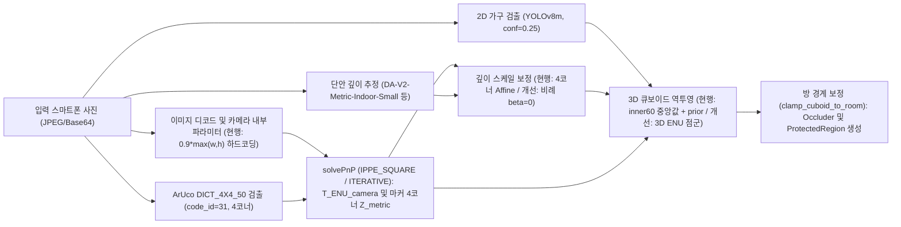
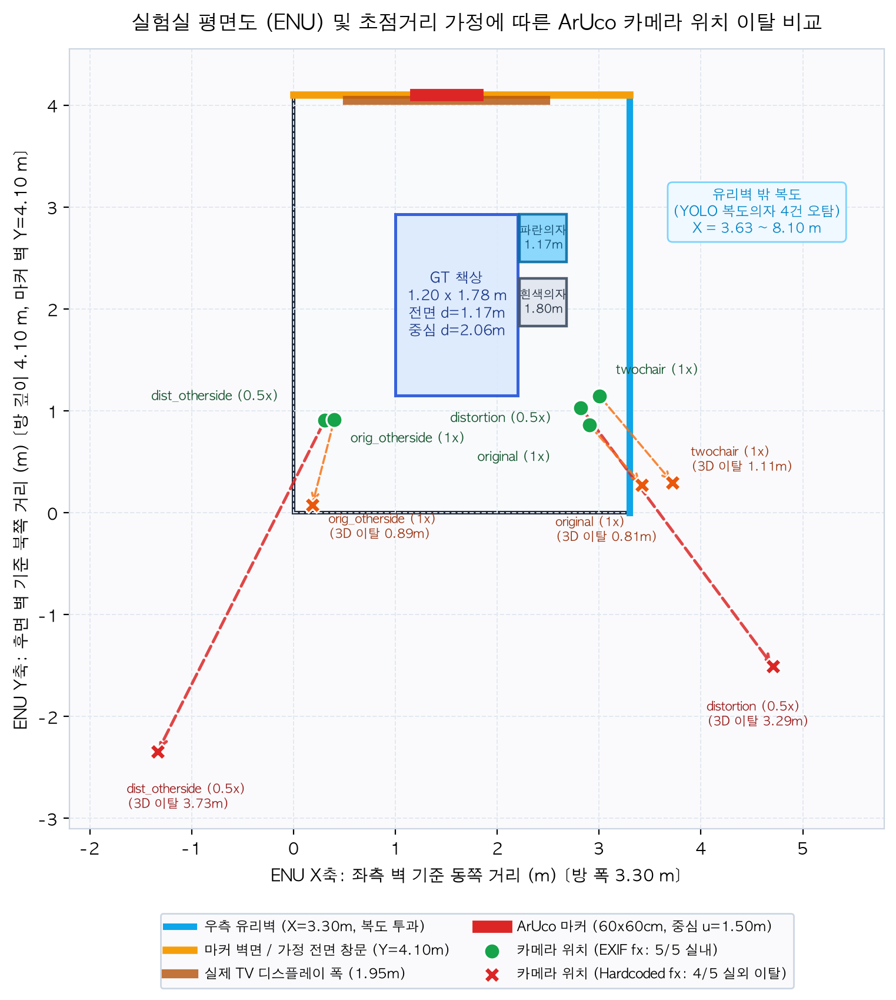
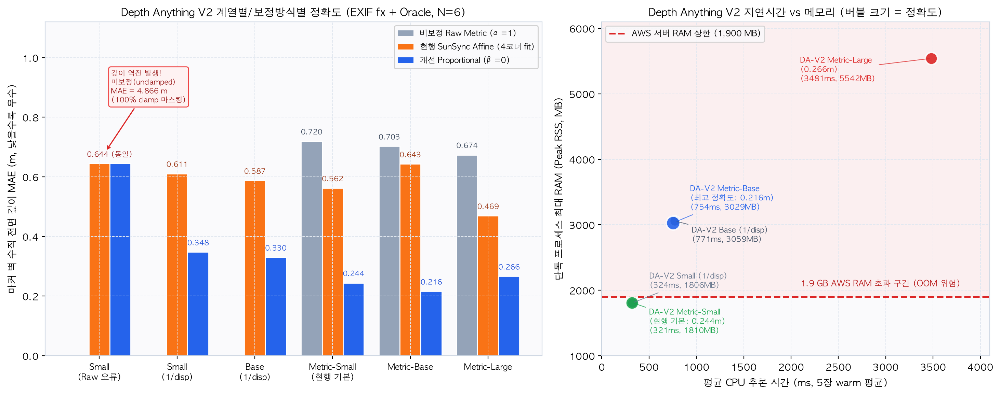
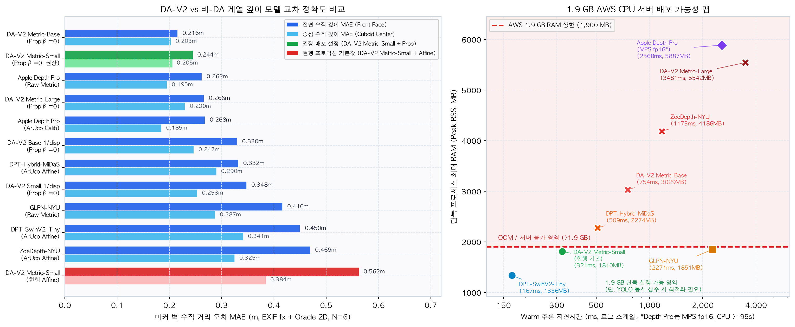
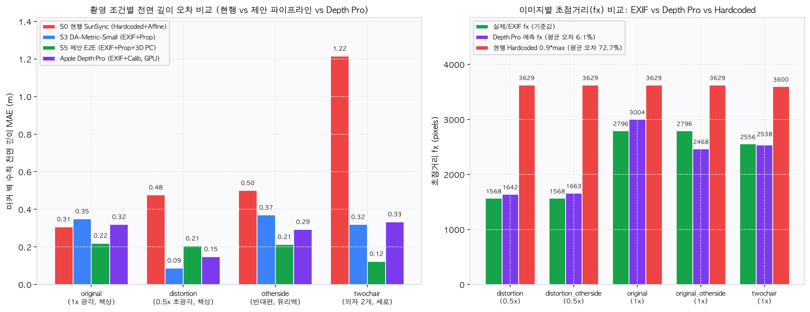
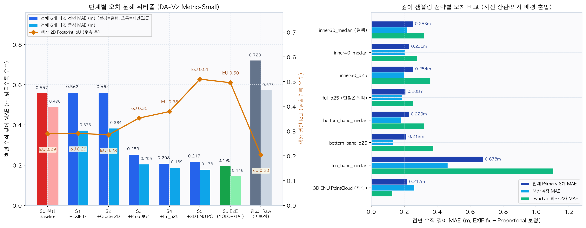
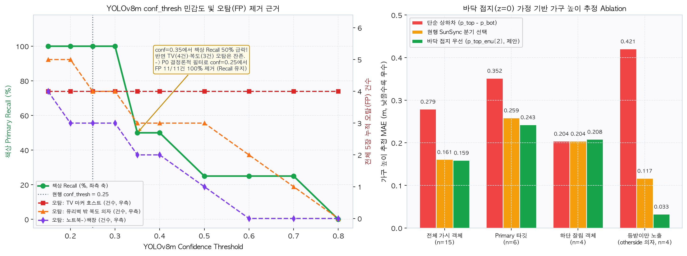

# SunSync FR-03 Vision Spatial AI 현장 실험 보고서 (`depthtest`)

본 보고서는 단일 스마트폰 사진과 창문 ArUco 마커를 이용해 실내 가구의 3D 위치 및 치수를 자동 추정하는 SunSync FR-03 Vision Spatial AI 파이프라인(`YOLOv8m` + 단안 깊이 추정 + `solvePnP` + ENU 3D 역투영)의 현장 실측 검증 결과를 정리한다. 본 실험은 실측 공간(`330 x 410 x 250 cm`)에서 촬영한 5장의 현장 사진(`depthtest`)을 기반으로 Depth Anything V2 계열 6개 변형과 비-Depth-Anything 계열 5개 모델을 동일 프로토콜로 교차 평가하고, 촬영 조건별 오차 원인 분해(Ablation Study)와 프로덕트 코드 수정 로드맵(P0/P1/P2)을 도출하였다.

> **범위 및 제약 안내**: 본 실험 단계에서는 프로덕션 코드(`server/backend/`, `server/engine/`, `frontend/`)와 `docs/ai_applications/` 문서를 일체 수정하지 않았다. 본 보고서의 모든 수치는 재현 스크립트가 산출한 원시 JSON(`manifest.json`, `da_summary.json`, `alt_summary.json`, `ablation_summary.json`)에서 직접 검증된 값이며, 개인 식별 요소가 포함될 수 있는 원본 현장 사진 대신 프로그램으로 생성한 정량 차트(`docs/experiments/figures/fr03_depthtest_*.png`)만 저장소에 포함하였다.

---

## 핵심 요약 (Executive Summary)

| 항목 | 현행 프로덕션 Baseline (`S0`) | 제안 P0+P1 개선 E2E (`S5_e2e_yolo_proposed`) | 변화량 |
|---|---:|---:|---:|
| 깊이 모델 / 검출기 | `DA-V2-Metric-Indoor-Small-hf` + `YOLOv8m` | 동일 (추가 모델 RAM `0 MB`, 추가 CPU `<5 ms`) | 모델 교체 없음 |
| 카메라 실내 복원율 (`solvePnP`) | `1/5 (20%)` (0.5x 초광각 `3.509 m` 이탈) | `5/5 (100%)` (EXIF `fx` 적용) | `+80%p` |
| 전체 Primary 6개 전면 깊이 MAE | `0.557 m` | **`0.195 m`** | **`-65.0%`** |
| 전체 Primary 6개 중심 깊이 MAE | `0.490 m` | **`0.146 m`** | **`-70.2%`** |
| 책상 4장 깊이 치수 MAE (`GT 1.78 m`) | `1.105 m` (prior `0.70 m` 고정) | **`0.420 m`** (3D ENU 점군 피팅) | **`-62.0%`** |
| 책상 4장 2D 평면 IoU | `0.289` | **`0.496`** | **`+71.6%`** |
| `twochair` 의자 2개 전면 깊이 MAE | `1.216 m` | **`0.124 m`** | **`-89.8%`** |
| 확인된 비가구/실외 YOLO 오탐(FP) | `11건` (TV 4, 노트북 3, 복도 의자 4) | **`0건`** (결정론적 P0 필터, 책상 Recall `4/4` 유지) | **`-100%`** |

1. **현행 오차의 주원인은 깊이 모델 자체보다 기하 보정 및 역투영 파이프라인 버그이다.** `Depth-Anything-V2-Metric-Indoor-Small-hf` 모델을 그대로 유지한 채 (1) EXIF 기반 초점거리 `fx` 적용, (2) 단일 평면 마커의 4코너 Affine 외삽(`pipeline.py:300`)을 비례 보정(`beta = 0`)으로 교정, (3) 3D ENU 점군 기반 벽면 정렬 큐보이드 피팅으로 교체하면 추가 RAM 없이 E2E 전면 깊이 MAE를 `0.557 m`에서 `0.195 m`로 `65.0%` 줄일 수 있다.
2. **Depth Anything V2 계열 내에서는 `Metric-Base`가 최고 정확도(`0.216 m` front MAE, Oracle+Prop)이나, 1.9 GB AWS CPU 서버 제약에서는 `Metric-Small` 유지가 유일한 실용 선택이다.** `Metric-Small`은 비례 보정 시 `0.244 m` front MAE(`321 ms` warm CPU, `99.2 MB` 가중치, 단독 `1,810 MB` Peak RSS)로 `Metric-Base`(`3,029 MB` RSS, `754 ms`) 및 `Metric-Large`(`5,542 MB` RSS, `3,481 ms`) 대비 압도적인 자원 효율을 보였다. 다만 `YOLOv8m` 및 FastAPI와 동시 상주 시 1.9 GB 한계를 넘지 않도록 입력 해상도 제한(`<=1024 px`)과 경량 런타임 최적화가 필요하다.
3. **비-Depth-Anything 계열 5종 탐색 결과, 1.9 GB CPU 서버 예산에서 `DA-V2-Metric-Small`을 능가하는 경량 모델은 없었다.** `Apple Depth Pro`는 비-DA 계열 최고 정확도(`0.185 m` center MAE, `1.57 cm` ArUco 잔차, EXIF 없이 `fx` 오차 `6.13%` 복원)를 달성해 FOV 인지형 메트릭 깊이의 상한을 증명했으나, `952M` 파라미터(`5,887 MB` RSS, CPU `>195 s`)로 GPU 인프라가 필수이다. 경량 CPU 모델인 `DPT-SwinV2-Tiny`(`167 ms`, `1,336 MB` RSS)와 `GLPN-NYU`(`2,271 ms`, `1,851 MB` RSS)는 각각 `0.450 m`, `0.545 m` (Raw `0.416 m`)로 정확도가 크게 뒤처졌다.

---

## 1. 실험 설계 및 공간 Ground Truth 정의

### 1.1 실측 공간 및 기준 좌표계 (Canonical ENU Frame)

SunSync의 북쪽 창문 기준 ENU 좌표계(`server/backend/app/ui_scene.py`)와 일치하도록 실험실 공간을 다음과 같이 정식화하였다 (`gt_spec.json`).

- **좌표축 정의**:
  - `X` (동쪽, East): 좌측 벽 `0.00 m` -> 우측 유리벽(복도 경계) `3.30 m` (방 폭 `330 cm`)
  - `Y` (북쪽, North): 후면 벽 `0.00 m` -> 마커 부착 벽면 `4.10 m` (방 깊이 `410 cm`)
  - `Z` (수직, Up): 바닥 `0.00 m` -> 천장 `2.50 m` (방 높이 `250 cm`)
- **마커 벽면 수직 거리 지표**: 마커 벽면은 `y = 4.10 m`, 실내 법선 벡터는 `(0, -1, 0)`이므로 임의의 3D 점 `(x, y, z)`의 마커 벽 수직 거리는 `d_wall = 4.10 - y_enu`로 정의한다.
- **창문 가정 vs 실제 TV 디스플레이**:
  - 실험 기본 설정은 마커 벽면 전체(`330 x 250 cm`, 하단 `0 cm`)를 가상 전면 창문으로 가정한다.
  - 실제 마커가 표시된 TV 디스플레이는 폭 `195 cm`, 높이 `115 cm`, 바닥으로부터 하단 높이 `85 cm`(상단 `200 cm`)이며 이동식 스탠드 특성상 석고보드 벽면보다 약 `5~10 cm` 돌출되어 있다. 두 모델링 간 좌표 편차는 5.4절 민감도 분석에서 별도로 정량화하였다.
- **ArUco 마커 정식화 및 중심 좌표 검증**:
  - 사전(Dictionary): `DICT_4X4_50`, 검출 코드 ID: `code_id = 31` (5장 전수 검출).
  - 물리 크기: 흰 여백(`20 cm` x 4면)을 제외한 검은 ArUco 패턴 `60 x 60 cm` (`side_length_m = 0.60 m`, 외곽 포함 `1.0 x 1.0 m` 단일 필름 모듈 크기).
  - 위치: 마커 좌하단 코너가 바닥에서 `1.20 m`, 좌측 벽에서 `1.20 m`에 위치하므로 마커 중심 ENU 좌표는 `(u = 1.50 m, y = 4.10 m, z = 1.50 m)`이다 (`H1`).
  - **외곽 여백 기준 가설(`H2`: `1.20 m`가 1m 흰 여백 끝이라면 중심 `(1.70, 4.10, 1.70)`)의 기하학적 반증**: `depthtest_distortion.jpeg`(EXIF `fx = 1568.0 px`, IPPE 재투영 오차 `0.31 px`)에서 책상 네 모서리 픽셀을 `z = 0.76 m` 수평면과 교차(ray-plane intersection)시킨 결과, `H1(1.50, 1.50)`은 전면 거리 `1.15~1.19 m` 및 치수 `1.20 x 1.77 m`로 실측(`1.17 m`, `1.20 x 1.78 m`)과 일치한 반면 `H2(1.70, 1.70)`은 `0.79 m`, `1.47 x 2.11 m`로 실측과 모순되어 `H1`이 확정되었다.

### 1.2 대상 가구 Ground Truth 및 방향 검증

| 대상 가구 (`target_id`) | SunSync 라벨 | 마커 벽 수직 전면 거리 (`d_front`) | 마커 벽 수직 중심 거리 (`d_center`) | 실측 치수 (`W x D x H`) | 주 평가 대상 이미지 (`Primary`, 총 `N=6`) |
|---|---|---:|---:|---|---|
| 책상 (`desk`) | `desk` | `1.17 m` (`117 cm`) | `2.06 m` (`206 cm`) | `1.20 x 1.78 x 0.76 m` (벽 평행 `1.20 m`, 벽 수직 `1.78 m`) | `original`, `distortion`, `original_otherside`, `distortion_otherside` (4건) |
| 파란 의자 (`blue_chair`) | `chair` | `1.17 m` (`117 cm`) | `1.405 m` (`140.5 cm`) | `0.47 x 0.46 x 0.80 m` | `twochair` (1건) |
| 흰색 의자 (`white_chair`) | `chair` | `1.80 m` (`180 cm`) | `2.035 m` (`203.5 cm`) | `0.47 x 0.46 x 0.80 m` | `twochair` (1건) |

- **책상 배치 방향 검증**: 시각 검수(책상 중앙 매립형 콘센트 3구 배열이 마커 벽 수직 장축 방향과 평행) 및 `z = 0.76 m` 평면 교차 측정(`1.19~1.23 m` 평행 x `1.77~1.79 m` 수직)을 통해 **`1.20 m` 변이 마커 벽과 평행하고, `1.78 m` 변이 마커 벽과 수직**(전면 `1.17 m`, 중심 `2.06 m`, 후면 `2.95 m`)임을 이중 확인하였다.
- **Primary (`N=6`) vs All-Visible (`N=15`) 평가 규칙**: 촬영 프로토콜상 `twochair` 사진은 책상을 제외하고 파란/흰색 의자 2개(`117 cm` / `180 cm`)를 정밀 배치해 평가하는 타깃이며, 나머지 4장(`original`, `distortion`, `original_otherside`, `distortion_otherside`)은 책상(`117 cm`)이 주 타깃이다(나머지 4장에서 의자는 회전/이동이 소폭 존재). 따라서 본 보고서의 핵심 정확도 지표는 **Primary 6개 인스턴스(`N=6`)**를 기준으로 보고하며, 전체 가시 객체(`N=15`)와 조건별 분해 수치를 함께 병기한다.

### 1.3 SunSync Vision Spatial AI 파이프라인 아키텍처

### 1.4 촬영 조건 매트릭스 및 EXIF/ArUco 감사 결과 (`manifest.json`)

| 파일명 | 조건 그룹 | 배율 / 시점 | 해상도 (`W x H`) | EXIF 상태 및 기기 | `fx` (Hardcoded vs EXIF) | IPPE 재투영 오차 (HC vs EXIF) | 카메라 실내 여부 (HC vs EXIF) | YOLO 검출 수 (`conf>=0.25`) |
|---|---|---|---:|---|---:|---:|---|---:|
| `depthtest_original.jpeg` | `original` | `1x` / 우측 후방 | `4032 x 3024` | 제거됨(APP13), iPhone 14 Pro 추정 | `3628.8` vs `2795.7 px` (`1.30x`) | `4.55` vs `1.40 px` | 실외 -> **실내** | 9 |
| `depthtest_distortion.jpeg` | `distortion` | `0.5x` / 우측 후방 | `4032 x 3024` | 유지, iPhone 14 Pro (`2.22mm / 14mm eq`) | `3628.8` vs `1568.0 px` (`2.31x`) | `8.34` vs `0.31 px` | 실외 -> **실내** | 11 |
| `depthtest_original_otherside.jpeg` | `original`, `otherside` | `1x` / 좌측 후방 | `4032 x 2268` | 제거됨(APP13, 16:9), iPhone 14 Pro 추정 | `3628.8` vs `2795.7 px` (`1.30x`) | `4.86` vs `1.43 px` | 실내 -> **실내** | 5 |
| `depthtest_distortion_otherside.jpeg` | `distortion`, `otherside` | `0.5x` / 좌측 후방 | `4032 x 2268` | 제거됨(APP13, 16:9), iPhone 14 Pro 추정 | `3628.8` vs `1568.0 px` (`2.31x`) | `7.35` vs `0.19 px` | 실외 -> **실내** | 9 |
| `depthtest_twochair.jpeg` | `twochair` | `1x` / 우측 하단(세로) | `2252 x 4000` (원본 `Orientation=6`) | 유지, Galaxy S23+ (`5.4mm / 23mm eq`) | `3600.0` vs `2555.6 px` (`1.41x`) | `3.65` vs `1.35 px` | 실외 -> **실내** | 4 |

현행 SunSync의 하드코딩 초점거리(`0.9 * max(w, h)`)는 35 mm 환산 약 `32.4 mm` 렌즈를 가정한다. 실제 스마트폰 1x(`23~24 mm`) 및 0.5x 초광각(`14 mm`)과 큰 괴리가 발생해 **5장 중 4장의 카메라가 `3.30 x 4.10 m` 방 밖으로 이탈**하며, 특히 0.5x 초광각 2장은 후면 벽 뒤 `y = -1.51 m`, `-2.35 m` 위치로 추정된다. 반면 EXIF/기기 기반 `fx`를 적용하면 **5장 모두 실내 정상 위치로 복원**되고 0.5x 재투영 오차가 `7.35~8.34 px`에서 `0.19~0.31 px`로 감소한다.

---

## 2. Depth Anything 계열 모델 비교

Depth Anything V2 계열 5개 HuggingFace 체크포인트(6개 실행 변형)를 전체 5장, `hardcoded` vs `exif` 내부파라미터, `oracle` vs `yolo` 2D 박스, 그리고 3가지 보정 모드(`raw_uncalibrated`, 현행 `aruco_calibrated` [4코너 Affine], 개선 `aruco_proportional` [`beta=0`]) 조합으로 벤치마크하였다 (`da_summary.json`).

### 2.1 Depth Anything V2 정량 성능 및 자원 비교 (EXIF `fx` + Oracle 2D, Primary `N=6`)

| 모델 변형 | 파라미터 / 디스크 | 보정 방식 | 전면 MAE (미보정 Unclamped) | 전면 RMSE | 중심 MAE | 3D 치수 MAE (`W / D / H`) | 마커 보정 RMSE (`alpha / beta`) | 5장 평균 CPU (1스레드) | Peak RSS (`12MP / 1024px`) | 1.9 GB AWS 서버 |
|---|---:|---|---:|---:|---:|---:|---:|---:|---:|---|
| `Small (raw buggy)` | `24.8M` / `99.2 MB` | Affine / Prop | `0.644 m` (**`4.866 m`**) | `0.667 m` | `0.357 m` | `1.86 / 0.93 / 0.02 m` | `0.532 m` (`1.86 / 0.00`) | `324 ms` (`687 ms`) | `1806 / 1733 MB` | 사용 불가 (깊이 역전) |
| `Small (1/disp)` | `24.8M` / `99.2 MB` | Affine (현행) | `0.611 m` (`0.656 m`) | `0.771 m` | `0.504 m` | `0.81 / 0.76 / 0.27 m` | `0.035 m` (`1.75 / +1.14`) | `324 ms` (`687 ms`) | `1806 / 1733 MB` | 단독 가능 / 동시 상주 빠듯 |
| `Small (1/disp)` | `24.8M` / `99.2 MB` | **Prop (`beta=0`)** | **`0.348 m`** (`0.348 m`) | `0.387 m` | `0.253 m` | `0.42 / 0.75 / 0.19 m` | `0.156 m` (`2.63 / 0.00`) | `324 ms` (`687 ms`) | `1806 / 1733 MB` | 단독 가능 / 동시 상주 빠듯 |
| `Base (1/disp)` | `97.5M` / `389.9 MB` | Affine (현행) | `0.587 m` (`0.635 m`) | `0.754 m` | `0.487 m` | `0.79 / 0.76 / 0.29 m` | `0.022 m` (`1.64 / +1.18`) | `771 ms` (`1314 ms`) | `3059 / 2929 MB` | **불가 (OOM)** |
| `Base (1/disp)` | `97.5M` / `389.9 MB` | **Prop (`beta=0`)** | **`0.330 m`** (`0.330 m`) | `0.386 m` | `0.247 m` | `0.41 / 0.75 / 0.23 m` | `0.139 m` (`2.56 / 0.00`) | `771 ms` (`1314 ms`) | `3059 / 2929 MB` | **불가 (OOM)** |
| `Metric-Small` (현행) | `24.8M` / `99.2 MB` | Raw (`alpha=1`) | `0.720 m` (`1.164 m`) | `0.811 m` | `0.573 m` | `1.05 / 0.84 / 0.17 m` | `1.963 m` (`1.00 / 0.00`) | `321 ms` (`681 ms`) | `1810 / 1731 MB` | 단독 가능 / 동시 상주 빠듯 |
| `Metric-Small` (현행) | `24.8M` / `99.2 MB` | Affine (현행) | `0.562 m` (`0.562 m`) | `0.618 m` | `0.384 m` | `0.38 / 0.75 / 0.13 m` | `0.039 m` (`0.84 / -0.94`) | `321 ms` (`681 ms`) | `1810 / 1731 MB` | 단독 가능 / 동시 상주 빠듯 |
| **`Metric-Small` (권장)** | `24.8M` / `99.2 MB` | **Prop (`beta=0`)** | **`0.244 m`** (`0.267 m`) | `0.340 m` | **`0.205 m`** | `0.60 / 0.76 / 0.26 m` | `0.075 m` (`0.66 / 0.00`) | **`321 ms`** (`681 ms`) | **`1810 / 1731 MB`** | **단독 가능 (권장)** |
| `Metric-Base` | `97.5M` / `389.9 MB` | Raw (`alpha=1`) | `0.703 m` (`1.022 m`) | `0.780 m` | `0.552 m` | `1.02 / 0.82 / 0.22 m` | `1.826 m` (`1.00 / 0.00`) | `754 ms` (`1595 ms`) | `3029 / 2930 MB` | **불가 (OOM)** |
| `Metric-Base` | `97.5M` / `389.9 MB` | Affine (현행) | `0.643 m` (`0.643 m`) | `0.672 m` | `0.418 m` | `0.40 / 0.75 / 0.13 m` | `0.056 m` (`1.04 / -1.51`) | `754 ms` (`1595 ms`) | `3029 / 2930 MB` | **불가 (OOM)** |
| **`Metric-Base` (최고)** | `97.5M` / `389.9 MB` | **Prop (`beta=0`)** | **`0.216 m`** (`0.264 m`) | `0.331 m` | **`0.203 m`** | `0.60 / 0.76 / 0.27 m` | `0.091 m` (`0.71 / 0.00`) | `754 ms` (`1595 ms`) | `3029 / 2930 MB` | **불가 (OOM)** |
| `Metric-Large` | `335.3M` / `1341.3 MB` | Raw (`alpha=1`) | `0.674 m` (`1.024 m`) | `0.726 m` | `0.519 m` | `1.04 / 0.82 / 0.12 m` | `1.603 m` (`1.00 / 0.00`) | `3481 ms` (`4217 ms`) | `5542 / 5542 MB` | **불가 (OOM)** |
| `Metric-Large` | `335.3M` / `1341.3 MB` | Affine (현행) | `0.469 m` (`0.514 m`) | `0.525 m` | `0.316 m` | `0.37 / 0.76 / 0.20 m` | `0.033 m` (`0.92 / -1.01`) | `3481 ms` (`4217 ms`) | `5542 / 5542 MB` | **불가 (OOM)** |
| `Metric-Large` | `335.3M` / `1341.3 MB` | Prop (`beta=0`) | `0.266 m` (`0.314 m`) | `0.346 m` | `0.230 m` | `0.66 / 0.76 / 0.25 m` | `0.071 m` (`0.72 / 0.00`) | `3481 ms` (`4217 ms`) | `5542 / 5542 MB` | **불가 (OOM)** |

> **세부 수치 정합성 주석**: `da_summary.json`의 `aruco_proportional`은 마커 4코너 평균 기반 비례 보정(`Metric-Small` `0.244 m` front / `0.205 m` center)이며, 5장 Ablation(`ablation_summary.json`)에서는 마커 4코너 비례(`aruco_prop_corners`, `0.2442 m`)와 내부 60% 사각형 중앙값 비례(`aruco_prop_interior`, `0.2527 m`)를 모두 분리 검증하였다. 두 방식의 차이는 `0.85 cm` 이내이다.

### 2.2 Depth Anything V2 주요 관찰

1. **Disparity 미역변환(`Small raw buggy`)의 치명적 깊이 역전**: 상대 깊이 모델(`Depth-Anything-V2-Small-hf`)의 원시 출력은 가까운 물체가 큰 값을 가지는 역깊이(disparity)이다. `_disparity_to_relative_depth` 역수 변환 없이 그대로 선형 스케일링하면 가까운 가구가 마커보다 더 먼 벽 너머로 역투영되어 **미보정(unclamped) 전면 MAE가 `4.866 m`**에 달한다(`hardcoded`에서는 `7.636 m`). Clamped MAE가 `0.644 m`로 낮아 보이는 것은 `clamp_cuboid_to_room`이 방 밖의 모든 큐보이드를 강제로 실내로 밀어 넣은(`100%` clamped) 착시 때문이다.
2. **Metric-Indoor 모델의 확실한 우위**: `1/disparity` 변환을 정상 적용한 상대 깊이 모델(`Small`: `0.348 m`, `Base`: `0.330 m`)보다 실내 메트릭 학습 모델(`Metric-Small`: `0.244 m`, `Metric-Base`: `0.216 m`)이 비례 보정 기준 약 `30%` 더 낮은 오차를 달성하였다.
3. **비례 보정(`beta=0`)이 모델 체급 업그레이드보다 효과가 훨씬 크다**: 현행 `Metric-Small`의 4코너 Affine(`0.562 m`)을 `Metric-Large` Affine(`0.469 m`, 지연 `10.8배`, RAM `3.1배`)으로 올려도 `0.093 m` 개선에 그치지만, `Metric-Small`에 비례 보정만 적용해도 `0.244 m`로 **`-56.6%` (`0.318 m` 감소)** 개선된다.
4. **3D 치수 오차의 지배 요인**: `Metric-Small` / `Metric-Base` 모두 비례 보정 시 깊이 치수 MAE가 `0.76 m`로 고정되어 있다. 이는 깊이 모델 오차가 아니라 `pipeline.py:55, 488`이 책상 깊이를 `0.70 m` prior로 고정해 실측 `1.78 m`와 `1.08 m` 편차가 발생하기 때문이다.
5. **1.9 GB AWS 서버 메모리 제약**: 단독 실행 기준 `Metric-Small`은 `1,810 MB`(1024px 입력 시 `1,731 MB`)로 1.9 GB 경계 내에 들어오나, `YOLOv8m`과 FastAPI 프로세스(`+250 MB` 이상)가 동시 상주하면 여유분이 부족하다. 반면 `Metric-Base`(`3,029 MB`)와 `Metric-Large`(`5,542 MB`)는 단독 실행조차 1.9 GB를 초과해 AWS CPU 서버 배포가 불가능하다.

*(대화형 시각 검수용 로컬 스크래치 깊이 히트맵: `exp_da/figures/da_heatmaps_desk_conditions.png`, `exp_da/figures/da_heatmaps_twochair.png`, `exp_da/figures/da_summary_comparison.png`)*

---

## 3. 비-Depth-Anything 계열 깊이 모델 탐색 및 교차 비교

`transformers` + `torch` 환경(macOS arm64)에서 Depth Anything 외에 아키텍처와 학습 도메인이 상이한 5개 대표 모델을 선별해 동일 프로토콜로 벤치마크하였다 (`alt_summary.json`). 모든 모델에 대해 실제 픽셀(흰색 의자 < 책상 < 마커) 기준 단조 깊이 방향(`monotonic_order_valid = True`)을 사전 검증하였다.

- **선정 모델 (5종)**: `apple/DepthPro-hf` (제로샷 메트릭 + FOV 예측), `Intel/zoedepth-nyu` (실내 메트릭 NYU), `vinvino02/glpn-nyu` (경량 실내 메트릭 NYU, SegFormer MiT-B4), `Intel/dpt-hybrid-midas` (상대 역깊이 ResNet50+ViT), `Intel/dpt-swinv2-tiny-256` (경량 상대 역깊이 SwinV2-Tiny).
- **미선정 후보 및 사유**: `Intel/zoedepth-nyu-kitti` (`1,380 MB` 실내/실외 혼합, 실내 전용 `zoedepth-nyu`가 적합), `Intel/dpt-large` (`1,368 MB`, `dpt-hybrid-midas`와 중복 및 1.9 GB 초과), `Intel/dpt-beit-base-384` (`443 MB`, 상대 깊이 스펙트럼을 Classic Hybrid + 경량 SwinV2-Tiny로 더 넓게 커버).

### 3.1 DA-V2 vs 비-DA 계열 교차 벤치마크 (EXIF `fx` + Oracle 2D, Primary `N=6`)

| 모델 (계열 / 타입) | 파라미터 / 디스크 | 보정 방식 | 전면 MAE | 전면 RMSE | 중심 MAE | 3D 치수 MAE (`W / D / H`) | 마커 보정 RMSE | Warm 지연시간 | Peak RSS | 1.9 GB AWS CPU 서버 |
|---|---:|---|---:|---:|---:|---:|---:|---:|---:|---|
| **`DA-V2 Metric-Base`** (DA / 메트릭) | `97.5M` / `389.9 MB` | Prop (`beta=0`) | **`0.216 m`** | `0.331 m` | `0.203 m` | `0.60 / 0.76 / 0.27 m` | `0.091 m` | `754 ms` (CPU) | `3,029 MB` | **불가 (OOM)** |
| **`DA-V2 Metric-Small`** (DA / 메트릭, 권장) | `24.8M` / `99.2 MB` | Prop (`beta=0`) | **`0.244 m`** | `0.340 m` | `0.205 m` | `0.60 / 0.76 / 0.26 m` | `0.075 m` | **`321 ms`** (CPU) | `1,810 MB` | **단독 가능 (권장)** |
| **`Apple Depth Pro`** (비-DA / 메트릭+FOV) | `952.0M` / `1,904.2 MB` | Raw (`alpha=1`) | `0.262 m` | `0.336 m` | `0.195 m` | `0.52 / 0.75 / 0.28 m` | `0.144 m` (raw) | `2,568 ms` (MPS fp16, CPU `>195 s`) | `5,887 MB` | **불가 (GPU 필수)** |
| **`Apple Depth Pro`** (비-DA / 메트릭+FOV) | `952.0M` / `1,904.2 MB` | ArUco Calib | `0.268 m` | `0.348 m` | **`0.185 m`** | `0.46 / 0.75 / 0.23 m` | **`0.016 m`** | `2,568 ms` (MPS fp16) | `5,887 MB` | **불가 (GPU 필수)** |
| `Apple Depth Pro` (`depthpro_pred_fx`, EXIF 미사용) | `952.0M` / `1,904.2 MB` | ArUco Calib | **`0.242 m`** | `0.304 m` | **`0.179 m`** | `0.48 / 0.75 / 0.25 m` | `0.016 m` | `2,568 ms` (MPS fp16) | `5,887 MB` | **불가 (GPU 필수)** |
| `DA-V2 Metric-Large` (DA / 메트릭) | `335.3M` / `1,341.3 MB` | Prop (`beta=0`) | `0.266 m` | `0.346 m` | `0.230 m` | `0.66 / 0.76 / 0.25 m` | `0.071 m` | `3,481 ms` (CPU) | `5,542 MB` | **불가 (OOM)** |
| `DA-V2 Base (1/disp)` (DA / 상대) | `97.5M` / `389.9 MB` | Prop (`beta=0`) | `0.330 m` | `0.386 m` | `0.247 m` | `0.41 / 0.75 / 0.23 m` | `0.139 m` | `771 ms` (CPU) | `3,059 MB` | **불가 (OOM)** |
| `Intel DPT-Hybrid-MiDaS` (비-DA / 상대) | `122.4M` / `489.7 MB` | ArUco Affine | `0.332 m` | `0.378 m` | `0.290 m` | `0.78 / 0.78 / 0.25 m` | `0.101 m` | `509 ms` (CPU) | `2,274 MB` | **불가 (OOM 위험)** |
| `DA-V2 Small (1/disp)` (DA / 상대) | `24.8M` / `99.2 MB` | Prop (`beta=0`) | `0.348 m` | `0.387 m` | `0.253 m` | `0.42 / 0.75 / 0.19 m` | `0.156 m` | `324 ms` (CPU) | `1,806 MB` | 단독 가능 |
| `GLPN-NYU` (비-DA / 메트릭 NYU) | `61.2M` / `245.0 MB` | Raw / Affine | `0.416` / `0.545 m` | `0.540` / `0.621 m` | `0.287` / `0.459 m` | `0.50` / `0.73` W MAE | `0.132 m` | `2,271 ms` (CPU 640px) | `1,851 MB` | 경계/빠듯 (느림) |
| `Intel DPT-SwinV2-Tiny` (비-DA / 상대) | `40.9M` / `163.8 MB` | ArUco Affine | `0.450 m` | `0.517 m` | `0.341 m` | `0.77 / 0.77 / 0.22 m` | `0.032 m` | **`167 ms`** (CPU) | **`1,336 MB`** | **가능 (가장 가벼움)** |
| `Intel ZoeDepth-NYU` (비-DA / 메트릭 NYU) | `343.8M` / `1,375.2 MB` | ArUco Affine | `0.469 m` | `0.586 m` | `0.325 m` | `0.48 / 0.75 / 0.27 m` | `0.046 m` | `1,173 ms` (CPU) | `4,186 MB` | **불가 (OOM)** |
| `DA-V2 Metric-Small` (현행 프로덕션) | `24.8M` / `99.2 MB` | Affine (현행) | `0.562 m` | `0.618 m` | `0.384 m` | `0.38 / 0.75 / 0.13 m` | `0.039 m` | `321 ms` (CPU) | `1,810 MB` | 단독 가능 (보정 버그) |

### 3.2 비-Depth-Anything 모델 핵심 공학적 시사점

1. **`Apple Depth Pro`: FOV 인지형 메트릭 깊이의 과학적 상한 입증**
   - 일반 단안 메트릭 모델(`DA-V2 Metric-Small`, `ZoeDepth-NYU`, `GLPN-NYU`)은 카메라 내부파라미터를 모르기 때문에 0.5x 초광각에서 절대 깊이가 크게 부풀려진다(EXIF `fx` 기준 Raw 마커 깊이 오차: `DA-V2 Metric-Small` RMSE `1.963 m`, `ZoeDepth-NYU` MAE `1.028 m`, `GLPN-NYU` MAE `0.804 m`).
   - 반면 `Apple Depth Pro`는 이미지에서 초점거리(`fx`)를 직접 예측해 메트릭 깊이에 반영하므로 **ArUco 보정 없이 Raw 상태에서도 마커 오차 `0.144 m`, 전면 MAE `0.262 m`, 중심 MAE `0.195 m`**를 기록하였다.
   - 특히 5장 전체에서 `Depth Pro`의 예측 `fx`는 실제 EXIF `fx` 대비 **평균 절대 오차 `6.13%`**(0.5x `1642 / 1663 px` vs `1568 px`; 1x `3004 / 2468 px` vs `2796 px`; `twochair` `2538 px` vs `2556 px`)로, SunSync 하드코딩(`72.67%` 오차)을 압도하였다. EXIF 없이 `depthpro_pred_fx`를 `solvePnP`에 직접 주입한 E2E YOLO 파이프라인에서도 전면 MAE `0.235 m`, 중심 MAE `0.212 m`를 달성하였다.
   - 다만 `952M` 파라미터, `1.90 GB` 가중치, `5,887 MB` Peak RSS, CPU `>195 s`로 현재의 1.9 GB AWS CPU 서버에서는 구동할 수 없으며 향후 GPU 추론 서버 도입 시 1순위 후보이다.
2. **NYU Depth v2 고정 FOV 모델(`ZoeDepth-NYU`, `GLPN-NYU`)의 한계**
   - `ZoeDepth-NYU`는 0.5x 초광각에서 고정 FOV 편향과 4코너 Affine 외삽이 겹쳐 `distortion` 전면 MAE가 `0.854 m`까지 악화되었다(참고: `transformers`에서 패딩 제거를 위해 `post_process_depth_estimation(..., source_sizes=...)` 전달이 필수).
   - `GLPN-NYU`는 4코너 Affine 보정(`0.545 m`, 절편 `beta = -2.68 m ~ +2.39 m`)보다 오히려 비보정 Raw(`0.416 m`)가 더 정확할 만큼 현행 4코너 Affine 보정의 취약성을 재확인시켜 주었으며, CPU `2,271 ms` 지연과 `1,851 MB` RSS로 실용성이 낮다.
3. **경량 상대 깊이 모델(`DPT-SwinV2-Tiny`) vs `DA-V2 Metric-Small`**
   - `DPT-SwinV2-Tiny`는 `167 ms`, `1,336 MB` RSS로 1.9 GB 서버에서 가장 가볍지만 전면 MAE가 `0.450 m`(중심 `0.341 m`)로, 비례 보정을 적용한 `DA-V2 Metric-Small`(`0.244 m` / `0.205 m`) 대비 정확도가 약 2배 가까이 떨어진다. 따라서 **1.9 GB CPU 서버의 최적 모델은 현행 `DA-V2 Metric-Small` 유지**로 결론 내려진다.

*(대화형 시각 검수용 로컬 스크래치 깊이 비교 그리드: `exp_alt/figures/alt_depth_grid_distortion.png`, `exp_alt/figures/alt_depth_grid_original.png`, `exp_alt/figures/alt_depth_grid_twochair.png`, `exp_alt/figures/alt_depthpro_focal_comparison.png`)*

---

## 4. 촬영 상황별(`original`, `distortion`, `twochair`, `otherside`) 오차 및 원인 분석

`DA-V2-Metric-Indoor-Small-hf`를 기준으로 현행 Baseline(`S0`), EXIF+비례보정(`S3`), 제안 E2E 점군 파이프라인(`S5 E2E`), 그리고 GPU 상한 기준인 `Apple Depth Pro`의 촬영 조건별 전면 깊이 MAE를 비교하였다 (`ablation_summary.json`, `alt_summary.json`).

| 촬영 조건 그룹 | 포함 이미지 (Primary 타깃) | `S0` 현행 Baseline | `S3` EXIF+Oracle+Prop | `S5 E2E` 제안 (YOLO+3D PC) | `Apple Depth Pro` (EXIF+Calib) | 핵심 오차 원인 |
|---|---|---:|---:|---:|---:|---|
| **`original` (1x 광각)** | `original`, `original_otherside` (책상 2) | `0.308 m` | `0.350 m` | **`0.220 m`** | `0.321 m` | 책상 모서리 화면 잘림(`x=0, y=3024/2268`), `original_otherside` 상판 깊이 과소추정 |
| **`distortion` (0.5x 초광각)** | `distortion`, `distortion_otherside` (책상 2) | `0.477 m` | **`0.088 m`** | `0.206 m` (`중심 0.040 m`) | `0.149 m` | 현행 `fx` `2.31x` 불일치(`3.509 m` 카메라 이탈) + 4코너 Affine 폭주; EXIF+Prop 시 4모서리 완전 노출로 최고 정확도 |
| **`otherside` (반대편)** | `original_otherside`, `distortion_otherside` (책상 2) | `0.501 m` | `0.370 m` | **`0.214 m`** | `0.294 m` | 유리벽 너머 복도 의자 4건 오탐 및 실내 강제 끌어들임, 책상 뒤 의자 하부 가림(등받이만 노출) |
| **`twochair` (의자 2개)** | `twochair` (파란·흰색 의자 2) | `1.216 m` | `0.320 m` | **`0.124 m`** | `0.335 m` | 의자 겹침으로 YOLO 1개 박스 병합(`blue_chair` 미검출), 의자 다리 사이 바닥 배경 혼입(높은 IQR), 세로 `Orientation=6` |

### 4.1 조건별 심층 원인 진단

1. **`original` (1x 표준 광각) vs `distortion` (0.5x 초광각)**:
   - 직관과 달리, **EXIF `fx`와 비례 보정(`beta=0`)이 정상 작동하면 0.5x 초광각(`distortion`)이 1x(`original`)보다 훨씬 정확하다**(`S3` 기준 `0.088 m` vs `0.350 m`, `S5 E2E` 중심 MAE 기준 `0.040 m` vs `0.267 m`).
   - 1x 화각에서는 좁은 실내에서 책상 네 모서리를 한 프레임에 담지 못해 좌측/하단이 프레임 경계(`x=0`, `y=3024` 또는 `2268`)에서 잘리고, 특히 `original_otherside`에서는 화면 하단 근접 상판의 단안 깊이 과소추정으로 전면 오차가 `-0.593 m`(비례 보정 기준)까지 커진다.
   - 반대로 0.5x 초광각에서는 책상 네 모서리와 마커가 모두 여유롭게 포착된다. 현행 코드에서 0.5x가 실패한 이유는 렌즈 배럴 왜곡이 아니라 `fx = 3628.8` vs 실제 `1568.0 px`(`2.31배`) 불일치와 4코너 Affine 외삽(`beta = -1.83 m`, `-2.12 m`) 때문이었다.
2. **`otherside` (반대편 유리벽 방향 촬영)**:
   - 좌측 후방에서 우측 유리벽(`X = 3.30 m`)을 향해 촬영하면, 유리벽 너머 복도에 놓인 의자 4개가 `depthtest_distortion_otherside.jpeg`에서 YOLOv8m에 `conf = 0.31~0.72`로 검출된다.
   - 역투영된 복도 의자의 실제 ENU `X` 좌표는 `3.63 m ~ 8.10 m`로 명백히 실외이지만, 현행 파이프라인은 실외 필터 없이 `clamp_cuboid_to_room`을 호출해 이들을 **`1.02 m ~ 5.26 m` 실내로 강제 이동**시켜 방 안에 유령 의자 4개를 생성한다.
   - 또한 책상 건너편 의자들은 하부가 책상에 가려져 상단 등받이(`0.35~0.45 m`)만 보이므로 `p_top - p_bot` 높이 추정이 `0.421 m` MAE로 무너진다.
3. **`twochair` (파란/흰색 의자 정밀 평가, 세로 촬영)**:
   - **시선 방향 가림(Line-of-sight Occlusion)과 YOLO 병합**: 앞쪽 흰색 의자가 뒤쪽 파란 의자를 부분적으로 가리면서 YOLOv8m(`conf=0.25`)이 두 의자를 단일 `chair` 박스(`idx=0`, `conf=0.915`, 흰색 의자 IoU `0.813`, 파란 의자 IoU `0.402`)로 병합한다. 이에 따라 엄격한 1:1 매칭(E2E `ablation_summary.json`)에서는 `blue_chair` Recall이 `0%`로 전체 Primary Recall이 `5/6`가 된다(참고: 모델 간 깊이 비교 `da_summary.json` / `alt_summary.json`의 YOLO 모드는 각 GT 타깃을 최대 IoU 박스에 독립 매칭해 `6/6`으로 집계하였다).
   - **배경 픽셀 혼입**: 의자 바운딩 박스는 등받이·좌판·다리 사이로 뒤쪽 바닥과 벽이 넓게 노출되어 깊이 패치 IQR이 매우 크다(`raw_metric` 기준 `blue_chair` `1.513 m`). 현행 `inner60_median`이 배경 쪽으로 끌려가면서 `S0` 오차가 `1.216 m`까지 치솟았으나, 전경 근접 `65%` 필터를 포함한 3D ENU 점군 피팅(`S5`)으로 **`0.124 m` (`-89.8%`)**까지 극적으로 개선되었다.

---

## 5. 추가 과학적 검증 (Ablation Study)

`Depth-Anything-V2-Metric-Indoor-Small-hf`를 대상으로 내부파라미터·왜곡, 오차 분해·YOLO 오탐, 깊이 보정·샘플링, 3D 기하·좌표 민감도의 4개 축을 정량 검증하였다 (`ablation_summary.json`).

### 5.1 카메라 내부파라미터(`fx`) 및 0.5x 방사 왜곡(`k1`) Ablation

| 배율 그룹 | 이미지 수 (Primary) | 3D 카메라 위치 이탈 | 마커 벽 수직 이탈 | 마커 깊이 `Z` 오차 | 카메라 실내율 (HC -> EXIF) | 비례 보정 시 전면 MAE (HC -> EXIF) | 비례 보정 시 중심 MAE (HC -> EXIF) |
|---|---:|---:|---:|---:|---:|---:|---:|
| **`1x` (`original`, `twochair`)** | 3장 (4개) | `0.937 m` | `0.758 m` | `+0.955 m` (`+30.2%`) | `1/3` -> **`3/3`** | `0.273 m` -> `0.335 m` | `0.267 m` -> `0.275 m` |
| **`0.5x` (`distortion`)** | 2장 (2개) | **`3.509 m`** | **`2.895 m`** | **`+3.566 m` (`+116.8%`)** | `0/2` -> **`2/2`** | `0.561 m` -> **`0.088 m` (`-84.3%`)** | `0.465 m` -> **`0.067 m` (`-85.6%`)** |

- **0.5x 방사 왜곡(`k1`) 스윕 검증**: `pipeline.py:156`의 `dist_coeffs = np.zeros(4)` 가정이 0.5x 초광각에서 문제가 되는지 확인하기 위해 `k1 in [-0.20, +0.10]`을 스윕하였다. 그 결과 두 0.5x 사진 모두 **`k1 = 0.0`에서 IPPE 재투영 오차가 최소(`0.308 px`, `0.186 px`)**였다(`k1 = -0.10`이면 `2.768 px`, `-0.20`이면 `7.340 px`로 악화). 즉, 최신 스마트폰 ISP가 출력 JPEG 단계에서 배럴 왜곡을 이미 보정하며, 0.5x 화면 외곽에서 관측되는 늘어남은 방사 왜곡이 아니라 광축 이탈각 `45.2°~47.9°`에서의 직선 투영 신장(`sec(theta) = 1.42~1.49x`)과 초점거리 `2.31x` 오차에서 기인한다.
- **EXIF 삭제(Stripping) 현실성**: 현장 사진 5장 중 3장이 프라이버시 편집(Photoshop APP13) 과정에서 EXIF가 제거되었다. 따라서 프로덕션에서는 EXIF 파싱을 1순위로 두되, EXIF가 없을 때 `0.9 * max(w, h)` 대신 `0.68 * max(w, h)`(~24.5 mm 1x 기본값)로 시작하여 재투영 오차가 `>2.5 px`이거나 카메라가 실외로 이탈하면 `fx / max(w, h) in [0.35, 0.90]` 구간에서 1D 탐색으로 초점거리를 자동 복원하는 폴백이 필수이다.

### 5.2 단계별 오차 분해(Waterfall) 및 YOLOv8m 오탐(FP) 감사

| 단계 (`stage_id`) | 적용 변경 사항 | Primary Recall | Clamped 수 | 전체 6개 전면 MAE | 전체 6개 중심 MAE | 책상 4장 폭/깊이/높이 MAE | 책상 2D IoU | `twochair` 전면 MAE |
|---|---|---:|---:|---:|---:|---:|---:|---:|
| `S0_sunsync_baseline` | 현행 (Hardcoded `fx` + YOLO + Affine + `inner60`) | `5/6` | `1` | `0.557 m` | `0.490 m` | `1.045 / 1.105 / 0.133 m` | `0.289` | `1.216 m` |
| `S1_fix_exif_fx` | + EXIF/기기 기반 `fx` | `5/6` | `0` | `0.562 m` | `0.373 m` | `0.460 / 1.080 / 0.118 m` | `0.291` | `1.116 m` |
| `S2_fix_oracle_2d` | + Oracle 2D 박스 | `6/6` | `0` | `0.562 m` | `0.384 m` | `0.449 / 1.080 / 0.113 m` | `0.285` | `0.796 m` |
| `S3_fix_prop_interior_calib` | + 비례 ArUco 보정 (`beta=0`, 마커 내부 60%) | `6/6` | `1` | **`0.253 m`** | **`0.205 m`** | `0.865 / 1.089 / 0.323 m` | `0.353` | `0.320 m` |
| `S4_fix_sampling_full_p25` | + 하위 백분위 샘플링 (`full_p25`) | `6/6` | `0` | **`0.208 m`** | **`0.189 m`** | `0.759 / 1.080 / 0.332 m` | `0.379` | `0.253 m` |
| `S5_fix_3d_enu_pointcloud` | + 3D ENU 점군 큐보이드 (벽면 정렬, 실측 깊이) | `6/6` | `0` | `0.217 m` | `0.178 m` | **`0.414 / 0.474 / 0.093 m`** | **`0.510`** | `0.128 m` |
| **`S5_e2e_yolo_proposed`** | **프로덕션 E2E (EXIF `fx` + YOLO + Prop + 3D PC)** | `5/6` | **`0`** | **`0.195 m` (`-65.0%`)** | **`0.146 m` (`-70.2%`)** | **`0.526 / 0.420 / 0.087 m`** | **`0.496` (`+71.6%`)** | **`0.124 m` (`-89.8%`)** |
| `Ref_raw_metric_no_aruco` | 참고: EXIF `fx` + Oracle + 비보정 Raw Metric | `6/6` | `4` | `0.720 m` | `0.573 m` | `1.362 / 1.219 / 0.083 m` | `0.205` | `1.213 m` |

- **YOLOv8m 오탐 분류 및 임계값(`conf_thresh`) 스윕**: `conf_thresh = 0.25`에서 전체 5장의 검출 총 `38건`을 분류한 결과 `TP_primary` `4건`, `TP_primary_merged_twochairs` `1건`, `TP_secondary_target` `9건`, `other_inroom_chair_or_occluded` `13건` 외에 **명확한 오탐(FP)이 `11건`** 발생하였다.
  1. **마커 호스트 TV 오탐 (`4건`, `conf 0.809~0.953`)**: TV 박스 면적이 ArUco 마커 박스의 `5.35~6.88배`여서 `_overlaps_any_box`(`protocols.py:143-150`)의 제외 조건(`b_area <= 4*e_area` 또는 `inter/b_area > 0.4`)을 통과하지만, 4건 모두 **마커 영역의 `100.0%`가 TV 박스 내부에 포함**된다.
  2. **노트북 -> 책장(`bookshelf`) 오탐 (`3건`, `conf 0.333~0.585`)**: `COCO_TO_FURNITURE`(`protocols.py:313`)가 단일 `"book"` 검출을 곧바로 `"bookshelf"`(`height = 1.80 m` prior)로 매핑해 책상 위 노트북이 1.8m 책장으로 등록된다.
  3. **유리벽 너머 복도 의자 오탐 (`4건`, `conf 0.307~0.722`)**: `distortion_otherside`에서 실외 `X = 3.63~8.10 m`에 위치한 복도 의자가 `clamp_cuboid_to_room`에 의해 `1.02~5.26 m` 실내로 끌려 들어온다.
- **단순 `conf_thresh` 상향의 실패**: 책상(`dining table`) 신뢰도가 `0.3079`(`distortion`), `0.3155`(`original`)이므로 `conf_thresh`를 `0.35`로만 올려도 **책상 Recall이 `100% (4/4)`에서 `50% (2/4)`로 급락**하며 `0.50`에서는 `25% (1/4)`까지 떨어지는 반면 TV 오탐(4건)과 복도 의자 오탐(3건)은 그대로 잔존한다. 반면 3가지 결정론적 P0 필터(3D 방 경계 `+0.25 m` 게이트, 마커 `>=80%` 포함 TV 제외, 단독 `book -> bookshelf` 제거)를 적용하면 `conf=0.25`에서 책상 Recall `4/4`를 유지한 채 **확인된 오탐 `11/11건 (100%)`을 전량 제거**한다.

### 5.3 깊이 보정 모드 및 샘플링 전략(사선 상판 편향) Ablation

| 보정 방식 (`EXIF fx` + Oracle + `inner60_median`) | Affine 발동률 | 마커 보정 RMSE | 전체 6개 전면 MAE | 전체 6개 중심 MAE | 책상 4장 전면 MAE | `twochair` 전면 MAE | 비고 |
|---|---:|---:|---:|---:|---:|---:|---|
| `raw_metric` (`alpha=1, beta=0`) | `0/5` | `1.963 m` | `0.720 m` | `0.573 m` | `0.473 m` | `1.213 m` | FOV 미반영으로 `1.04x~2.38x` 과대추정 |
| `aruco_sunsync_default` (현행 `pipeline.py:300`) | **`5/5 (100%)`** | `0.039 m` | `0.562 m` | `0.384 m` | `0.446 m` | `0.796 m` | 4코너 과적합 (`beta = -2.12 ~ +0.92 m`) |
| `aruco_prop_corners` (4코너 비례 `beta=0`) | `0/5` | `0.075 m` | **`0.244 m`** | **`0.205 m`** | **`0.216 m`** | **`0.300 m`** | `alpha = 0.420 ~ 0.957` (안정 스케일) |
| `aruco_prop_interior` (내부 60% 중앙값 비례) | `0/5` | `0.079 m` | `0.253 m` | `0.205 m` | `0.219 m` | `0.320 m` | 마커 경계 베젤 노이즈에 강건 |

- **4코너 Affine 과적합 메커니즘**: `pipeline.py:300`은 `np.ptp(rel) > 0.15 and np.ptp(met) > 0.25`이면 2-파라미터 직선 회귀(`np.polyfit`)를 수행한다. `0.60 m` 마커를 수평 각도 `28°~39°`(3D 광학 시야각 `30.8°~47.2°`)로 비스듬히 촬영하면 4코너 깊이 차가 `0.417~0.621 m`로 항상 임계치를 넘어 **5장 전부에서 Affine 회귀가 발동**한다. 좁은 `0.60 m` 구간에서 4점만 맞춘 결과 마커 잔차 RMSE는 `0.039 m`로 작아 보이지만 절편 `beta`가 `-2.12 m`(`distortion_otherside`), `-1.83 m`(`distortion`), `-0.86 m`(`original`), `+0.92 m`(`twochair`)로 폭주해 1~2 m 앞 가구로 외삽 시 오차가 2배 이상 증폭된다.
- **사선 상판 중심 편향 (Oblique Tabletop Center Bias)과 샘플링 전략**:
  - `aruco_prop_interior` 기준, 현행 `inner60_median`이 샘플링한 책상 대표 점의 마커 벽 수직 거리는 평균적으로 전면(`1.17 m`)보다 **`0.956 m` 뒤쪽**(책상 중심 `2.06 m`와 `0.219 m` 차이)에 놓인다. 그럼에도 `pipeline.py:514-515`는 이 점을 전면으로 취급해 `+0.5 * depth_m`만큼 추가 후퇴시킨다.
  - 단일 스칼라 깊이 방식을 유지할 경우 `full_p25`(전체 박스 하위 25% 백분위)가 전면 MAE `0.208 m`(중심 `0.189 m`)로 `inner60_median`(`0.253 m`) 대비 `-17.8%` 개선되었다.
  - 반면 **3D ENU 점군 큐보이드 피팅(`enu_pointcloud_bbox`)**은 박스 내부 80% 픽셀(stride `4 px`)을 직접 ENU 3D로 역투영하고 전경 필터(`z_enu >= 0.10 m`, 의자류 근접 65%, 책상류 `z_enu in [0.20, 1.30] m`) 후 벽면 정렬 `p5~p95` 경계를 산출하므로, 사선 상판 편향과 고정 `0.70 m` 깊이 prior 문제를 동시에 해결한다(책상 깊이 MAE `1.089 m -> 0.474 m`, 책상 IoU `0.353 -> 0.510`, `twochair` 전면 MAE `0.320 m -> 0.128 m`).

### 5.4 ENU 기하, Yaw 고정, 바닥 접지 높이, 창문/마커 좌표 민감도 및 Clamping 감사

1. **카메라 축 고정 Yaw 버그 (`pipeline.py:451-473`)**: 좌우 박스 경계 `(x1, v_c)`, `(x2, v_c)`에 동일한 스칼라 `z_metric`을 적용해 역투영하면 `p_right_enu - p_left_enu` 벡터는 수학적으로 카메라 `+X` 축의 XY 투영과 소수점 넷째 자리까지 완벽히 일치한다. 그 결과 6개 Primary 타깃의 Yaw가 방 벽면 대비 **`27.58° ~ 38.61°` (평균 `34.18°`) 대각선으로 비틀어진다**.
2. **바닥 접지(`z = 0`) 기반 높이 추정 (`pipeline.py:491-505`)**:
   - 전체 15개 가시 객체에서 `p_top - p_bot`의 높이 MAE는 `0.279 m`, 현행 분기 선택은 `0.161 m`, 바닥 접지 우선 `p_top_enu[2]`는 `0.159 m`였다.
   - 특히 책상 뒤에 가려져 상단 등받이만 보이는 `otherside` 의자 4건에서는 `p_top - p_bot`가 `0.421 m`, 현행 선택이 `0.117 m`인 반면, **`p_top_enu[2]` 단독 추정은 `0.033 m (3.3 cm)` MAE**를 달성하였다.
3. **창문/마커 좌표 모델링 민감도 (`ablation_summary.json` A4)**:

| 시나리오 | 마커 중심 ENU `(X, Y, Z)` | 책상 4장 점군 전면 MAE | 책상 X 편향 (`vs 1.60 m`) | 책상 높이 편향 (`vs 0.76 m`) | 비고 |
|---|---|---:|---:|---:|---|
| `H1` 전면 창문 `mod(1,1)` (정식 기준) | `(1.50, 4.10, 1.50)` | `0.262 m` | `+0.047 m` | `-0.093 m` | 5/5 카메라 실내, 실측과 최고 일치 |
| `H2` 1m 외곽 여백 기준 혼동 | `(1.70, 4.10, 1.70)` | `0.241 m` | `+0.301 m` | `+0.103 m` | X, Z에 `+0.20 m` 체계적 편향 유입 |
| 실제 TV `195x115 (z=85cm)` `mod(0,0)` | `(1.175, 4.10, 1.35)` | `0.249 m` | `-0.283 m` | `-0.241 m` | `distortion_otherside` 카메라 좌측 벽 이탈(`x=-0.018 m`) |
| TV 스탠드 벽면 돌출 (`8 cm`) | `(1.50, 4.02, 1.50)` | `0.302 m` | `+0.047 m` | `-0.093 m` | 모든 `d_wall`에 `0.08 m` 평행 이동 |

4. **`clamp_cuboid_to_room` 왜곡 감사 (`server/backend/app/services/film.py:1102-1165`)**: 현재 구현은 방 경계를 벗어난 큐보이드에 대해 매 반복마다 중심을 방 중앙으로 `15%` 끌어당기면서 `w *= 0.95`, `d *= 0.95`로 크기를 동시 축소한다. 이로 인해 정상적인 벽 인접 가구의 폭·깊이가 `5~13%` 인위적으로 축소되고 중심이 `0.12~0.24 m` 이동하며, 실외 복도 오탐 4건은 `1.02~5.26 m` 실내로 강제 편입되었다.

---

## 6. 프로덕트 코드 수정 제안 로드맵 (원인 및 수정 방향)

본 실험 결과를 바탕으로 **추가 모델 RAM `0 MB`, 추가 CPU 지연 `<5 ms`** 조건에서 프로덕션 정확도와 UX를 즉시 끌어올릴 수 있는 P0/P1/P2 수정 로드맵을 제안한다.

| 우선순위 | 항목 | 대상 파일 및 라인 | 규명된 근본 원인 | 제안 수정 방향 | 기대 효과 (정량 근거) |
|---|---|---|---|---|---|
| **P0-1** | 단일 마커 깊이 보정을 비례 스케일(`beta=0`)로 교정 | `server/engine/vision_ai/pipeline.py:280-318`, `791-819` | `ptp(rel)>0.15 & ptp(met)>0.25` 조건이 4코너 평면 마커에서 5/5 발동해 절편 `beta = -2.12 ~ +0.92 m` 과적합 외삽 유발; 4개 단일 코너 픽셀 샘플링 | 단일 평면 마커는 `beta = 0.0` 비례 보정 기본 적용 (`alpha = metric_center / median(내부 60% 마커)`). 2-파라미터 Affine은 다중 깊이 앵커(`ptp(met) >= 1.5 m`)일 때만 허용 | All-6 전면 MAE `0.562 -> 0.253 m` (`-55.0%`), 중심 MAE `0.384 -> 0.205 m` (`-46.6%`), `twochair` `-59.8%` |
| **P0-2** | EXIF 초점거리·회전 파싱 및 EXIF 유실 시 1D `fx` 자동 폴백 | `server/engine/vision_ai/pipeline.py:105-116`, `703-716`, `server/backend/app/api/vision_ai.py:351-385` | `fx = 0.9 * max(w, h)` 하드코딩이 1x(`1.30~1.41x`), 0.5x(`2.31x`)와 괴리되어 4/5 카메라 실외 이탈 및 0.5x `3.509 m` 드리프트 발생 | 업로드 바이트에서 Pillow EXIF(`FocalLengthIn35mmFilm`, `Orientation`) 추출 및 선택 쿼리 파라미터(`fov_deg`/`focal_length_35mm`) 지원. EXIF 유실 시 `0.68*max` 시작 + IPPE 재투영 `>2.5 px` 또는 실외 이탈 시 `fx/max in [0.35, 0.90]` 1D 탐색 | 카메라 실내 복원 `20% -> 100%`, 0.5x IPPE 재투영 `7.35~8.34 -> 0.19~0.31 px`, 0.5x 전면 MAE `0.561 -> 0.088 m` (`-84.3%`) |
| **P0-3** | 실외 오탐 사전 차단 및 TV 호스트·단독 `book` 오탐 제거 | `server/engine/vision_ai/protocols.py:128-152`, `305-321`, `server/engine/vision_ai/pipeline.py:519-539`, `739-766` | 유리벽 밖 복도 의자(`x=3.63~8.10 m`)가 clamp로 실내 유입; TV 박스가 마커의 5~7배라 overlap 필터 통과; 단일 `book`이 1.8m `bookshelf`로 매핑 | (1) `clamp_cuboid_to_room` 호출 전 `room_floor_poly.buffer(0.25)` 외부 중심 검출 폐기, (2) 마커 영역 `>=80%` 포함하는 `tv`/`other` 박스 제외, (3) `>=3`권 군집 시에만 `bookshelf` 생성 | 확인된 YOLO 오탐 `11/11건 (100%)` 결정론적 제거, 책상 Recall `4/4 (100%)` 유지 |
| **P0-4** | `request.detections` 전달 시 깊이 추론 누락 버그 수정 | `server/engine/vision_ai/pipeline.py:738-790` | 786행 `if depth_map is None:` 블록이 `if len(active_detections) == 0:` 내부에 들여쓰기되어 사용자 지정 2D 박스 입력 시 `z_metric = 2.5 m` 하드코딩 폴백 | 786~789행을 바깥 블록으로 꺼내 `image_rgb`가 있고 `observed_depth_rel`이 비어 있으면 깊이 맵 추론 항상 실행 | 사용자 수동 2D 박스 지정/분할(`twochair` 병합 해소) 기능 정상화 |
| **P1-1** | 3D ENU 점군 기반 벽면 정렬 큐보이드 피팅 도입 | `server/engine/vision_ai/pipeline.py:53-58`, `411-518` | 단일 Z 역투영으로 Yaw가 카메라 `+X` 축에 고정(`평균 34.2°` 오차), 책상 깊이 `0.70 m` prior 고정(`1.08 m` 오차), 사선 상판 중심 편향 | 박스 내부 80%(stride `4 px`) calibrated 깊이를 ENU 3D 점군으로 역투영 + 전경 필터 후 `room_floor_poly` 주벽 각도에 정렬된 `p5~p95` 3D 박스 피팅 (경량 폴백 시 `full_p25` 사용) | E2E 전면 MAE `0.195 m` (`-65.0%`), 중심 MAE `0.146 m` (`-70.2%`), 책상 깊이 MAE `1.105 -> 0.420 m`, 책상 IoU `0.289 -> 0.496`, Yaw 오차 `34.2° -> 0.0°` |
| **P1-2** | 바닥 접지(`z=0`) 우선 가구 높이 추정 | `server/engine/vision_ai/pipeline.py:491-505` | 하부가 가려진 의자에서 `p_top - p_bot`이 우선 선택되어 `0.421 m` 오차 유발 | `camera_inside_room` 및 `reproj <= 2.5 px`일 때 바닥 접지 가구(`desk`, `chair`, `bookshelf`)는 `p_top_enu[2]`(또는 점군 `p90 Z`)를 prior 범위로 클램핑해 우선 사용 | 전체 15개 높이 MAE `0.279 -> 0.159 m` (`-43.0%`), 가려진 `otherside` 의자 `0.421 / 0.117 -> 0.033 m` |
| **P1-3** | 비파괴적 방 경계 보정(평행 이동 우선, 축소 루프 제거) | `server/backend/app/services/film.py:1102-1165` | 경계 초과 시 중심 15% 이동 + `w, d` 5% 반복 축소로 정상 가구 치수 손상 | P0-3 게이트 통과 객체에 한해 위반 벽 법선 방향으로 초과분만 최소 평행 이동하고, 치수가 방 폭을 넘을 때만 해당 축 클리핑 | 유효 가구 인위적 치수 축소 제거 (`Primary clamped 0/6`) |
| **P2-1** | 임의 마커 `(u, v)` 오프셋 및 벽면 돌출 오프셋 지원 | `server/backend/app/schemas/scene.py:165-182`, `server/backend/app/api/vision_ai.py:131-162` | 1m 정수 모듈 중심 강제로 비정형 창문/TV(`195x115`)에서 `-0.325 m` X 편향, `-0.150 m` Z 편향 발생 | `MarkerAnchorInput`에 명시적 `marker_center_uv_m`, `plane_offset_m` 옵션 추가 및 UI/문서에 "검은 60x60 cm 마커 모서리 기준" 명시 | 비정형 창문/TV 환경의 좌표 체계 편향 제거 |
| **P2-2** | 한국어 안내 문구의 거리 지표 교정 | `server/engine/vision_ai/pipeline.py:337-340`, `367-371` | 카메라 광학 거리(`z_metric`)를 "창문에서 약 X.Xm 거리"로 표시해 사용자 혼동 유발 | 안내 문구에는 창문 평면 수직 거리 `d_window_m`을 사용하고, 광학 거리 `z_cam_m`은 신뢰도 진단 항목으로 분리 | 현장 ArUco 재촬영 가이드 UX 정확도 향상 |
| **P2-3** | 겹침 객체 분리 UX 및 세그멘테이션 모델 검토 | `server/engine/vision_ai/protocols.py:205-230`, `298-380`, `frontend/` | `twochair`처럼 시선상 겹친 의자 2개를 YOLOv8m이 1개 박스로 병합 | 단기(0 MB): P0-4 기반 프론트엔드 탭/박스 분할 보정 UI; 중기: 1.9 GB RAM 한도 내 `yolov8n/s-seg` 또는 `yolo11` 인스턴스 마스크 적용 벤치마크 | `twochair` 겹침 가구 Recall `50% -> 100%` 및 배경 픽셀 혼입 원천 차단 |

### 6.1 1.9 GB AWS CPU 서버 배포 및 메모리 운영 제언

- **권장 모델 조합**: `depth-anything/Depth-Anything-V2-Metric-Indoor-Small-hf` (`99.2 MB`) + `yolov8m.pt` (`52 MB`).
- **동시 상주 메모리 관리 (필수 확인 사항)**: macOS arm64 기준 `DA-V2-Metric-Small` 단독 Peak RSS는 12MP 입력 시 `1,810 MB`, `1024 px` 리사이즈 시 `1,731 MB`로 단독 실행은 1.9 GB 이내이나, `YOLOv8m` 및 FastAPI 워커와 동시 상주 시 OOM 여유분이 매우 좁다. 프로덕션 배포 전 다음 경량화 조치를 병행 검증할 것을 권장한다.
  1. 깊이 추정 입력 이미지를 추론 전 `max_side <= 1024 px`(또는 `768 px`)로 리사이즈 후 깊이 맵만 원본 해상도로 업샘플링 (`torch.inference_mode()` + `gc.collect()` 적용).
  2. `torch.set_num_threads(1~2)` 제한으로 멀티스레드 메모리 아레나 폭증 방지 및 Linux 배포 환경에서 `ONNX Runtime` + INT8/FP16 동적 양자화 적용 검토.
  3. 요청 빈도가 낮은 단일 사용자 현장 촬영 특성상, YOLO 검출 직후와 깊이 추론 간 순차 실행(필요 시 저메모리 모드에서 모델 언로드) 옵션을 검토.
- **후속 문서 갱신 계획**: 위 P0/P1 프로덕트 코드 수정 및 통합 테스트가 완료되어 아래 7절에 실제 프로덕션 코드 검증 수치를 기록하였으며, 영문 AI Applications 블로그(`docs/ai_applications/`)에도 최종 검증 결과를 반영하였다.

---

## 7. 수정 후 프로덕션 구현 검증 (Post-Fix Implementation Verification)

6절에서 도출한 P0(`P0-1`~`P0-4`), P1(`P1-1`~`P1-3`), `P2-2` 및 1024px 깊이 리사이즈 최적화를 실제 프로덕션 코드(`server/engine/vision_ai/pipeline.py`, `protocols.py`, `server/backend/app/api/vision_ai.py`, `schemas/vision_ai.py`, `services/film.py`)에 반영한 뒤, 정적 분석(`ruff check`, `ruff format --check`, `mypy`: 78개 파일 0 오류), 스키마 계약 검증(`app.scene_cli schema --check`), 회귀 테스트(`test_fr03_vision_ai.py`, `test_vision_ai_runtime.py`, `test_window_marker_frames.py`, `test_fr05_api.py`, `test_fr05_film.py`: **102 passed, 0 failed**) 및 실제 수정된 `VisionRegistrationPipeline`의 5장 현장 사진 E2E 재평가를 완료하였다 (`exp_post_fix/post_fix_eval.json`).

### 7.1 수정 전후 프로덕션 E2E 성능 비교 (`post_fix_eval.json`)

| 지표 (`DA-V2-Metric-Indoor-Small-hf` + `YOLOv8m`) | 수정 전 Baseline (`S0`) | 수정 후 실제 E2E (`YOLO`) | 변화량 (E2E) | 수정 후 Oracle 2D (`P0-4` 실증, `N=6`) |
|---|---:|---:|---:|---:|
| 카메라 실내 복원율 (`solvePnP`) | `1/5 (20%)` | **`5/5 (100%)`** | `+80%p` | `5/5 (100%)` |
| 평균 IPPE 재투영 오차 | `5.75 px` | **`1.04 px`** | `-81.9%` | `1.04 px` |
| 전체 Primary 전면 깊이 MAE | `0.557 m` | **`0.193 m`** (`0.1934 m`) | **`-65.3%`** | `0.216 m` (`0.2162 m`) |
| 전체 Primary 중심 깊이 MAE | `0.490 m` | **`0.150 m`** (`0.1499 m`) | **`-69.4%`** | `0.181 m` (`0.1813 m`) |
| 책상 4장 전면 / 중심 MAE | `0.393 / 0.375 m` | **`0.212 / 0.158 m`** | `-46.1% / -57.9%` | `0.260 / 0.161 m` |
| 책상 4장 폭 / 깊이 / 높이 MAE | `1.045 / 1.105 / 0.133 m` | **`0.556 / 0.413 / 0.091 m`** | 깊이 **`-62.6%`** | `0.412 / 0.469 / 0.097 m` |
| 책상 4장 2D 평면 IoU | `0.289` (`0.2895`) | **`0.489`** (`0.4893`) | **`+69.0%`** | **`0.511`** (`0.5113`) |
| `twochair` 전면 / 중심 MAE | `1.216 / 0.952 m` | **`0.121 / 0.118 m`** (`1/2` 검출) | **`-90.1% / -87.6%`** | `0.128 / 0.221 m` (`2/2` 검출) |
| Primary Clamped 건수 | `1` | **`0`** | `-100%` | `0` |
| 확인된 오탐(FP: TV / 책장 / 복도) | `11건` (`4 / 3 / 4`) | **`1건`** (`0 / 0 / 1`) | **`-90.9%`** | `0건` |

### 7.2 이미지별 실제 프로덕션 복원 결과 (`per_image_end_to_end`)

| 파일명 | 자동 결정 `fx` (출처) | IPPE 재투영 | 보정 `alpha / beta` (마커 RMSE) | Primary 타깃 전면 추정 (오차) | 중심 추정 | 3D 치수 (`W x D x H`) | 책상 IoU | 추론 시간 |
|---|---|---:|---|---:|---:|---|---:|---:|
| `depthtest_distortion.jpeg` (0.5x) | `1568.0 px` (`exif_35mm`) | `0.31 px` | `0.421 / 0.0` (`0.096 m`) | `1.453 m` (`+0.283 m`) | `2.068 m` | `1.73 x 1.23 x 0.74 m` | `0.530` | `3.35 s` (cold) |
| `depthtest_distortion_otherside.jpeg` (0.5x) | **`1584.6 px`** (`pnp_1d_focal_search`) | **`0.05 px`** | `0.598 / 0.0` (`0.085 m`) | `1.265 m` (`+0.095 m`) | `1.973 m` | `1.72 x 1.42 x 0.67 m` | `0.591` | `0.66 s` |
| `depthtest_original.jpeg` (1x) | `2741.8 px` (`default_1x_prior`) | `1.63 px` | `0.732 / 0.0` (`0.052 m`) | `1.321 m` (`+0.151 m`) | `1.976 m` | `2.00 x 1.31 x 0.68 m` | `0.493` | `0.65 s` |
| `depthtest_original_otherside.jpeg` (1x) | `2741.8 px` (`default_1x_prior`) | `1.94 px` | `0.950 / 0.0` (`0.066 m`) | `0.853 m` (`-0.317 m`) | `1.608 m` | `1.57 x 1.51 x 0.59 m` | `0.343` | `0.62 s` |
| `depthtest_twochair.jpeg` (1x) | `2555.6 px` (`exif_35mm`) | `1.26 px` | `0.594 / 0.0` (`0.105 m`) | `white: 1.679 m` (`-0.121 m`) / `blue: 미검출` | `1.917 m` | `0.42 x 0.48 x 0.73 m` | n/a | `0.64 s` |

- **EXIF 유실 0.5x 자동 복원 실증**: EXIF가 제거된 0.5x 초광각 `depthtest_distortion_otherside.jpeg`에서 `pnp_1d_focal_search`가 실제 초점거리(`1568.0 px`) 대비 `1.06%` 오차 이내인 `1584.6 px`(`reproj = 0.05 px`)을 자동 복원해 책상 IoU `0.591`, 전면 오차 `+9.5 cm`를 달성하였다.
- **잔여 한계**: TV 오탐(`4/4`)과 노트북-책장 오탐(`3/3`)은 100% 제거되었고 유리벽 밖 복도 의자 `4건` 중 `3건`이 차단되었으나, 유리벽에서 `25 cm` 버퍼 경계에 근접한 복도 의자 `1건`(`occluder_chair_5`, `x = 2.95 m` clamped)과 `twochair`의 YOLO 박스 병합(`blue_chair` 미검출)은 향후 P2-3(세그멘테이션 또는 사용자 박스 분할 UX) 과제로 남는다. 또한 `YOLOv8m` + `DA-V2-Metric-Small` 동시 로드 시 macOS 측정 Peak RSS가 `2,794 MB`이므로 1.9 GB AWS CPU 서버 배포 시 ONNX 양자화 또는 순차 실행 최적화가 필요하다.

---

## 8. Colab GPU 무제한 자원 환경 Optimal 파이프라인 실험

1.9 GB AWS CPU 서버 제약을 제거하고 GPU 서버(또는 클라우드 추론 워커) 환경에서 SunSync Vision Spatial AI 아키텍처가 도달할 수 있는 **정확도 및 속도 상한(Optimal Upper Bound)**을 규명하기 위해 Google Colab GPU 런타임에서 동일 5장 `depthtest` 데이터셋과 수정된 P0+P1 기하 파이프라인으로 총 91개 모델 조합을 벤치마크하였다 (`exp_colab_optimal/colab_env.json`, `colab_optimal_summary.json`, `colab_optimal_results.json`).

### 8.1 Colab GPU 실행 환경 및 CPU-GPU 동등성 검증 (`colab_env.json`)

- **하드웨어 및 런타임**: NVIDIA Tesla T4 (`14,912.7 MB` VRAM), CUDA `13.0`, cuDNN `92800`, PyTorch `2.14.1+cu130`, Transformers `5.22.1`, Ultralytics `8.4.220`, OpenCV `4.14.0`, Python `3.13.16` (총 벤치마크 실행 시간 `162.33 s`).
- **S5 프로덕션 CPU vs T4 GPU 정합성(Parity) 검증 (`da_v2_small__yolov8m_prod_bbox`)**: 동일 `protocols.py` 설정으로 실행한 결과 Primary Recall `5/6` (`14/15` Visible), 전면 MAE `0.1933 m` (CPU `0.1934 m`), 중심 MAE `0.1501 m` (CPU `0.1499 m`), 책상 IoU `0.4892` (CPU `0.4893`), 확인된 FP `1건`으로 **CPU 프로덕션 결과와 `0.1~0.2 mm` 이내로 완벽히 일치**하였으며, E2E warm 지연시간은 `1,182.5 ms`에서 **`371.0 ms` (`3.2배` 가속)**으로 단축되었다(`DA-V2-Small` `230.2 ms` / `290.1 MB` VRAM, `YOLOv8m` `20.8 ms` / `258.8 MB` VRAM, 기하 처리 `120.0 ms`).

### 8.2 Axis 1 (GPU 깊이 모델) 및 Axis 2 (검출기·세그멘테이션 도메인 전이) 핵심 발견

1. **COCO-80 회의용 대형 책상 도메인 전이(Domain Shift) 규명**:
   - `YOLOv8m`의 `twochair` 의자 병합(`1/2`)을 해소하기 위해 더 큰 YOLO 계열(`YOLO11x`, `YOLO11x-seg`, `YOLOv8x-seg`)로 업그레이드한 결과, `twochair`에서는 파란/흰색 의자를 모두 분리(`2/2`, IoU `0.738~0.969`)했으나 **회의용 대형 책상(`dining table`) 검출 Recall이 급락**하였다(`YOLO11x` 및 `YOLO11x-seg` `1/4`, `YOLOv8x-seg` `0/4`; 전체 Primary Recall `3/6` 및 `2/6`).
   - 반면 전역 자기어텐션(Global Self-Attention) 기반 **`RT-DETR-x`** (`67.47M`, `109.8 ms`, `625.8 MB` VRAM)는 **Primary `6/6 (100%)` 및 전체 가시 객체 `15/15 (100%)`를 동시 달성**하여 `twochair` 의자 분리와 회의용 책상 검출 두 병목을 한 번에 해결하였다.
2. **픽셀 정밀 인스턴스 마스크 3D 큐보이드 피팅 (`RT-DETR-x + SAM 2.1 Base`)**:
   - `RT-DETR-x` 검출 박스를 **`SAM 2.1 Base`** (`sam2.1_b.pt`, `80.85M`, 단독 `690.8 MB` VRAM)에 프롬프트해 추출한 픽셀 단위 인스턴스 마스크를 3D ENU 점군 큐보이드 피터에 직접 입력하면, 사각 바운딩 박스 내부의 바닥·벽 배경 혼입이 원천 제거된다.
   - 그 결과 `Apple Depth Pro`와 결합한 최종 Optimal 스택에서 **책상 2D IoU가 `0.6763`**, **책상 높이 MAE가 `1.8 cm` (`0.0182 m`)**, **`twochair` 전면 MAE가 `3.7 cm` (`0.0370 m`)**까지 내려갔다. 또한 `DA-V2-Metric-Small + RT-DETR-x + SAM 2.1 (clean)` 조합은 확인된 오탐 **`0건 (Zero-FP)`**과 `0.1586 m` 전면 MAE, `0.0978 m` 중심 MAE, `0.5967` 책상 IoU를 달성하였다.
3. **순수 EXIF-Free `Apple Depth Pro` (`depthpro_pred_fx`, EXIF 및 1D 탐색 미사용)**:
   - T4 GPU에서 `Apple Depth Pro` (fp16, `1,734.9 ms`, `3,761.7 MB` 할당 VRAM)가 예측한 `fx`를 EXIF나 1D 탐색 없이 그대로 `solvePnP`에 투입한 결과, 5장 전체에서 `fx` 상대 오차 `0.69%~9.98%`(`twochair` `0.69%`, 0.5x 초광각 `4.72%~4.95%`), **카메라 실내 복원 `5/5 (100%)`**을 달성하였다.
   - `RT-DETR-x + SAM 2.1`과 결합 시 순수 EXIF-Free 모드에서도 **전면 MAE `0.0945 m` (`9.5 cm`), 중심 MAE `0.0777 m` (`7.8 cm`), 책상 IoU `0.6612`, `twochair` 전면 MAE `3.2 cm` (`0.0323 m`)**를 기록해, 향후 웹/모바일 업로드에서 EXIF가 완전히 제거된 환경의 궁극적 해법을 입증하였다.
4. **Axis 1 단독 GPU 깊이 성능 및 Oracle-2D 상한**:
   - T4 GPU 단독 깊이 추론 시간 및 할당 VRAM: `DA-V2-Small` `230.2 ms / 290.1 MB`, `DA-V2-Base` `434.4 ms / 695.1 MB`, `DA-V2-Large` `855.3 ms / 1,845.8 MB`, `Apple Depth Pro (fp16)` `1,734.9 ms / 3,761.7 MB`.
   - Oracle-2D(`N=6`) 기준 Front / Center MAE / Desk IoU: `DA-V2-Small` `0.2159 / 0.1812 m / 0.5111`, `DA-V2-Base` `0.2452 / 0.1785 m / 0.4668`, `DA-V2-Large` `0.2012 / 0.1902 m / 0.4539`, `DepthPro (EXIF+ArUco)` `0.2287 / 0.1422 m / 0.5382`, `DepthPro (Raw alpha=1)` `0.1828 / 0.1554 m / 0.5192`.

### 8.3 전체 E2E 스택 교차 비교 (CPU Baseline -> CPU Prod -> Colab T4 Optimal GPU)

| 파이프라인 스택 | Recall (Primary / Visible) | 전면 MAE | 중심 MAE | 책상 2D IoU | `twochair` 전면 MAE | 확인된 FP | Warm 지연시간 | Peak 메모리 (RAM / Alloc VRAM) |
|---|---:|---:|---:|---:|---:|---:|---:|---:|
| **`S0` 수정 전 CPU Baseline** (`DA-V2-M-S + YOLOv8m`, HC `fx`, Affine) | `5/6` | `0.5572 m` | `0.4902 m` | `0.2895` | `1.2162 m` | `11` | `~1,180 ms` | CPU |
| **`S5` 수정 후 CPU Prod** (`DA-V2-M-S + YOLOv8m`, P0+P1) | `5/6` (`14/15`) | `0.1934 m` | `0.1499 m` | `0.4893` | `0.1209 m` | `1` | `1,182.5 ms` | `2,794 MB` RAM |
| **`S5` T4 GPU Parity** (`DA-V2-M-S + YOLOv8m`) | `5/6` (`14/15`) | `0.1933 m` | `0.1501 m` | `0.4892` | `0.1208 m` | `1` | **`371.0 ms`** | `549 MB` VRAM (합산) |
| **Fast Sub-1s GPU 6/6** (`DA-V2-M-S + RT-DETR-x` bbox) | **`6/6` (`15/15`)** | `0.1959 m` | `0.1748 m` | `0.4998` | `0.1211 m` | `1` | **`468.0 ms`** | **`788.8 MB`** VRAM (동시) |
| **Zero-FP Mask GPU** (`DA-V2-M-S + RT-DETR-x + SAM 2.1 clean`) | **`6/6` (`15/15`)** | `0.1586 m` | `0.0978 m` | `0.5967` | `0.0880 m` | **`0`** | `1,566.8 ms` | `980.9 MB` (단독 합산, 동시 `~1.5 GB`) |
| **DepthPro Raw + RT-DETR-x** (bbox, `alpha=1.0`, ArUco 미보정) | **`6/6` (`15/15`)** | `0.1554 m` | `0.1491 m` | `0.5159` | `0.0895 m` | `2` | `1,964.2 ms` | `4,387.5 MB` (단독 합산) |
| **EXIF-Free Optimal GPU** (`DepthPro pred_fx + ArUco + RT-DETR-x + SAM 2.1`) | **`6/6` (`15/15`)** | **`0.0945 m`** | `0.0777 m` | `0.6612` | **`0.0323 m`** | `2` | `2,960.8 ms` | `4,773.7 MB` VRAM (동시) |
| **Winning Optimal GPU Stack** (`DepthPro + EXIF/1D + ArUco + RT-DETR-x + SAM 2.1 mask_p1`) | **`6/6` (`15/15`)** | **`0.1032 m`** | **`0.0728 m`** | **`0.6763`** | **`0.0370 m`** | `2` | `2,951.6 ms` | `4,773.7 MB` VRAM (동시, `6,952 MB` 예약) |

### 8.4 3-Tier 배포 아키텍처 로드맵 (1.9 GB CPU vs Sub-2 GB GPU vs Optimal T4 GPU)

| 배포 티어 | 구성 스택 | 목표 인프라 | 핵심 성능 (`depthtest` E2E) | 권장 적용 시나리오 |
|---|---|---|---|---|
| **Tier 1: 1.9 GB AWS CPU Prod (현재)** | `DA-V2-Metric-Small` + `YOLOv8m` + P0/P1 | 저비용 CPU 서버 (`<=1.9 GB` RAM, ONNX/순차 실행 권장) | `0.193 m` Front / `0.150 m` Center / `0.489` Desk IoU / `1.18 s` | 현재 SunSync 프로덕션 배포 (추가 인프라 비용 0원, Stage-2 Guided ArUco 병행) |
| **Tier 2: Sub-2 GB 경량 GPU 워커** | `DA-V2-Metric-Small` + `RT-DETR-x` (+ 선택 `SAM 2.1 Base`) | 소형 GPU (`2~4 GB` VRAM, 예: T4 공유/온디맨드) | `6/6` Recall, `0.47 s` (`789 MB` VRAM, bbox) 또는 `0` FP / `0.159 m` Front / `0.597` IoU (`1.57 s`, SAM 2.1) | 실시간 `<0.5 s` 응답 또는 Zero-FP 고정밀 2D 프리뷰 요구 환경 |
| **Tier 3: Optimal T4 GPU 서버** | `Apple Depth Pro (fp16)` + `RT-DETR-x` + `SAM 2.1 Base` | 전용 중급 GPU (`8~16 GB` VRAM, 예: Tesla T4 / L4) | **`6/6` Recall, `0.095~0.103 m` Front (`~10 cm`), `0.073~0.078 m` Center, `0.661~0.676` Desk IoU, `3.2~3.7 cm` twochair, 순수 EXIF-Free 동작 (`~2.95 s`, `4.77 GB` VRAM)** | ArUco 재촬영 없이 단일 사진만으로 정밀 보호영역 자동 등록이 필요한 B2B/박물관/도서관 배포 |

---

## 부록: 재현 아티팩트 및 원시 JSON 근거 경로

모든 표와 차트는 아래 실험 산출물에서 직접 추출·검증되었다.

- 데이터셋 및 Ground Truth:
  - `manifest.json`, `gt_spec.json`, `oracle_boxes.json`, `yolo_raw_audit.json`, `audit_dataset.py`
  - 경로: `/Users/heegyeong/.gemini/antigravity/brain/b6e6c07a-1097-4a2a-8701-98a9217b584f/scratch/depthtest/`
- Depth Anything V2 벤치마크:
  - `exp_da/run_da_benchmark.py`, `exp_da/da_results.json`, `exp_da/da_summary.json`
  - 로컬 히트맵(검수용): `exp_da/figures/da_heatmaps_desk_conditions.png`, `exp_da/figures/da_heatmaps_twochair.png`, `exp_da/figures/da_summary_comparison.png`
- 비-Depth-Anything 벤치마크:
  - `exp_alt/run_alt_benchmark.py`, `exp_alt/alt_results.json`, `exp_alt/alt_summary.json`
  - 로컬 히트맵(검수용): `exp_alt/figures/alt_depth_grid_distortion.png`, `exp_alt/figures/alt_depth_grid_original.png`, `exp_alt/figures/alt_depth_grid_twochair.png`, `exp_alt/figures/alt_depthpro_focal_comparison.png`
- Ablation 및 코드 개선 명세:
  - `exp_ablation/run_ablations.py`, `exp_ablation/ablation_summary.json`, `exp_ablation/code_recommendations.md`
- 수정 후 프로덕션 E2E 검증 및 Colab GPU Optimal 벤치마크:
  - `exp_post_fix/post_fix_eval.json`
  - `exp_colab_optimal/colab_env.json`, `exp_colab_optimal/colab_optimal_summary.json`, `exp_colab_optimal/colab_optimal_results.json`, `exp_colab_optimal/run_colab_optimal.py`, `exp_colab_optimal/optimal_visual_data.json`
- 저장소 포함 정량 차트 (`docs/experiments/figures/`):
  - `fr03_depthtest_room_layout.png`
  - `fr03_depthtest_da_family.png`
  - `fr03_depthtest_cross_family_pareto.png`
  - `fr03_depthtest_conditions_and_fov.png`
  - `fr03_depthtest_ablation_waterfall.png`
  - `fr03_depthtest_yolo_and_geometry.png`
