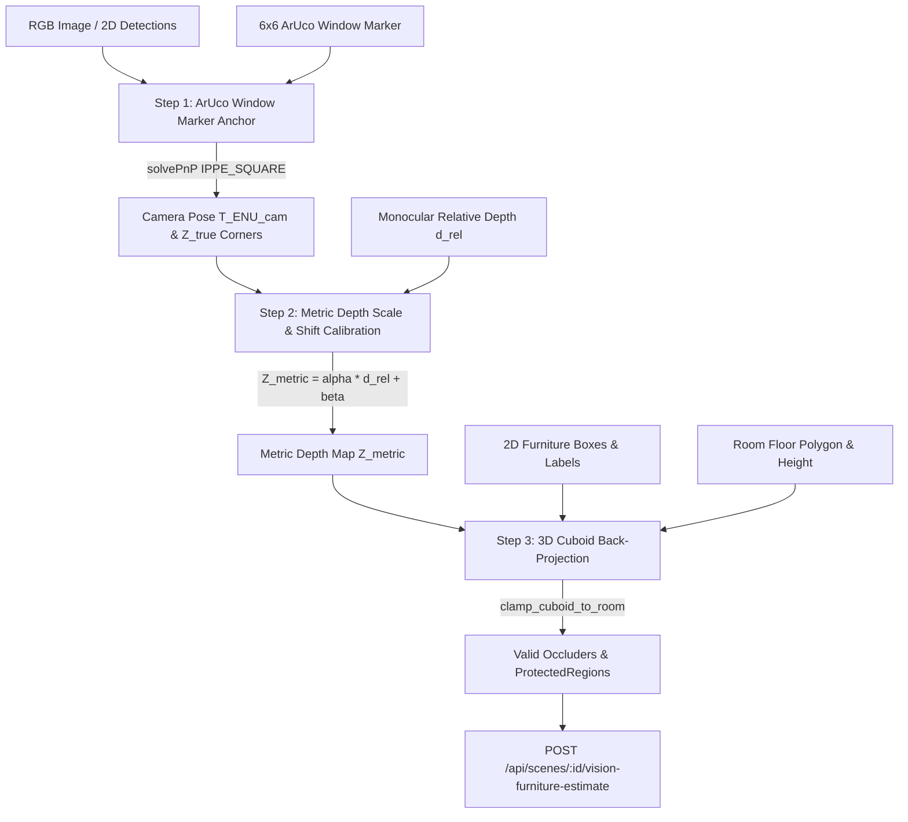

# FR-03 & FR-06 Vision AI 3D Furniture Estimation & Scene Registration

This document provides the mathematical derivations, architectural design, API specifications, and experiment guidelines for **FR-03 (Vision AI Automatic Furniture Classification)** and **FR-06 (3D Bounding Box Estimation & Scene Registration)** in SunSync.

---

## 1. Architectural Overview

Monocular RGB images inherently suffer from depth scale ambiguity: an object in a 2D bounding box can be small and close or large and far away. Standard monocular depth networks (such as *Depth Anything V2* or *MiDaS*) output relative or affine-invariant inverse depth $d_{\text{rel}}$, but lack metric scale (metres).

SunSync resolves this fundamental ambiguity by utilizing the smart film window's $6 \times 6$ ArUco marker (DICT_4X4_50, side length $s = 0.6\,\text{m}$):
1. **Metric Anchor**: The window ArUco marker has confirmed metric dimensions and confirmed ENU transform $T_{\text{ENU}, \text{marker}}$ on the window plane.
2. **Camera Pose & Metric Depth Extraction**: OpenCV's `cv2.solvePnP` with `SOLVEPNP_IPPE_SQUARE` computes the camera pose in ENU ($T_{\text{ENU}, \text{camera}}$) and exact metric depths $Z_{\text{true}}$ of the marker corners.
3. **Linear Monocular Calibration**: A least-squares linear calibration maps relative depth to metric depth:
   $$Z_{\text{metric}}(u, v) = \alpha \cdot d_{\text{rel}}(u, v) + \beta$$
4. **Floor-Standing 3D Cuboid Unprojection**: 2D bounding boxes are unprojected into 3D, constrained to the room floor ($z_{\text{base}} = 0$), refined with class-specific priors, and clamped to the room boundary polygon.
5. **Immediate Scene Readiness**: An optical `ProtectedRegion` (Grade B for bookshelves, Grade C for desks) is automatically attached to each estimated piece of furniture.



---

## 2. Mathematical Framework

### Step 1 — Window Marker Pose & Corner Depths

Let the window ArUco marker have side length $s$ ($0.6\,\text{m}$). In the marker local frame (centered at $(0, 0, 0)$ with $+x$ right, $+y$ up, $+z$ normal):
$$P_{m, 0} = \left(-\frac{s}{2}, \frac{s}{2}, 0\right)^T, \quad P_{m, 1} = \left(\frac{s}{2}, \frac{s}{2}, 0\right)^T$$
$$P_{m, 2} = \left(\frac{s}{2}, -\frac{s}{2}, 0\right)^T, \quad P_{m, 3} = \left(-\frac{s}{2}, -\frac{s}{2}, 0\right)^T$$

Given camera intrinsics matrix $K = \begin{pmatrix} f_x & 0 & c_x \\ 0 & f_y & c_y \\ 0 & 0 & 1 \end{pmatrix}$ and observed corner pixels $p_i = (u_i, v_i)$, `cv2.solvePnP` with `SOLVEPNP_IPPE_SQUARE` computes:
$$P_c = R_{c\_m} P_m + t_{c\_m}$$

The rigid transformation from marker frame to ENU frame is $T_{\text{ENU}, m} = \begin{pmatrix} R_{\text{ENU}, m} & t_{\text{ENU}, m} \\ 0 & 1 \end{pmatrix}$. The camera pose in ENU coordinates is then derived as:
$$R_{\text{ENU}, c} = R_{\text{ENU}, m} R_{c\_m}^T$$
$$t_{\text{ENU}, c} = t_{\text{ENU}, m} - R_{\text{ENU}, c} t_{c\_m}$$
$$T_{\text{ENU}, c} = \begin{pmatrix} R_{\text{ENU}, c} & t_{\text{ENU}, c} \\ 0 & 1 \end{pmatrix}$$

The true metric depths of the 4 marker corners in the camera optical frame ($Z_c$) are:
$$Z_{\text{true}, i} = \left[R_{c\_m} P_{m, i} + t_{c\_m}\right]_z \quad (i = 0, 1, 2, 3)$$

### Step 2 — Linear Depth Calibration

Given relative depth values $d_{\text{rel}, i}$ at anchor points and their true metric depths $Z_{\text{true}, i}$, we formulate the least-squares linear regression:
$$\min_{\alpha, \beta} \sum_{i=1}^N \left(\alpha \cdot d_{\text{rel}, i} + \beta - Z_{\text{true}, i}\right)^2$$

When $N \ge 2$ and relative depth values have non-zero variance:
$$\begin{pmatrix} \alpha \\ \beta \end{pmatrix} = \left(A^T A\right)^{-1} A^T Z_{\text{true}}, \quad A = \begin{pmatrix} d_{\text{rel}, 1} & 1 \\ \vdots & \vdots \\ d_{\text{rel}, N} & 1 \end{pmatrix}$$

For degenerate depth ranges or single-point anchors, scale-only calibration is used ($\beta = 0$, $\alpha = \bar{Z}_{\text{true}} / \bar{d}_{\text{rel}}$).
All calibrated depths are clamped to physical boundaries:
$$Z_{\text{metric}} = \text{clip}\left(\alpha \cdot d_{\text{rel}} + \beta, 0.3\,\text{m}, 25.0\,\text{m}\right)$$

### Step 3 — 3D Cuboid Back-Projection & Floor Refinement

For each 2D bounding box $(x_1, y_1, x_2, y_2)$ with center $(u_c, v_c)$ and calibrated metric distance $Z_{\text{obj}}$:
1. **Ray Unprojection**:
   $$P_{\text{left}, c} = \left(\frac{x_1 - c_x}{f_x} Z_{\text{obj}}, \frac{v_c - c_y}{f_y} Z_{\text{obj}}, Z_{\text{obj}}\right)^T$$
   $$P_{\text{right}, c} = \left(\frac{x_2 - c_x}{f_x} Z_{\text{obj}}, \frac{v_c - c_y}{f_y} Z_{\text{obj}}, Z_{\text{obj}}\right)^T$$
   $$P_{\text{top}, c} = \left(\frac{u_c - c_x}{f_x} Z_{\text{obj}}, \frac{y_1 - c_y}{f_y} Z_{\text{obj}}, Z_{\text{obj}}\right)^T$$
   $$P_{\text{bot}, c} = \left(\frac{u_c - c_x}{f_x} Z_{\text{obj}}, \frac{y_2 - c_y}{f_y} Z_{\text{obj}}, Z_{\text{obj}}\right)^T$$
2. **ENU Transformation**: $P_{\text{ENU}} = R_{\text{ENU}, c} P_c + t_{\text{ENU}, c}$.
3. **Floor-Standing Constraint**: $z_{\text{base}} = 0.0$ for `bookshelf`, `desk`, and `chair`.
4. **Dimensions & Yaw**:
   - Width $w = \|P_{\text{right}, \text{ENU}}[0:2] - P_{\text{left}, \text{ENU}}[0:2]\|_2$.
   - Lateral yaw $\theta = \text{atan2}(\Delta y, \Delta x) \pmod{360}$.
   - Depth thickness $d$ is derived from class priors ($0.40\,\text{m}$ for bookshelf, $0.70\,\text{m}$ for desk, $0.55\,\text{m}$ for chair) or depth span.
   - The cuboid center is positioned at $P_{\text{front}} + \frac{d}{2} \hat{v}_{\text{inward}}$, where $\hat{v}_{\text{inward}}$ points away from the camera.
5. **Room Polygon Clamping**: `clamp_cuboid_to_room` guarantees the cuboid footprint is strictly inside `room.floor_vertices_m` and height $\le \text{room.height\_m}$.

### Step 4 — Default ProtectedRegion Generation

- **Bookshelf**: Generates vertical front surface facing into the room with **Grade B** (protects books against direct solar UV degradation).
- **Desk / Table**: Generates horizontal top tabletop surface ($z = h$) with **Grade C** (maintains glare-free reading/work lighting).

---

## 3. REST API Specification

### Endpoint: `POST /api/scenes/{scene_id}/vision-furniture-estimate`

#### Request Payload (`VisionFurnitureEstimateRequest`)
```json
{
  "camera": {
    "width": 1280,
    "height": 720,
    "fx": 900.0,
    "fy": 900.0,
    "cx": 640.0,
    "cy": 360.0
  },
  "marker_anchor": {
    "code_id": 0,
    "side_length_m": 0.6,
    "corners_px": [
      [572.5, 292.5],
      [707.5, 292.5],
      [707.5, 427.5],
      [572.5, 427.5]
    ],
    "anchor_depth_rel": 4.0
  },
  "detections": [
    {
      "box_xyxy": [450.0, 320.0, 720.0, 580.0],
      "label": "desk",
      "confidence": 0.95,
      "observed_depth_rel": 2.5,
      "name": "Oak Study Desk",
      "protection_grade": "C"
    }
  ],
  "apply_to_scene": true,
  "auto_create_protected_regions": true
}
```

#### Response Payload (`VisionFurnitureEstimateResponse`)
```json
{
  "scene_id": "reading_room_01",
  "scene_revision": 2,
  "applied_to_scene": true,
  "camera_position_enu_m": [3.0, 0.8, 1.4],
  "depth_calibration_alpha": 1.0,
  "depth_calibration_beta": 0.0,
  "estimated_items": [
    {
      "occluder": {
        "occluder_id": "occluder_desk_1",
        "room_id": "room_reading",
        "name": "Oak Study Desk",
        "kind": "cuboid",
        "type": "desk",
        "base_center_m": [3.0, 3.0, 0.0],
        "dimensions_m": [1.4, 0.7, 0.75],
        "yaw_deg_ccw_from_east": 0.0,
        "material": "opaque",
        "quality": {
          "observation_ids": ["obs_vision_a1b2c3d4"],
          "confirmed": false
        }
      },
      "protected_region": {
        "region_id": "region_occluder_desk_1",
        "room_id": "room_reading",
        "name": "Oak Study Desk Surface",
        "host_occluder_id": "occluder_desk_1",
        "vertices_m": [
          [2.3, 2.65, 0.75],
          [3.7, 2.65, 0.75],
          [3.7, 3.35, 0.75],
          [2.3, 3.35, 0.75]
        ],
        "receiving_normal": [0.0, 0.0, 1.0],
        "grade": "C",
        "policy_id": "policy_reading_room",
        "quality": {
          "observation_ids": ["obs_vision_a1b2c3d4"],
          "confirmed": false
        }
      },
      "confidence": 0.95,
      "calibrated_distance_m": 2.5,
      "clamped_to_room": false
    }
  ]
}
```

---

## 4. Experiment Guidelines for Teammates

### Running the Synthetic Benchmark
Execute the automated 3D benchmark tool:
```bash
.venv/bin/python tools/ai_experiments/run_fr03_vision_3d_experiment.py --noise-pct 2.0 --json-out /tmp/fr03_benchmark.json
```
Output:
- Exact camera pose recovery error (typically $0.0\,\text{cm}$)
- Metric depth calibration equation ($Z_{\text{metric}} = \alpha \cdot d_{\text{rel}} + \beta$)
- Per-object 3D center error, dimension error, and yaw orientation error.

### Running with Real-World Photographs
1. **Camera Calibration**: Note your camera's resolution and intrinsics ($f_x, f_y, c_x, c_y$).
2. **Affix Window Marker**: Print and affix a standard `6×6` ArUco `DICT_4X4_50` marker ($s = 0.6\,\text{m}$) on the target window.
3. **Capture Image**: Take an indoor photo where both the window marker and indoor furniture are visible.
4. **Detect Furniture with YOLOv8**:
   ```python
   from engine.vision_ai.protocols import YoloV8DetectorAdapter
   detector = YoloV8DetectorAdapter("yolov8m.pt")
   detections = detector.detect(image_rgb)
   ```
5. **Estimate Relative Depth with Depth Anything V2**:
   ```python
   from engine.vision_ai.protocols import MonocularDepthAdapter
   depth_adapter = MonocularDepthAdapter()
   depth_map = depth_adapter.estimate_relative_depth(image_rgb, width=1280, height=720)
   ```
6. **Execute Pipeline**: Pass the detected boxes and ArUco marker pixel corners to `VisionRegistrationPipeline.run()` or send a request to `POST /api/scenes/{scene_id}/vision-furniture-estimate`.
