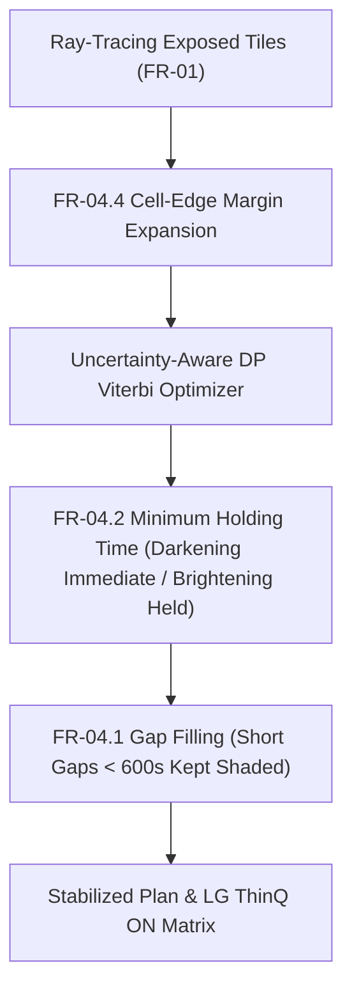

# FR-04 Uncertainty-Aware Adaptive Smart Film Control & LG SGF / ThinQ ON Integration Guide

**Author**: Track 3 Subagent (Adaptive Control & LG SGF / ThinQ ON Bridge Developer)  
**Target Teammate**: `0nsetofspring` (FR-02 & FR-04 Selective Shading & Stabilization Specialist)  
**Branch**: `feature/ai-core-modules`  
**Status**: Prototype. Checked only on synthetic irradiance (section 7); not connected to the web app or to FR-05.  

---

## 1. Overview and Core Objectives

SunSync's rule-based selective shading (FR-02) operates deterministically on forecasted DNI. However, real-world sky conditions exhibit high cloud intermittency, where brief cumulus passages cause smart film cells to oscillate rapidly between transparent and opaque. This creates severe visual flicker and premature wear on switching electronics.

**FR-04 Adaptive Control** introduces an AI-enhanced, uncertainty-aware multi-objective controller that:
1. **Suppresses Flicker**: Formulates horizon control as a **Dynamic Programming (Viterbi)** optimization balancing damage risk, daylight quality, and switching costs.
2. **Quantile Risk-Aversion**: Ingests DNI prediction quantiles $(P_{10}, P_{50}, P_{90})$ to hedge against cloud edge spikes.
3. **Enforces Strict Safety Rules**: Guaranteed compliance with standard `FR-04.1` (Gap Filling), `FR-04.2` (Holding Time), `FR-04.3` (Dynamic Hysteresis), and `FR-04.4` (Cell-Edge Margin).
4. **LG SGF Continuous Dimming**: Replaces binary $0/1$ PDLC switching with multi-level continuous dimming ($0.0, 0.25, 0.5, 0.75, 1.0$), maximizing interior natural lighting while respecting strict protection caps ($I_{\max}$).
5. **LG ThinQ ON Bridge**: Synchronizes real-time cell opacity and transmittance matrices to LG Electronics' ThinQ ON smart home hub.

---

## 2. Mathematical Formulation: Multi-Objective Horizon Optimization

For each window cell $(r, c)$, the controller computes the optimal opacity trajectory $u_{1..T} \in [0, 1]^T$ minimizing the cumulative horizon loss $\mathcal{L}$:

$$\mathcal{L}(u_{1..T}) = \sum_{t=1}^T \Big( w_{\text{damage}} \cdot \text{Risk}_t(u_t) + w_{\text{daylight}} \cdot u_t^2 + w_{\text{flicker}} \cdot |u_t - u_{t-1}| \Big)$$

### 2.1 Component Definitions

1. **Damage Risk Penalty ($\text{Risk}_t(u_t)$)**:
   - **Grade A (Artifacts & Sensitive Exhibits)**: Hard constraint ($I_{\max} = 0 \text{ W/m}^2$). If direct sunlight reaches the cell:
     $$\text{Risk}_t(u_t) = \begin{cases} 0.0 & \text{if } u_t \ge 0.99 \\ 10^9 & \text{if } u_t < 0.99 \text{ (strictly forbidden)} \end{cases}$$
   - **Grades B and C (Reading Desks & Office Zones)**:
     Evaluates risk-averse effective irradiance using quantile DNI predictions:
     $$I_{\text{eff}, t} = I_{q50, t} + \kappa_{\text{grade}} \cdot \max(0, I_{q90, t} - I_{q50, t})$$
     where $\kappa_B = 1.2 > \kappa_C = 0.8$.
     The transmitted irradiance at opacity $u_t$ is:
     $$I_{\text{trans}, t}(u_t) = I_{\text{eff}, t} \cdot \tau_{\text{glazing}} \cdot \tau(u_t)$$
     If $I_{\text{trans}, t}(u_t) > I_{\max}$, the quadratic excess penalty applies:
     $$\text{Risk}_t(u_t) = 100 \cdot (I_{\text{trans}, t}(u_t) - I_{\max})^2$$
   - **Grade D & Unexposed Cells**: $\text{Risk}_t(u_t) = 0.0$.

2. **Daylight Quality Term ($w_{\text{daylight}} \cdot u_t^2$)**:
   Penalizes unnecessary darkening. Because daylight illuminance benefits room occupants and reduces artificial lighting energy, lower opacity is favored unless protection requires shading.

3. **Flicker Reduction Term ($w_{\text{flicker}} \cdot |u_t - u_{t-1}|$)**:
   Penalizes state changes between consecutive time steps. Under cloud fluctuations, this term penalizes toggling, keeping the film stable.

---

## 3. FR-04 Stabilization Rules (`FR-04.1` ~ `FR-04.4`)

In addition to Viterbi DP, deterministic post-stabilization rules guarantee physical safety and regulatory compliance:



### 3.1 FR-04.1 Gap Filling
- **Rule**: If a cell is shaded ($u > 0$), drops to transparent ($u = 0$) for a brief gap $\Delta t < \text{min\_gap\_seconds}$ (default $600\text{s} = 10\text{ min}$), and is shaded again, the gap is filled:
  $$u_t = \min(u_{\text{left}}, u_{\text{right}})$$
- **Effect**: Eliminates brief flickers when clouds temporarily drift across the sun.

### 3.2 FR-04.2 Minimum Holding Time
- **Rule**: When a cell darkens ($u_t > u_{t-1}$), it must maintain at least that opacity for $\text{brightening\_hold\_seconds}$ (default $600\text{s}$) before it is permitted to brighten.
- **Critical Exception**: Immediate darkening to strengthen protection against rising solar irradiance is **always allowed without delay**.

### 3.3 FR-04.3 Dynamic Hysteresis Threshold
- **Rule**: When considering brightening ($u_t < u_{t-1}$), the effective threshold incorporates a dynamic margin scaled by cloud uncertainty:
  $$\text{margin}_{\text{hysteresis}} = \text{brightening\_margin\_W\_m2} \cdot \left(1.0 + \frac{I_{q90} - I_{q10}}{I_{q50} + 1.0}\right)$$
- Brightening is discouraged unless transmitted irradiance falls safely below $I_{\max} - \text{margin}_{\text{hysteresis}}$.

### 3.4 FR-04.4 Cell-Edge Margin
- **Rule**: When enabled (`enable_edge_margin=True`), any direct-sun ray hitting within the boundary zone of a cell expands protection needs to adjacent orthogonal neighboring cells.
- **Effect**: Prevents direct sun leakage caused by penumbra diffraction, slight frame alignment drift, or seasonal sun elevation shift.

---

## 4. LG SGF Continuous Dimming vs. Binary PDLC

Traditional PDLC (Polymer Dispersed Liquid Crystal) films only support discrete binary states:
$$u \in \{0.0, 1.0\} \implies \tau \in \{\tau_{\max}, \tau_{\min}\}$$

**LG SGF (Smart Glass Film) / SPD (Suspended Particle Device)** allows continuous or multi-level dimming:
$$u \in [0.0, 1.0], \quad \tau(u) = \tau_{\max} - u \cdot (\tau_{\max} - \tau_{\min})$$

### Comparison in Practice

| Feature | Binary PDLC (FR-02) | Multi-level SGF (FR-04) |
|---|---|---|
| **States** | `{0.0, 1.0}` (`transparent`, `opaque`) | Continuous `[0.0, 1.0]` or 5 levels `{0, 0.25, 0.5, 0.75, 1.0}` |
| **When the cap is exceeded a little** | Must go fully opaque | Can dim just enough |
| **Switch count** | Low | Higher: every step between levels counts as a switch |
| **Size of each change** | Always 0 to 1 | Smaller steps |

Worked example from the formulas above (glazing 0.85, film 0.72 clear and 0.03 opaque, cap 50 W/m2, no risk margin). The FR-02 rule compares the incident irradiance with the cap; the FR-04 optimizer compares the transmitted irradiance. These are formula results, not experiment results.

| Incident | Mode | Opacity | Film transmittance | Transmitted |
|---|---|---|---|---|
| 200 W/m2 | FR-02 rule | 1.00 | 0.030 | 5.1 W/m2 |
| 200 W/m2 | FR-04 PDLC | 1.00 | 0.030 | 5.1 W/m2 |
| 200 W/m2 | FR-04 5-level SGF | 0.75 (the level above the 0.62 needed) | 0.203 | 34.4 W/m2 |
| 200 W/m2 | FR-04 continuous | 0.62 | 0.294 | 50.0 W/m2 |
| 80 W/m2 | FR-02 rule | 1.00 (80 is above 50) | 0.030 | 2.0 W/m2 |
| 80 W/m2 | FR-04 (any mode) | 0.00 (a clear film already gives 49.0, below 50) | 0.720 | 49.0 W/m2 |

The second case is where FR-04 can return daylight, with or without SGF. In the experiments the hedge against q90 (`kappa_B`) and the 10-minute hold take most of it back.

How much daylight this gives back on a real day is in section 7. An earlier version of this section quoted "+25% to +45% natural daylight"; that figure had no source (section 9).

---

## 5. LG ThinQ ON Protocol Contract (`LG_THINQ_ON_SGF_V1`)

SunSync bridges directly to LG ThinQ ON smart home hubs via `POST /api/scenes/{scene_id}/thinq-hub-sync`.

### 5.1 Device Payload Structure
```json
{
  "hub_device_id": "thinq_on_hub_01",
  "protocol_version": "LG_THINQ_ON_SGF_V1",
  "scene_id": "scene_library_01",
  "window_id": "window_south",
  "timestamp": "2026-10-14T05:00:00Z",
  "hardware_mode": "LG_SGF",
  "cell_opacity_matrix": [
    [0.0, 0.0, 0.0, 0.0],
    [0.0, 1.0, 0.5, 0.0],
    [0.0, 0.5, 0.5, 0.0],
    [0.0, 0.0, 0.0, 0.0]
  ],
  "cell_transmittance_matrix": [
    [0.612, 0.612, 0.612, 0.612],
    [0.612, 0.026, 0.319, 0.612],
    [0.612, 0.319, 0.319, 0.612],
    [0.612, 0.612, 0.612, 0.612]
  ],
  "active_shaded_cells": 3,
  "dimmed_cells": 2,
  "energy_daylight_score": 0.8142,
  "decision_summary_ko": "LG ThinQ ON SGF 제어: 조도 불확실성(P90)을 반영하여 3개 셀 차광(디밍 2개)을 최적화했습니다. 플리커를 75.0% 저감하고 자연채광률을 32.4% 향상했습니다."
}
```

The numbers in this payload (for example "75.0%" and "32.4%" in `decision_summary_ko`) are an illustrative example, not measured results. `LG_THINQ_ON_SGF_V1` is a contract defined inside SunSync; no LG-published ThinQ ON interface was checked.

---

## 6. Teammate Guide for `0nsetofspring`

### 6.1 Running the Experiment CLI
Run the standalone experiment simulator from repository root:
```bash
.venv/bin/python tools/ai_experiments/run_fr04_adaptive_control_experiment.py
```
This script generates:
- Terminal formatted benchmark tables
- `docs/reports/fr04_adaptive_control_experiment_benchmark.md`
- `docs/reports/fr04_adaptive_control_experiment_results.json`

### 6.2 Experiment results

See section 7. The full tables are in `docs/reports/fr04_adaptive_control_experiment_benchmark.md`, written by the CLI on every run.

### 6.3 Interfacing in Backend Code
- **Engine Package**:
  ```python
  from engine.fr04 import (
      AdaptivePolicyTuner,
      AdaptiveWeights,
      OpticalProfileData,
      optimize_cell_dp,
      apply_fr04_stabilization,
      compare_baseline_vs_adaptive,
  )
  ```
- **REST Endpoints**:
  - `POST /api/scenes/{scene_id}/adaptive-shading-plan`: Returns both `baseline_plan` and `stabilized_plan`, along with continuous `dimming_trajectories` and `metrics`.
  - `POST /api/scenes/{scene_id}/thinq-hub-sync`: Evaluates current dimming state, persists it to virtual film, and returns the LG ThinQ ON device payload.

---

## 7. Experiment results (run of 2026-11-10)

Source: `tools/ai_experiments/run_fr04_adaptive_control_experiment.py`. Four synthetic days (Sunny, Partly Cloudy Rapid-Flicker, High Uncertainty Squall, Overcast Low Irradiance), one 4x4 window (1 Grade A cell, 3 Grade B cells with a 50 W/m2 cap, 12 Grade D cells), 5-minute steps. Positive means better than the rule baseline. Nothing is clipped at zero.

| Mode | Flicker change (total opacity change) | Switch count change | Daylight gain, all 16 cells | Daylight gain, Grade B cells |
|---|---|---|---|---|
| FR-04 Adaptive PDLC | +62.5% to +85.0% | +62.5% to +85.0% | -7.3% to +0.0% | -9.4% to +0.0% |
| FR-04 Adaptive SGF (5 levels) | +43.8% to +85.0% | -125.0% to +40.0% | -4.8% to +4.8% | -5.9% to +6.5% |

| Mode | Cell-steps above the cap if q90 is true (all four scenarios) |
|---|---|
| FR-02 rule baseline | 0, 9, 18, 0 |
| FR-04 Adaptive PDLC | 0, 0, 0, 0 |
| FR-04 Adaptive SGF | 0, 0, 0, 0 |

How to read it:

1. **Flicker.** Both adaptive modes cut the total opacity change by 44% to 85%. The effect comes mostly from the stabilization rules (FR-04.1 to FR-04.4): raising `w_flicker` from 5 to 60 changes nothing in the sweep.
2. **Switch count is the wrong measure for SGF.** SGF changes by small steps, so it can switch more often (18 against 8 on the Sunny day) while its total change is lower (4.5 against 8.0).
3. **Protection is where FR-04 differs from the rule.** The baseline decides on the median forecast (q50). If the sunny end of the band (q90) is true, it leaves 9 and 18 cell-steps above the cap in the two cloudy scenarios. The adaptive modes use q90 and have none. This costs daylight.
4. **Daylight.** Adaptive PDLC is darker than the baseline on Grade B cells (-1.8%, -5.5% and -9.4% in the first three scenarios, 0.0% in Overcast), because it hedges against q90 and holds darkness for 10 minutes. SGF is close to even (-5.9% to +6.5%). The gain on all 16 cells is small by construction: 12 cells are never shaded and the Grade A cell is always opaque in sun.
5. **Where SGF helps.** Only when the irradiance is low enough that partial dimming meets the cap: +6.5% on Grade B cells in the Overcast scenario (100 to 300 W/m2), and +4.2% on the Sunny day. With a 50 W/m2 cap and a midday sun of 700 to 850 W/m2, the film has to be nearly fully opaque.
6. **Older numbers.** The earlier report printed flicker reduction and daylight gain clipped at 0.0%, so a worse-than-baseline result looked like "no gain". The engine function `compare_baseline_vs_adaptive` still clips, and so does the `metrics` block of the adaptive-shading-plan API.

### 7.1 Recommended weights

Sweep of `w_flicker` (0, 5, 20, 60) and `kappa_B` (0.8, 1.0, 1.2, 1.6), averaged over the four scenarios (table in the benchmark report).

| Finding | Evidence |
|---|---|
| `w_flicker` above 5 adds nothing | PDLC +77.5% at 5, 20 and 60; SGF +77.5% at 20 and 60 |
| `kappa_B` is the protection lever for SGF | SGF with `kappa_B` 0.8 leaves 6 cell-steps above the cap at q90; 1.0 and above leave none |
| `kappa_B` barely changes flicker | Nearly the same flicker for 0.8 to 1.6 |
| Cost of a higher `kappa_B` | About 0.3 to 0.4 points of Grade B daylight per 0.2 step in SGF (2.9% at 0.8, 1.5% at 1.6, with `w_flicker` 0) |

Recommended starting point, by the rule "no cap exceeded at q50 or q90 in any scenario, then the largest flicker change, then the largest Grade B daylight gain":

| Mode | w_flicker | kappa_B | Flicker change | Grade B daylight |
|---|---|---|---|---|
| PDLC | 5 | 0.8 to 1.6 (no difference in protection) | +77.5% | -4.2% |
| SGF | 20 | 1.0 | +77.5% | -0.3% |

The rule is ours and open to review. `w_damage` (1000) and `w_daylight` (1.0) were not varied. `AdaptivePolicyTuner` picks its own weights with a score based on the clipped switch count and a baseline-relative violation check; its choice is a default, not a finding.

---

## 8. Film material research (LG SGF, PDLC, SPD)

What could be confirmed and what could not. Search results were read as summaries unless marked "page read".

| Question | Finding | Source |
|---|---|---|
| What is LG Chem SGF? | A switchable glazing film for vehicles (sunroofs, glass roofs, side windows). Transmittance is adjusted "freely" with voltage. Two grades: PDLC ("Haze Black", scattering-type shading) and NCLC ("Clear Black", "uniform dimming control"). Page read. | [LG Chem SGF](https://www.lgchem.com/product-detail/sgf?lang=en_US) |
| Numeric specs of SGF (visible transmittance range, haze, response time, voltage, power, size) | Not on the page. Datasheets only by inquiry. Not found elsewhere. | same page |
| Is SGF continuous or on/off? | Not stated. "Dimming control" is listed; NCLC is described as uniform dimming. | same page |
| What does an opaque PDLC do to light? | It scatters light instead of absorbing it; one study says PDLC windows modulate scattering, not transmission. | [ISES paper](https://proceedings.ises.org/scholar/paper/100062) |
| Visible light through opaque PDLC | One government technical note says 2% to 65% depending on dye. Vendor SHGC values for the off state are 0.40 and 0.32 (on: 0.49 and 0.38) for two products. | [Alberta technical note](https://www.alberta.ca/system/files/tec-dtseries21pdlcglass.pdf), [BenQ Materials](https://www.benqmaterials.com/product-detail/60/) |
| SPD transmission range, switching time, power | A search summary reports a typical range of 20% to 60%, switching from hundreds of milliseconds to about a second, and about 5 W/m2 in one model. The source page was not identified and no manufacturer datasheet was found, so these are not usable as values. | none |

Consequences for this project:

- **No verified SGF preset can be written.** The film values in the experiment (0.03 opaque, 0.72 clear, glazing 0.85) and the engine defaults (0.05, 0.70) are assumptions and are labeled as such. Ask LG Chem for a datasheet, or measure a sample, before using them in a claim.
- **PDLC does not block energy the way the model assumes.** The model lowers "direct irradiance" by the film transmittance. A scattering film turns the direct beam into diffuse light, so the energy that reaches a protected object may be much higher than the model says.
- **SGF is an automotive product.** Window-sized architectural use was not confirmed.

---

## 9. Review of the assumptions behind this document

| # | Assumption | Problem | What to do |
|---|---|---|---|
| 1 | "+25% to +45% daylight" and "50% to 80% flicker removed" were targets | Hypothetical targets from the first draft, with no source (confirmed by the author). The experiment did not support the daylight figure | Replaced by computed results (section 7) |
| 2 | The forecast is also the truth | The simulation has no separate real irradiance. Protection can only be checked at q50 and q90 | A fair test needs real days: forecast and measured DNI side by side |
| 3 | The "FR-02 baseline" is FR-02 | In the CLI it is a three-line rule. The API compares with the real FR-02 plan | Run the comparison on real scenes through the API |
| 4 | FR-04 is a smoothing step after FR-02 | The requirement (`docs/features.md`) says FR-04 smooths FR-02's plan. The DP controller decides from irradiance itself | Decide whether FR-04 post-processes or replaces FR-02 |
| 5 | Cap of 50 W/m2 for Grade B | The scene policy uses 0, 30 and 70 W/m2 (`ui_scene.py`) | Rerun with 30 and 70. A lower cap makes dimming even rarer |
| 6 | The film lowers direct irradiance by its transmittance | See section 8: scattering | Use total solar transmittance of a real film |
| 7 | Opacity measures daylight | It ignores diffuse light and the sun's strength | Use transmitted illuminance if daylight is a claim |
| 8 | Quantile band widths (0.6 and 1.4 of q50, and so on) | Made up; the real band comes from the FR-01.4 model | Use the real model's band on recorded days |
| 9 | Time step | FR-01 uses 300 s steps and FR-04.2 holds for 600 s; the nowcast refreshes every 10 minutes. Clouds shorter than that are invisible to the controller | State it when presenting |
| 10 | FR-04 improves the app | FR-04 is only an API. The web app and FR-05 do not call it | Wire it in, or present it as a simulation result |
| 11 | Metrics are honest | The engine metric and the tuner clip negative values, and count a violation only relative to the baseline | Fix in a separate change; the existing test asserts `>= 0` |
| 12 | Cells are independent | Neighbouring cells are controlled one at a time except for the edge margin (off by default) | Not tested |

Not checked at all: real hardware behaviour, flicker as people experience it, energy use and cost.
