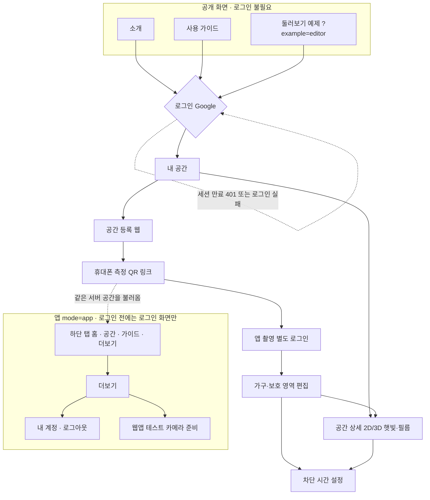

# SunSync UI 구현 (웹 / 모바일 PWA)

웹과 앱의 화면 흐름과 화면 목록을 한눈에 보는 문서다. 아래 흐름도와 화면표가 기준이고, 뒤쪽은 구현 상세다.

## 화면 흐름 한눈에 보기



- 실선은 화면 이동, 점선은 조건부 연결이다. 앱 탭에는 "측정"이 없다. 측정은 내 공간 › 공간 등록(또는 공간 선택) 이후 촬영 화면에서 시작한다.
- 웹 개인 화면(내 공간, 공간 상세, 편집·등록, 계정, 촬영)은 로그인이 필요하다. 앱은 로그인하기 전에는 로그인 화면만 보인다.
- 웹앱 테스트는 개발 빌드에서 `?tools=camera`를 붙였을 때만 더보기에 나타난다.

## 화면 목록

페이지 키는 `frontend/src/navigation.ts`의 `pages`다. 로그인 필요 표시는 웹 기준이며, 앱은 모든 화면이 로그인 후에만 열린다. API는 모두 백엔드(`/api`) 경로이고 `/measure`는 측정 서버(8001, Caddy가 `/measure/*`로 전달)다.

| 화면 | 웹/앱 | 페이지 키 | 하는 일 | FR·이슈 | API |
| --- | --- | --- | --- | --- | --- |
| 소개 | 웹 (공개) | `home` | 서비스 소개, 로그인·회원가입 진입, 핵심 가이드 4개. `?example=editor`는 서버를 읽거나 쓰지 않는 예제 공간 둘러보기 | UI-2 (#48) | `GET /api/auth/session` |
| 홈 | 웹 (로그인 필요) · 앱 | `home` | 웹: 내 공간 요약과 새 공간 시작. 앱: 오늘 차단 시각 카드와 보호 설정 현황 띠(모두 / 일부 / 없음) | FR-06 | `GET /api/ui/spaces` |
| 내 공간 | 웹 (로그인 필요) · 앱 | `spaces` | 건물별 공간 목록, 측정 대기 작업 확인(3초 갱신), 임시 저장 이어하기, 공간 삭제 | FR-06.5, FR-06.1 | `GET /api/ui/spaces`, `DELETE /api/ui/spaces/{id}`, `GET /api/ui/measurements` |
| 새 공간 등록 | 웹 (로그인 필요) · 앱 | `register` | 건물·층·공간·구역, 방 크기, 창문 규격·위치, 위치(위도·경도·시간대) 입력. 필름 QR 마커 위치 미리보기 | FR-06.1, FR-06.2 | `POST /api/ui/spaces`, `PUT /api/ui/spaces/{id}` |
| QR 측정 | 웹 (로그인 필요) | `capture` | 휴대폰 측정 안내와 앱 연결 링크·QR 만들기. 웹에는 카메라 입력이 없다 | FR-03, FR-06.5 | `POST /api/ui/measurements`, `GET /api/ui/measurements/{token}` |
| QR 측정 | 앱 | `capture` | 필름에 마커 표시(창 입력에서 고른 필름) → 가구 이름·상판 형태 선택 → 지점마다 촬영 버튼 한 번(사진을 자동으로 여러 장 확보·선별) → 품질 확인과 재촬영 안내 | FR-03, FR-05.2 | `POST /api/ui/measurements/{token}/connect`, `POST /api/scenes/{id}/capture-marker`, `GET /api/scenes/{id}/capture-marker/{session_id}`, `POST /api/scenes/{id}/capture-marker/{session_id}/end`, `POST /measure/v1/detect`, `POST /measure/v1/mobile/automatic-setup` |
| 공간 구성 | 웹·앱 | `processing` | 촬영 사진으로 가구 치수를 계산하고 공간에 등록. 완료되면 도면 확인으로 이동 | FR-03, FR-06.3 | `POST /measure/v1/measurements`, `POST /measure/v1/fr06`, `GET`·`PUT /api/scenes/{id}`, `POST /api/scenes/{id}/registrations`, `POST /api/ui/measurements/{token}/complete` |
| 도면 확인 | 웹 (로그인 필요) · 앱 | `review` | 가구별 종류·치수·위치 수정, 2D 도면에서 끌어 옮기기, 가구 추가·삭제, 다시 측정 | FR-06.1, FR-06.3 | `PUT /api/ui/spaces/{id}` |
| 도면과 보호 영역 | 웹 (로그인 필요) | `protect` | 가구 면 또는 독립 영역으로 보호 영역 설정, 높이, A~D 등급, 차단 시간. 앱은 조회만 한다 | FR-06.6, FR-02 | `PUT /api/ui/spaces/{id}`, `POST /api/scenes/{id}/sunpath-predictions`, `POST /api/scenes/{id}/shading-plans` |
| 공간 현황 | 웹 (로그인 필요) · 앱 | `detail` | 구역 선택, 시간 슬라이더, 햇빛 영역, 필름 칸 격자, 차단 시간 설정, 가상 필름 제어·적용 로그 조회, KMA·Open-Meteo 일사량 예측 상세 비교(차트 아래에 값의 출처: 기상청 관측 기반 AI·일반 날씨 예보·대체·시험 운영 안내), AI 제어 효과 배지(깜빡임, 자연 채광). 웹은 2D/3D 전환(앱은 2D) | FR-01, FR-02, FR-05, #60, #61, #62, #85, #102, #115, #116 | `GET /api/ui/spaces/{id}`, `POST /api/scenes/{id}/sunpath-predictions`, `POST /api/scenes/{id}/shading-plans`, `GET /api/scenes/{id}/nowcast-comparison`, `GET /api/scenes/{id}/ai-nowcast/latest`, `POST /api/scenes/{id}/film-schedule-apply`, `GET /api/scenes/{id}/film-state`, `GET /api/scenes/{id}/film-logs`, `POST /api/scenes/{id}/adaptive-shading-plan` |
| 사용 가이드 | 웹 (공개) · 앱 | `guide` | 목록 → 단계별 설명(6단계). 가이드에서 측정·편집을 실행하지 않는다 | UI-2 (#48) | 없음 |
| 더보기 | 앱 | `more` | 계정 카드와 등급 기준 목록(정사각형 칩). 개발용 웹앱 테스트(카메라 준비) | FR-06 | 없음 |
| 내 계정 | 웹 (로그인 필요) · 앱 | `account` | 연결 계정 확인, 로그아웃 | #121, #105 | `GET /api/auth/session`, `POST /api/auth/logout` |
| 로그인 | 웹·앱 | (페이지 키 없음) | 소개·가이드·예제를 뺀 화면에서 로그인하지 않았으면 표시. 로그인 후 원래 주소로 돌아간다 | #121, #105 | `GET /api/auth/google/login?next=`, `GET /api/auth/session` |

- 로그인 화면은 별도 페이지 키가 아니라 `home` 위에 겹쳐 보이는 단계다.
- 공간 현황(`detail`)에서는 가상 필름 제어(`/api/scenes/{id}/film-*`)와 일사량 예측 불확실성(q10~q90)·KMA 비교 차트 상세 보기를 제공한다.
- 공간 목록의 각 공간에는 `⋯` 메뉴(`SpaceMenu`)가 있어 배치, 정보 수정, 삭제 같은 동작을 연다.

## AI 제어 효과 배지

공간 현황에서 차광 계획이 있을 때 그 옆에 "AI 제어 효과" 카드가 나온다(`AdaptiveEffect.tsx`, 웹과 앱 모두). 이슈 #89.

- 저장된 공간의 버전마다 한 번 `POST /api/scenes/{id}/adaptive-shading-plan`을 호출한다 (기본 모드, 필름 종류 선택은 없다). 계산에 몇 초 걸리며 "계산하는 중이에요"를 보여 주고, 새로고침 버튼으로 다시 계산한다. 실패하면 오류 문구를 보여 준다.
- 배지 두 개: **깜빡임**은 `metrics.total_change_reduction_pct`, **자연 채광**은 `metrics.daylight_gain_pct`. 기준(FR-02 계획)과 비교한 오늘 하루치다. 깜빡임은 줄면 "N% 줄어요", 늘면 "N% 늘어요"로, 자연 채광은 늘면 "N% 늘어요", 줄면 "N% 줄어요"로 표시하며 나빠진 값을 0으로 바꾸지 않는다. 변화가 없으면 "변화 없음", 기준 계획이 하루 종일 바뀌지 않는데 결과가 바뀌면 "기본 계획보다 늘어요"를 보여 준다.
- 규칙은 `frontend/src/adaptiveEffect.ts`와 그 시험에 있고, 값의 뜻은 [FR-04](fr04_adaptive_control_lg_sgf.md) 7절과 11절에 있다.

## 인증과 세션

- 앱 모드(`?mode=app`, 모바일 웹 기본)는 로그인 전에는 로그인 화면만 보여 준다.
- 웹에서 소개, 사용 가이드, 둘러보기 예제(`?example=editor`)는 공개다. 내 공간, 공간 상세, 편집·등록, 계정, 촬영은 로그인이 필요하다.
- 세션은 30분 동안 쓰지 않거나 로그인 후 12시간이 지나면 끝난다.
- API가 401을 돌려주면 로그인 화면으로 돌아가고, 작업 중이던 초안은 유지한다.
- QR 연결 링크는 로그인한 뒤 같은 링크로 돌아온다. 휴대폰은 컴퓨터와 따로 로그인한다.
- 로그인에 실패하면 `/?login=failed` 안내가 나온다.
- 계약: `GET /api/auth/session`, `GET /api/auth/google/login?next=`, `POST /api/auth/logout`. 자세한 내용은 [Google 로그인](auth.md)을 참고한다.

## 3D 공간 보기

- 웹 공간 현황에는 2D/3D 전환이 있다. 앱은 2D만 쓴다.
- 3D는 공간의 `site.timezone`으로 날짜와 시각을 계산하고, 선반은 창문 벽 쪽으로 열린다.

Figma 파일 `xTumraXSQt3TMGvZivZ96z`의 테마와 흐름을 React + Vite + TypeScript로 옮긴 UI다. 모바일은 하단 메뉴와 파스텔 배경, PC는 흰 배경과 상단 메뉴를 사용한다. 별도의 네이티브 앱 프로젝트는 생성하지 않았다.

최신 서버 저장 연동과 실행 방법은 [FR-06 UI 연동](ui-fr06-integration.md)을 참고한다.

## 실행

```sh
cd frontend
npm ci
npm run dev -- --host 0.0.0.0
```

노트북: `http://localhost:5173`. 같은 네트워크의 스마트폰: 개발 서버가 표시하는 Network 주소. 모바일 사진 촬영은 브라우저/운영체제에 따라 카메라 또는 사진 선택기로 열린다. 실제 카메라 API와 설치형 PWA 배포는 HTTPS 환경에서 확인해야 한다.

이 작업 환경의 시스템 Node는 ICU 라이브러리가 누락되어 실행되지 않았다. Node 24 런타임으로 설치·검증했다. Node 24+ 사용을 권장한다.

```sh
npm test
npm run lint
npm run build
npm run preview -- --host 0.0.0.0
```

배포 빌드에는 manifest와 버전별 서비스 워커가 포함된다. 서비스 워커는 현재 빌드의 캐시만 유지하고 새 빌드에서 즉시 교체되며, 열려 있는 페이지에는 "새 버전이 있어요" 안내가 뜬다. 계정 화면 하단에 실행 중인 빌드가 "버전 <commit>"으로 표시된다. 오프라인 UI는 첫 온라인 설치가 완료된 후 사용 가능하며 실제 Google 인증·서버 측정·예측 기능의 오프라인 동작을 의미하지 않는다.

## 흐름

1. 첫 실행: 앱 모드는 Google 로그인을 마칠 때까지 로그인 화면만 보인다. PC 웹 첫 실행은 로그인과 관계없이 소개 홈을 표시한다. 웹 소개·가이드·둘러보기 예제는 공개이고, 내 공간·공간 상세·등록·편집·계정·촬영은 로그인 후 접근한다. 세션은 30분 미사용 또는 12시간 후 끝나며, 401이 오면 로그인 화면으로 돌아가고 작성 중인 초안은 유지한다. 인증 상세는 [Google 로그인](auth.md)을 참고한다.
2. 홈/내 공간: 건물별 공간 목록 → 공간 선택 → 공간 현황.
3. 공간 등록: 건물·층·공간·구역 이름과 방 크기 입력. 구역 추가/전환 가능. 창문 가로·높이, 창이 있는 벽, 창문 상하좌우 여백(왼쪽·아래가 저장값, 오른쪽·위는 환산), 필름 QR 마커 크기·위치 입력(필름 칸 미리보기). 위도·경도는 기기 현재 위치로 자동 입력하고 수정 가능.
4. QR 측정(앱): 필름 중앙에 60cm ArUco 마커 하나를 표시하고(촬영 세션마다 마커 ID가 무작위) 가구 이름·상판 형태 선택 → 형태별 지점(P1~Pn)을 차례로 이동하며 지점마다 촬영 버튼을 한 번 누르면 사진을 자동으로 확보·선별한다(유효한 관측이 부족하면 같은 지점에서 재촬영, [fr03_robust_measurement.md](fr03_robust_measurement.md)). 사진마다 흔들림·밝기를 기기에서 확인하고, 문제가 있으면 원인별 재촬영 안내. 촬영한 사진은 측정 서버(8001)로 보내 가구 치수를 계산하고 가구를 배치한다. 여러 가구를 이어서 촬영한 뒤 도면 생성. 직접 입력 경로도 제공.
5. 도면 확인: 가구별 선택, 종류·가로·세로·높이 및 위치 수정, 2D 도면에서 가구 끌어 옮기기, 가구 추가/삭제. 가구 종류별 평면 기호(책장 선반선, 책상 앞선, 수납장 X, 진열장 안쪽 테두리)와 실제 창 위치 표시.
6. 보호 설정: 가구의 면 선택 또는 독립 영역 그리기. 보호 시작/끝 높이, A~D 등급 설정. 독립 영역 이동/크기 조절과 숫자 입력 지원.
7. 저장: 입력 검사 후 건물·공간 목록으로 복귀. 동일 공간 편집은 덮어쓰고 다른 공간은 보존. 바뀐 내용이 없는 편집 화면(저장 후 뒤로 가기 포함)은 저장 확인 없이 닫힌다.
8. 공간 현황: 웹은 2D/3D 전환(앱은 2D). 구역 선택, 가구/보호면 확인, 시간 슬라이더. 선택 시각에 가려질 필름 칸 격자(10cm 칸). 차단 시간 설정: 사용자가 켬/끔과 시작·종료 시간(10분 단위, 시작 < 종료)을 정해 공간과 함께 저장(`shadingSchedule`). 필름 칸은 설정한 시간 안에서 햇빛이 보호영역에 닿을 때만 가린다. 보호영역별 햇빛 닿는 시간은 간이 계산 참고값으로만 표시. 도면·보호구역 편집 화면에서도 같은 설정을 바꿀 수 있다. D 등급은 차단하지 않음.
9. 더보기: 계정 카드와 등급 기준. 내 계정 → 연결 계정 정보 → 로그아웃 확인(`POST /api/auth/logout`). 로그아웃 후 서버 공간은 그대로 있고, 이 기기의 로컬 캐시만 남는다.
10. 사용 가이드: 목록 → 단계별 설명 → 이전/다음 단계. 가이드에서 촬영·측정·편집을 실행하지 않는다. 작업 중 도움말을 닫으면 해당 작업으로 복귀한다.

Figma의 전용 문자/숫자 키패드는 제거했다. 실제 input/select, 모바일 숫자 키보드와 기본 사진 선택기를 사용한다.

## 실제 동작과 데모 경계

| 항목                                                 | 현재 상태                                               |
| ---------------------------------------------------- | ------------------------------------------------------- |
| 화면 이동, 폼, 가구 선택, 치수·보호면·높이·등급 변경 | 동작                                                    |
| 영역 그리기/이동/크기 조절, 구역 추가                | 동작                                                    |
| 저장과 재실행 시 복원                                | FR-06 서버 저장 + 브라우저 캐시                         |
| Google 로그인                                        | 서버 OAuth 세션(30분 미사용/12시간). 서버에서 켠 경우에만 검사 |
| 휴대폰 웹 촬영                                       | 사진을 측정 서버(8001)로 보내 ArUco 마커를 인식하고 가구 치수를 계산해 도면에 배치 |
| 필름 마커                                            | 1m 필름 중앙의 60cm ArUco 마커 하나(PR #109). 촬영 세션마다 마커 ID가 무작위(PR #119) |
| 모바일 웹 `?mode=app`                                | 앱 역할로 동작(팀 결정). 별도 네이티브 앱은 없음        |
| 카메라 준비                                          | 더보기 › 웹앱 테스트(웹앱 테스트 전용, 개발 빌드 `?tools=camera`) |
| 형태별 촬영 지점(P1~Pn)                              | 웹앱 테스트 단계에서만 제공                             |
| Mac 사진 업로드                                      | 제거됨(11/05). 촬영은 휴대폰 웹에서만                   |
| 예측: 햇빛 영역·닿는 시간·필름 칸                    | FR-01·FR-02 서버 계산을 연결. 날씨는 저장된 Open-Meteo·KMA AI 예측 값, 없으면 맑은 날 가정 |
| 차단 시간 설정                                       | 사용자가 정한 시간을 공간과 함께 저장                   |
| 가상 필름 제어 및 로그                               | FR-05 가상 필름 스케줄 적용(`film-schedule-apply`), 현재 칸 상태(`film-state`), 적용·목표 미달 로그(`film-logs`) 조회 연결 |
| 가구 겹침 검사 (#115)                                | 같은 구역에서 3D 부피가 겹치는 가구 저장 거절(맞닿음 허용). 이미 저장된 겹침 공간은 열람 시 안내 표시 |
| PC/휴대폰 사이 데이터 공유                           | 같은 서버의 저장 공간 조회(계정별 분리는 아직 없음)     |

측정한 가로·세로·높이는 수정 가능한 값으로 도면에 들어간다. 측정이 실패하면 원인 안내 후 재촬영하거나 직접 입력한다.

## 데이터와 협업 경계

- `src/model.ts`: 공간/구역, 가구, 보호영역 타입과 입력 검증·저장 갱신. 단위 m. 가구 연결 보호면의 범위는 가구 치수 변경을 따라간다.
- `src/Plan.tsx`: 데이터 기반 SVG 평면도와 터치/포인터 영역 편집. 숫자 입력으로도 같은 영역 수정 가능.
- `src/App.tsx`: 화면 상태·로그인 확인·폼·안내·저장 흐름.
- `public/design/`: Figma에서 내려받은 로고/아이콘/햇빛 SVG. 화면 전체 이미지를 UI 대신 사용하지 않는다.
- 저장 키: `sunsync-ui-v1`. 사진·인증 토큰은 저장하지 않는다. 손상/미지원 데이터는 초기 상태로 처리한다.
- 공간별 변경 revision을 저장하여 기존 예측의 최신 여부를 구분한다.
- 백엔드 공간 저장 API, ENU 좌표 변환, 측정 서버, Google 로그인, 예측·차단 계획 API는 연동했다. 실제 필름 제어는 미연결이다. UI 전용 타입과 공통 Scene 계약은 어댑터로 분리한다.
- 이후 연동 시 건물 위치/창 위치·방위/좌표계, 구역별 실측 좌표 정합, 측정 품질 및 실패 상태, 실제 보호면 형상과 엔진 결과 매핑을 확정해야 한다. 구역별 현재 도면은 동일 방 크기 안의 예시 배치이며 자동 정합하지 않는다.
- PR 작업은 `feature/ui-flow`에서 진행한다. 원본 `main`, 원격 GitHub, Google Docs, Figma 파일은 이 코드 작업에서 변경하지 않는다.

## 검증 기록

- `npm run build`, `npm run lint`: 통과. 서비스 워커 구문 검사와 `git diff --check` 통과.
- `npm test`: 9개 통과. 공간 경계/치수, 보호 높이, 가구 연결 보호면 갱신, 구역 참조, 저장 덮어쓰기, 로그인/공간 복원, 손상된 저장값, HTTP 모바일 미리보기의 ID 생성 검사.
- 브라우저: 로그인 → 건물/층/공간 입력 → 구역 추가 → 예시 QR 측정 → 가구 치수 변경 → 보호면/높이/B 등급 설정 → 자유영역 그리기/이동/크기 변경/D 등급 → 저장 → 새로고침 → 저장값 복원.
- 가구 02의 가로 2.2m/높이 1.6m, 동쪽 보호면 높이 0.3~1.4m가 재접속 후 유지됨을 확인.
- 가구 가로 99m 저장은 차단하고 오류로 초점 이동. 수정 후 저장 시 공간을 중복 생성하지 않음을 확인.
- 가이드의 촬영 항목은 설명만 표시하고, 작업 중 도움말 종료 후 작업 상태 복귀 확인.
- 로그아웃 확인 → 로그인 화면 → 새로고침 후 로그아웃 유지 → 재로그인 후 공간 보존 확인.
- PC 1440px/모바일 390px에서 수평 넘침 없음. Figma SVG 자산 로드와 화면 표시 확인.
- 실제 휴대폰 기기, Google OAuth, 실제 QR 치수 분석, 필름 연결 및 운영 배포는 검증 대상 아님. 설치형 PWA의 기기별 설치/오프라인 실행은 배포 HTTPS에서 추가 확인 필요.

## PC 웹 구성 개편

- LG ThinQ 공식 웹사이트 <https://www.lge.co.kr/lg-thinq>의 브랜드/계정 상단, 가로 메뉴, 넓은 소개 이미지, 가이드 콘텐츠 구성을 참고했다. LG 콘텐츠·문구·브랜드 이미지는 복사하지 않았다.
- 웹 첫 화면: SunSync 로고와 이름 / 오른쪽 로그인·회원가입 또는 내 계정 → 메뉴바 → 선택적 햇빛 보호 연출 이미지와 소개 → 4개 핵심 사용 가이드.
- `src/Website.tsx`, `src/Website.css`: 공개 소개·단계별 가이드·웹 헤더/푸터와 PC 전용 배치. 모바일은 기존 앱 화면을 유지한다.
- `src/guideContent.ts`: 앱/웹 공통 가이드 내용. 가이드에서 실제 측정·편집을 실행하지 않는다.
- PC 주요 버튼은 내용에 맞는 폭과 약 38~45px 높이, 6px 모서리로 조정했다. 등록 폼은 가로 액션, 편집은 도면+고정 폭의 스크롤 가능한 사이드 패널로 정리했다.
- A: 최우선 보호 구역 / B: 강한 햇빛 금지 구역 / C: 우선순위 낮은 구역 / D: 별도의 제약 없음. `model.ts`의 문구를 앱·웹과 웹 가이드에서 공통 사용한다. 실제 등급 정책 계산은 변경하지 않았다.
- 검증: 비로그인 웹 홈·가이드 열람, 내 공간 클릭 → 로그인 → 요청한 공간 목록 이동, A~D 설명 변경, 390px 모바일 편집 화면 유지 확인. PC 홈에서 수평 넘침 없음과 소개 이미지 로드 확인. 빌드/린트와 기존 9개 테스트 통과.
- 소개 이미지는 내장 이미지 생성 도구로 만든 연출 이미지다. 파일·최종 프롬프트는 [이미지 생성 기록](hero-asset.md) 참고.

## 브라우저 이동

- 페이지 제목 위의 ‘이전’ 버튼과 ‘내 공간 / …’ 경로 표시를 앱/웹에서 제거했다. 웹 가이드의 상단 경로도 제거했다.
- `navigation.ts`에서 화면·가이드 단계·공간별 URL을 정의한다. 화면은 `#/register`, 가이드는 `#/guide/3`처럼 브라우저 기록에 연결된다.
- 화면 전환은 history.pushState, 폼 입력은 history.replaceState를 사용한다. 뒤로/앞으로 버튼의 popstate로 화면과 편집 상태를 복원한다.
- 같은 공간의 입력값은 뒤로 이동해도 최신 값을 유지한다. 작업 중 상태는 브라우저 기록에 저장하고 실제 로그인 상태는 별도로 확인한다. 로그아웃 후 이전 기록으로 보호 화면을 복원하지 않는다.
- 도면 생성 중인 임시 화면은 완료 시 기록을 대체하므로 뒤로 이동할 때 처리 화면이 반복 실행되지 않는다.
- 검증: 공간 등록 → 입력 → QR 측정 → 브라우저 뒤로(입력 보존) → 앞으로(QR 측정) → 두 번 뒤로(홈), 가이드 목록 → 상세 → 브라우저 뒤로(목록). 빌드·린트와 모델/이동 테스트 총 14개 통과.

## 웹·앱 역할 분리

- 모바일 기본은 앱 역할: 공간 등록 → QR 중심 가로·세로 촬영 → 도면 조회 → 서버 저장·웹 연결. 보호구역 편집 폼과 드래그 편집은 제공하지 않는다.
- 웹 역할: 공간 등록 → QR 촬영 안내와 앱 연결 링크 → 저장된 도면으로 보호구역 편집. 웹 QR 단계에는 카메라 입력을 제공하지 않는다. 모바일 웹 `?mode=app`이 곧 앱 역할이다.
- 연결 링크는 공간을 `/api/ui/spaces`에 저장한 후 `?mode=app|web&space=<id>`로 같은 서버 공간을 불러온다. 공간·측정 초안은 보호영역 없이도 공통 Scene으로 저장 가능하다. 버전 충돌 시 서버가 차단한다.
- 실제 네이티브 앱 딥링크 대신 현재 모바일 웹/PWA로 연결한다. 휴대폰·PC 모두 접근할 수 있는 동일 서버 주소가 필요하며, localhost 링크는 다른 기기의 서버로 연결되지 않는다. 위치/카메라 권한은 HTTPS 또는 localhost 환경이 필요하다.
- 휴대폰 웹 촬영은 사진을 측정 서버로 보내 가구를 배치한다. 연속 촬영 위치 추정(SLAM)은 없다. 휴대폰은 컴퓨터와 따로 로그인한다.
